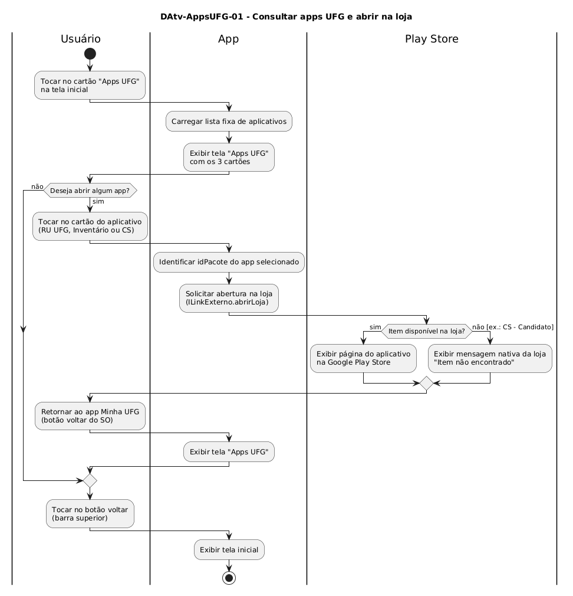

# DAtv-AppsUFG-01 – Consultar apps UFG e abrir na loja

| Campo | Valor |
|---|---|
| **Código** | `DAtv-AppsUFG-01` |
| **Título** | Consultar apps UFG e abrir na loja |
| **Autor(a)** | Maicon Brendo da Silva |
| **Revisor(a)** | Revisor(a) a definir |
| **Status** | Em produção |
| **Rastreia para** | `DCdu-AppsUFG-01`, `DIhc-AppsUFG-01`, `DCla-Comum-01`, `DSeq-AppsUFG-01` |

## Diagrama

Fonte: [`DAtv-AppsUFG-01.puml`](DAtv-AppsUFG-01.puml)

## Descrição

O diagrama modela as atividades de consulta ao catálogo de aplicativos institucionais da UFG e a subsequente solicitação de abertura da página do aplicativo na Google Play Store, correspondendo aos casos de uso `UC01` e `UC02` de `DCdu-AppsUFG-01`.

O fluxo é dividido em três raias de responsabilidade:
- **Usuário:** Interage com as telas do app Minha UFG e com a loja de aplicativos externa.
- **App:** Gerencia a apresentação da tela com os cartões estáticos, identifica o identificador do pacote selecionado e delega o redirecionamento ao componente compartilhado `ILinkExterno` (`DCla-Comum-01`).
- **Play Store:** Ambiente externo gerenciado pelo sistema operacional Android, responsável por carregar a página oficial do app ou apresentar a mensagem nativa de item indisponível.

### Ações de interação e granularidade de sequência

Em conformidade com a seção 6 do `contrato-base.md`, ações em que o usuário interage com o app disparando comunicação com componentes externos geram diagramas de sequência:

| Ação no DAtv | Natureza da interação | Item gerado |
|---|---|---|
| Tocar no cartão do aplicativo / solicitar abertura na loja | Usuário $\rightarrow$ App $\rightarrow$ `ILinkExterno` $\rightarrow$ Play Store | `DSeq-AppsUFG-01` |

Ações internas como carregar a lista de constantes em memória e transições de retorno à tela inicial são triviais e não demandam diagrama de sequência isolado.

## Referências

GOOGLE. **Antigravity**. Assistente de IA para Engenharia de Software. Disponível em: https://antigravity.google.com. Acesso em: 29 out. 2026.

INSTITUTE OF ELECTRICAL AND ELECTRONICS ENGINEERS. **Guide to the Software Engineering Body of Knowledge – SWEBOK v4**. Cap. 11 (Software Engineering Models and Methods). IEEE, 2024.

---

## Registro de revisão

| Data | Revisor(a) | Situação | Observações |
|---|---|---|---|
| | | | |

