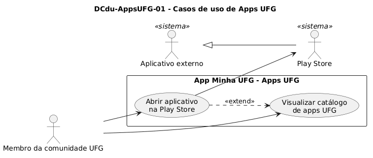

# DCdu-AppsUFG-01 – Casos de uso de Apps UFG

| Campo | Valor |
|---|---|
| **Código** | `DCdu-AppsUFG-01` |
| **Título** | Casos de uso de Apps UFG |
| **Autor(a)** | Maicon Brendo da Silva |
| **Revisor(a)** | Revisor(a) a definir |
| **Status** | Em produção |
| **Rastreia para** | `DCdu-Geral-01`, `DPac-Geral-01`, `DAtv-AppsUFG-01`, `DIhc-AppsUFG-01`, `DCla-Comum-01` |

## Diagrama

Fonte: [`DCdu-AppsUFG-01.puml`](DCdu-AppsUFG-01.puml)

## Descrição

O diagrama detalha o caso de uso macro UC08 "Consultar apps UFG" do `DCdu-Geral-01`. A funcionalidade apresenta uma lista fixa de aplicativos institucionais da UFG disponíveis para o sistema operacional Android, permitindo que o usuário consulte as opções e seja redirecionado diretamente à respectiva página na Google Play Store.

### Atores

- **Membro da comunidade UFG:** Ator primário que utiliza a funcionalidade de forma anônima, sem necessidade de autenticação no app.
- **Play Store:** Ator secundário (especialização de Aplicativo externo) que recebe a solicitação de abertura da página do aplicativo especificado.

---

### UC01 – Visualizar catálogo de apps UFG

- **Ator principal:** Membro da comunidade UFG.
- **Pré-condição:** O usuário está na tela inicial do app Minha UFG e toca no cartão "Apps UFG".
- **Fluxo principal:**
  1. O usuário seleciona o cartão "Apps UFG" na tela inicial.
  2. O aplicativo exibe a tela "Apps UFG" contendo a barra de topo com botão de retorno e os cartões dos três aplicativos institucionais cadastrados: *RU UFG*, *INVENTARIO PATRIMONIAL* e *CS - CANDIDATO*.
  3. Cada cartão apresenta o ícone do aplicativo, o seu nome em destaque e a indicação visual com o ícone da Play Store.
- **Fluxo alternativo A1 (Retornar à tela inicial):**
  1. A qualquer momento, o usuário toca no botão de voltar (seta à esquerda na barra de título).
  2. O aplicativo retorna para a tela inicial.
- **Pós-condição:** A lista de aplicativos institucionais permanece visível para consulta.

---

### UC02 – Abrir aplicativo na Play Store

- **Ator principal:** Membro da comunidade UFG.
- **Ator secundário:** Play Store.
- **Pré-condição:** O catálogo de aplicativos está visível em tela (estende `UC01`).
- **Fluxo principal:**
  1. O usuário toca em qualquer região do cartão correspondente ao aplicativo desejado (*RU UFG*, *INVENTARIO PATRIMONIAL* ou *CS - CANDIDATO*).
  2. O aplicativo identifica o identificador de pacote do aplicativo selecionado e aciona o componente de integração externa (`ILinkExterno.abrirLoja(idPacote)`).
  3. O sistema operacional Android abre o aplicativo da Google Play Store na página correspondente ao pacote solicitado.
  4. O usuário interage com a Play Store (instalação, atualização ou consulta) e, ao finalizar, pode retornar ao app Minha UFG por meio da navegação do sistema operacional.
- **Fluxo alternativo A1 (Item descontinuado ou indisponível na loja):**
  1. No passo 3, caso o pacote solicitado não esteja mais disponível publicamente na Play Store (como observado na engenharia reversa do pacote *CS - CANDIDATO*), a própria Play Store é aberta e exibe a mensagem de que o item não foi encontrado.
  2. O tratamento da indisponibilidade ocorre inteiramente no ambiente da loja externa, sem retenção de erro ou travamento no Minha UFG. O usuário retorna ao app normalmente pelo botão de voltar do dispositivo.
- **Pós-condição:** A loja externa é acionada com o identificador de pacote fornecido e o Minha UFG preserva o seu estado ao retornar.

## Referências

GOOGLE. **Antigravity**. Assistente de IA para Engenharia de Software. Disponível em: https://antigravity.google.com. Acesso em: 29 out. 2026.

INSTITUTE OF ELECTRICAL AND ELECTRONICS ENGINEERS. **Guide to the Software Engineering Body of Knowledge – SWEBOK v4**. Cap. 11 (Software Engineering Models and Methods). IEEE, 2024.

---

## Registro de revisão

| Data | Revisor(a) | Situação | Observações |
|---|---|---|---|
| | | | |

