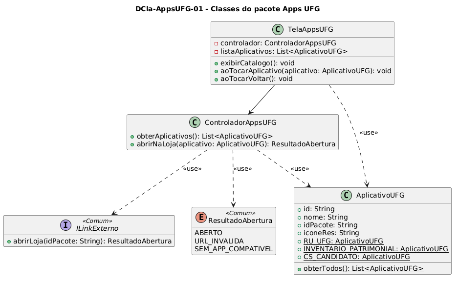

# DCla-AppsUFG-01 – Classes do pacote Apps UFG

| Campo | Valor |
|---|---|
| **Código** | `DCla-AppsUFG-01` |
| **Título** | Classes do pacote Apps UFG |
| **Autor(a)** | Maicon Brendo da Silva |
| **Revisor(a)** | Revisor(a) a definir |
| **Status** | Em produção |
| **Rastreia para** | `DPac-Geral-01`, `DCmp-AppsUFG-01`, `DCla-Comum-01`, `DIhc-AppsUFG-01`, `DSeq-AppsUFG-01` |

## Diagrama

Fonte: [`DCla-AppsUFG-01.puml`](DCla-AppsUFG-01.puml)

## Descrição

O diagrama detalha a estrutura orientada a objetos do pacote `AppsUFG`, especificando a camada de apresentação (`TelaAppsUFG`), o controlador de coordenação (`ControladorAppsUFG`) e o modelo estático de dados (`AplicativoUFG`).

### Decisões de modelagem e arquitetura

1. **Configuração local de dados:** Em conformidade com as regras acordadas pela equipe no `contrato-base.md` e a engenharia reversa das telas, o pacote `AppsUFG` não acessa banco de dados relacional e não realiza requisições remotas de rede. A classe `AplicativoUFG` encapsula o catálogo fixo de três aplicativos institucionais (`RU_UFG`, `INVENTARIO_PATRIMONIAL` e `CS_CANDIDATO`) com seus respectivos identificadores de pacote e recursos visuais locais.
2. **Desacoplamento via pacote Comum:** O controlador não implementa mecanismos diretos de acionamento do sistema operacional. Ele utiliza a interface compartilhada `ILinkExterno` (`DCla-Comum-01`), delegando a construção do Intent Android da loja à classe `AberturaLinkExterno` do pacote `Comum`.
3. **Tratamento de retorno:** As operações recebem e propagam a enumeração `ResultadoAbertura`, garantindo que a aplicação reaja de forma padronizada caso a invocação seja bem-sucedida (`ABERTO`) ou caso o ambiente não possua loja compatível (`SEM_APP_COMPATIVEL`).

## Referências

GOOGLE. **Antigravity**. Assistente de IA para Engenharia de Software. Disponível em: https://antigravity.google.com. Acesso em: 29 out. 2026.

INSTITUTE OF ELECTRICAL AND ELECTRONICS ENGINEERS. **Guide to the Software Engineering Body of Knowledge – SWEBOK v4**. Cap. 3 (Software Design). IEEE, 2024.

---

## Registro de revisão

| Data | Revisor(a) | Situação | Observações |
|---|---|---|---|
| | | | |

