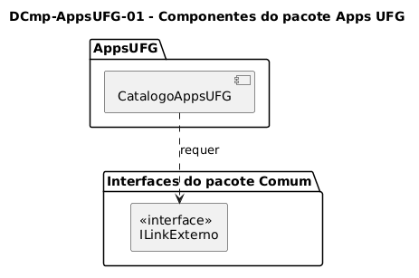

# DCmp-AppsUFG-01 – Componentes do pacote Apps UFG

| Campo | Valor |
|---|---|
| **Código** | `DCmp-AppsUFG-01` |
| **Título** | Componentes do pacote Apps UFG |
| **Autor(a)** | Maicon Brendo da Silva |
| **Revisor(a)** | Revisor(a) a definir |
| **Status** | Em produção |
| **Rastreia para** | `DPac-Geral-01`, `DImp-Geral-01`, `DCmp-Comum-01`, `DCla-AppsUFG-01` |

## Diagrama

Fonte: [`DCmp-AppsUFG-01.puml`](DCmp-AppsUFG-01.puml)

## Descrição

O diagrama apresenta a visão de componentes de software para a funcionalidade Apps UFG, destacando os limites do módulo e suas dependências arquiteturais externas.

### Estrutura de Componentes

- **`CatalogoAppsUFG`:** Componente autônomo responsável pela apresentação e navegação do catálogo de aplicativos da universidade.
- **`ILinkExterno`:** Interface requerida fornecida pelo componente `LinkExterno` do pacote `Comum` (`DCmp-Comum-01`).

Essa modelagem assegura a independência do pacote `AppsUFG`, que não se comunica diretamente com serviços de rede ou módulos do sistema operacional, restringindo todo o acionamento de recursos nativos ao contrato estabelecido pela interface `ILinkExterno`.

## Referências

GOOGLE. **Antigravity**. Assistente de IA para Engenharia de Software. Disponível em: https://antigravity.google.com. Acesso em: 29 out. 2026.

INSTITUTE OF ELECTRICAL AND ELECTRONICS ENGINEERS. **Guide to the Software Engineering Body of Knowledge – SWEBOK v4**. Cap. 3 (Software Design). IEEE, 2024.

---

## Registro de revisão

| Data | Revisor(a) | Situação | Observações |
|---|---|---|---|
| | | | |

