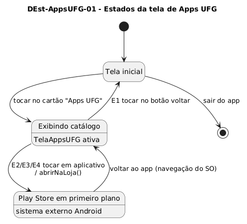

# DEst-AppsUFG-01 – Estados da tela de Apps UFG

| Campo | Valor |
|---|---|
| **Código** | `DEst-AppsUFG-01` |
| **Título** | Estados da tela de Apps UFG |
| **Autor(a)** | Maicon Brendo da Silva |
| **Revisor(a)** | Revisor(a) a definir |
| **Status** | Em produção |
| **Rastreia para** | `DCdu-AppsUFG-01`, `DIhc-AppsUFG-01`, `DIhc-Inicio-01`, `DSeq-AppsUFG-01` |

## Diagrama

Fonte: [`DEst-AppsUFG-01.puml`](DEst-AppsUFG-01.puml)

## Descrição

O diagrama de transição de estados modela o ciclo de vida da interface de usuário da funcionalidade Apps UFG e sua relação com a navegação global do sistema.

### Estados

- **Tela inicial:** Ponto de entrada padrão do aplicativo Minha UFG.
- **Exibindo catálogo:** Estado ativo da `TelaAppsUFG`, exibindo os cartões dos três aplicativos institucionais carregados a partir da configuração estática em memória.
- **Play Store em primeiro plano:** Estado no qual o controle da interface do usuário é transferido para o aplicativo nativo da Google Play Store.

### Transições de interface

| Transição | Evento | Condição / Guarda | Ação disparada |
|---|---|---|---|
| Entrada no catálogo | Toque no cartão "Apps UFG" na tela inicial | – | Transiciona para a `TelaAppsUFG` e renderiza os cartões |
| Abertura da loja | Eventos `E2`, `E3` ou `E4` | Toque em qualquer cartão | Dispara `abrirNaLoja()` e transfere o foco para a Play Store |
| Retorno da loja | Botão voltar do sistema operacional | – | Retoma o foco na `TelaAppsUFG` mantendo o catálogo exibido |
| Retorno à tela inicial | Evento `E1` (botão voltar na barra superior) | – | Desaloca a tela de catálogo e restaura a tela inicial |

## Referências

GOOGLE. **Antigravity**. Assistente de IA para Engenharia de Software. Disponível em: https://antigravity.google.com. Acesso em: 29 out. 2026.

INSTITUTE OF ELECTRICAL AND ELECTRONICS ENGINEERS. **Guide to the Software Engineering Body of Knowledge – SWEBOK v4**. Cap. 11 (Software Engineering Models and Methods). IEEE, 2024.

---

## Registro de revisão

| Data | Revisor(a) | Situação | Observações |
|---|---|---|---|
| | | | |

