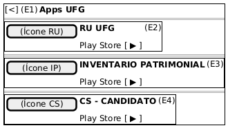

# DIhc-AppsUFG-01 – Interface da lista de aplicativos da UFG

| Campo | Valor |
|---|---|
| **Código** | `DIhc-AppsUFG-01` |
| **Título** | Interface da lista de aplicativos da UFG |
| **Autor(a)** | Maicon Brendo da Silva |
| **Revisor(a)** | Revisor(a) a definir |
| **Status** | Em produção |
| **Rastreia para** | `DCdu-AppsUFG-01`, `DAtv-AppsUFG-01`, `DEst-AppsUFG-01`, `DSeq-AppsUFG-01` |

## Diagrama

Fonte: [`DIhc-AppsUFG-01.puml`](DIhc-AppsUFG-01.puml)

## Descrição

O protótipo de IHC (Interface Homem-Computador) representa fielmente a tela de exibição do catálogo de aplicativos da UFG na versão 3.1.1 do app Minha UFG, obtida por engenharia reversa das capturas de tela reais.

A interface é composta por uma barra superior laranja com botão de navegação para retorno e três cartões brancos com cantos arredondados contendo a identidade visual e o nome de cada aplicativo disponível.

### Mapeamento de eventos de interação

Os pontos de interação marcados no protótipo correspondem a eventos do ciclo de navegação e acionamento externo, tratados no diagrama de estados `DEst-AppsUFG-01`:

| Evento | Elemento disparador | Origem | Ação / Efeito no app |
|---|---|---|---|
| **E1** | Botão voltar `[<]` na barra de topo | Usuário $\rightarrow$ App | Retorna para a tela inicial do Minha UFG |
| **E2** | Cartão *RU UFG* | Usuário $\rightarrow$ App | Dispara `ILinkExterno.abrirLoja("br.ufg.cercomp.rufg")` |
| **E3** | Cartão *INVENTARIO PATRIMONIAL* | Usuário $\rightarrow$ App | Dispara `ILinkExterno.abrirLoja("br.ufg.cercomp.inventariopatrimonial")` |
| **E4** | Cartão *CS - CANDIDATO* | Usuário $\rightarrow$ App | Dispara `ILinkExterno.abrirLoja(...)` para a página do app na Play Store |

Conforme validado a partir do aplicativo real, o toque em qualquer área do cartão (ícone, título ou área do botão da loja) dispara o mesmo evento de abertura.

## Referências

GOOGLE. **Antigravity**. Assistente de IA para Engenharia de Software. Disponível em: https://antigravity.google.com. Acesso em: 29 out. 2026.

INSTITUTE OF ELECTRICAL AND ELECTRONICS ENGINEERS. **Guide to the Software Engineering Body of Knowledge – SWEBOK v4**. Cap. 11 (Software Engineering Models and Methods). IEEE, 2024.

---

## Registro de revisão

| Data | Revisor(a) | Situação | Observações |
|---|---|---|---|
| | | | |

