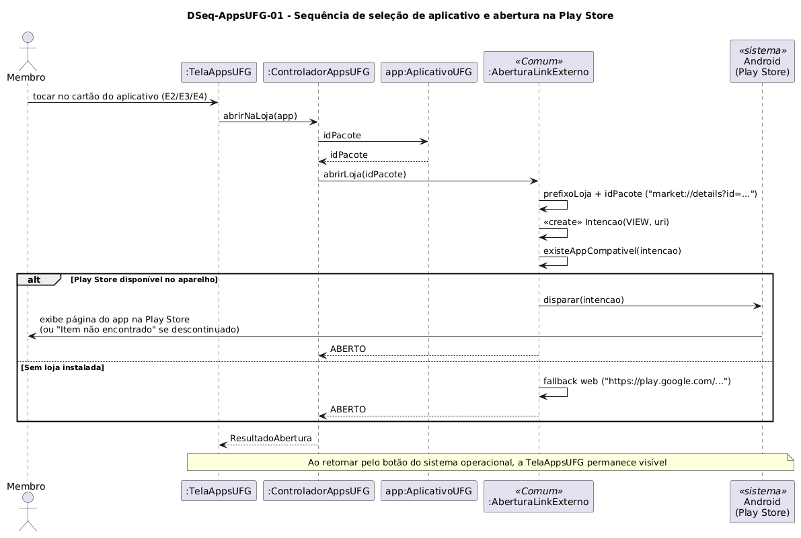

# DSeq-AppsUFG-01 – Sequência de seleção de aplicativo e abertura na Play Store

| Campo | Valor |
|---|---|
| **Código** | `DSeq-AppsUFG-01` |
| **Título** | Sequência de seleção de aplicativo e abertura na Play Store |
| **Autor(a)** | Maicon Brendo da Silva |
| **Revisor(a)** | Revisor(a) a definir |
| **Status** | Em produção |
| **Rastreia para** | `DCdu-AppsUFG-01`, `DAtv-AppsUFG-01`, `DIhc-AppsUFG-01`, `DCla-AppsUFG-01`, `DCla-Comum-01` |

## Diagrama

Fonte: [`DSeq-AppsUFG-01.puml`](DSeq-AppsUFG-01.puml)

## Descrição

O diagrama detalha a sequência de troca de mensagens correspondente à ação em que o usuário toca em um dos três cartões da lista de aplicativos (eventos `E2`, `E3` ou `E4` do `DIhc-AppsUFG-01`) para acionar a página do aplicativo na Google Play Store.

### Dinâmica das mensagens

1. O usuário toca no cartão na camada de apresentação (`TelaAppsUFG`).
2. A tela invoca `ControladorAppsUFG.abrirNaLoja(app)`.
3. O controlador obtém o identificador de pacote correspondente da instância `AplicativoUFG` e aciona o componente de integração externa (`ILinkExterno.abrirLoja(idPacote)`).
4. A implementação `AberturaLinkExterno` do pacote `Comum` formata a URI nativa (`market://details?id=...`), valida a existência de aplicação compatível e dispara o Intent para o sistema operacional Android.
5. Caso o aplicativo Play Store esteja presente, ele é aberto em primeiro plano exibindo a página do app. Se o item estiver descontinuado ou indisponível (como no caso real do aplicativo *CS - CANDIDATO*), a mensagem "Item não encontrado" é tratada nativamente pela Play Store.
6. Ao fechar a Play Store ou tocar no botão de retorno do dispositivo, o usuário retorna diretamente para a tela `TelaAppsUFG`, preservando o estado do aplicativo Minha UFG.

## Referências

GOOGLE. **Antigravity**. Assistente de IA para Engenharia de Software. Disponível em: https://antigravity.google.com. Acesso em: 29 out. 2026.

INSTITUTE OF ELECTRICAL AND ELECTRONICS ENGINEERS. **Guide to the Software Engineering Body of Knowledge – SWEBOK v4**. Cap. 11 (Software Engineering Models and Methods). IEEE, 2024.

---

## Registro de revisão

| Data | Revisor(a) | Situação | Observações |
|---|---|---|---|
| | | | |

