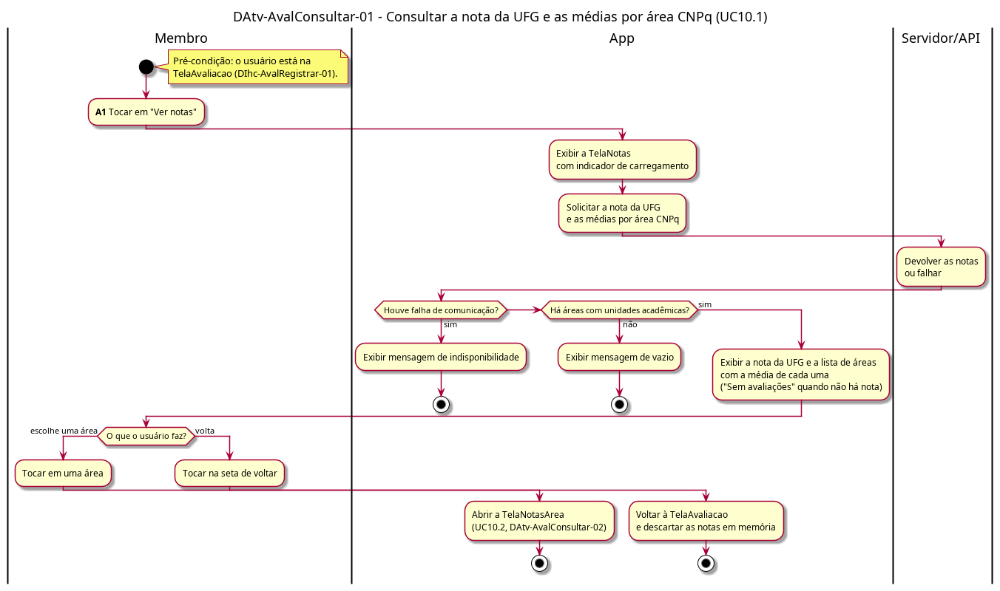

# DAtv-AvalConsultar-01 – Consultar a nota da UFG e as médias por área CNPq

| Campo | Valor |
|---|---|
| **Código** | `DAtv-AvalConsultar-01` |
| **Título** | Consultar a nota da UFG e as médias por área CNPq |
| **Autor(a)** | Pessoa D |
| **Revisor(a)** | Pessoa C |
| **Status** | Em produção |
| **Rastreia para** | `DCdu-AvalConsultar-01`, `DIhc-AvalConsultar-01`, `DIhc-AvalRegistrar-01`, `DAtv-AvalConsultar-02`, `DEst-Comum-01` |

## Diagrama

Fonte: [`DAtv-AvalConsultar-01.puml`](DAtv-AvalConsultar-01.puml)

## Descrição

Atividades do UC10.1 do `DCdu-AvalConsultar-01`, em raias: Membro, App e Servidor/API. A funcionalidade é nova e não existe no app atual.

Ao tocar em "Ver notas" na `TelaAvaliacao` (E2 do `DIhc-AvalRegistrar-01`), o app abre a `TelaNotas` (`DIhc-AvalConsultar-01`), mostra o indicador de carregamento e pede ao Servidor/API a nota da UFG e as médias por área. A resposta segue o ciclo genérico de tela remota (`DEst-Comum-01`): exibindo, vazio ou indisponível. Nos dois últimos casos, o usuário só sai pela seta de voltar, pois o Comum não tem "tentar de novo". Área sem nenhuma UA avaliada aparece com "Sem avaliações" (P-AC-4); isso não é o estado vazio, que ocorre só quando não há área nenhuma.

Com as áreas exibidas, o usuário escolhe uma área, o que continua em `DAtv-AvalConsultar-02`, ou volta à `TelaAvaliacao`, e as notas em memória são descartadas.

**Tabela 1 – Atividades de interação do UC10.1**

| Atividade | Ação do Membro | Evento de interação | Gera DSeq (D-AVC-03) |
|---|---|---|---|
| A1 | Tocar em "Ver notas" (abre a `TelaNotas` e carrega as notas) | E2 `aoTocarConsultar` do `DIhc-AvalRegistrar-01`; E0 da `TelaNotas` | Sim |

Tocar em uma área é a atividade A2, detalhada em `DAtv-AvalConsultar-02`. Voltar é navegação trivial e não gera DSeq.

## Referências

ANTHROPIC. **Claude Code**. Assistente de IA. Disponível em: https://claude.com/claude-code. Acesso em: 31 out. 2026.

---

## Registro de revisão

| Data | Revisor(a) | Situação | Observações |
|---|---|---|---|
| | | | |
