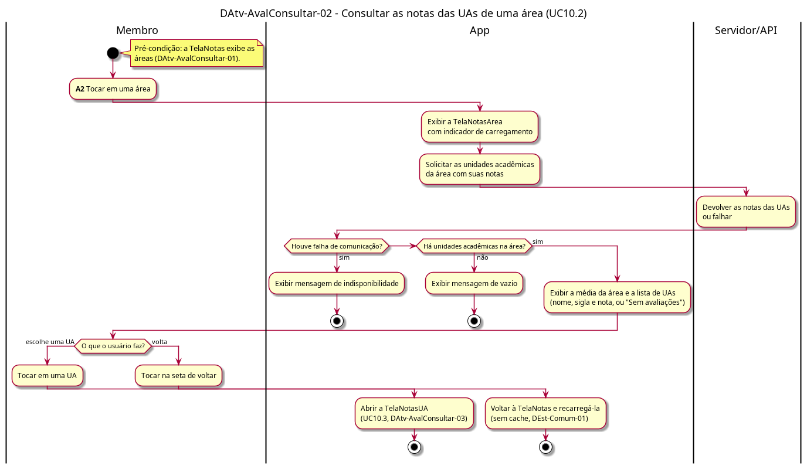

# DAtv-AvalConsultar-02 – Consultar as notas das UAs de uma área

| Campo | Valor |
|---|---|
| **Código** | `DAtv-AvalConsultar-02` |
| **Título** | Consultar as notas das UAs de uma área |
| **Autor(a)** | Phablo Tavares Paixão |
| **Revisor(a)** | Maicon Brendo da Silva |
| **Status** | Em produção |
| **Rastreia para** | `DCdu-AvalConsultar-01`, `DIhc-AvalConsultar-01`, `DIhc-AvalConsultar-02`, `DAtv-AvalConsultar-01`, `DAtv-AvalConsultar-03`, `DEst-Comum-01` |

## Diagrama

Fonte: [`DAtv-AvalConsultar-02.puml`](DAtv-AvalConsultar-02.puml)

## Descrição

Atividades do UC10.2 do `DCdu-AvalConsultar-01`, em raias: Membro, App e Servidor/API.

Ao tocar em uma área na `TelaNotas` (E1 do `DIhc-AvalConsultar-01`), o app abre a `TelaNotasArea` (`DIhc-AvalConsultar-02`), mostra o indicador de carregamento e pede ao Servidor/API as UAs da área com suas notas. A resposta segue o ciclo de tela remota (`DEst-Comum-01`). Com sucesso, o app mostra a média da área e a lista de UAs, com nome, sigla e nota, na ordem recebida; UA sem avaliações aparece com "Sem avaliações" e não entra na média (P-AC-4). O vazio ocorre quando a área não tem UA nenhuma. Como no `DAtv-AvalConsultar-01`, os três desfechos convergem na escolha do usuário: nos estados vazio e indisponível, a única saída é a seta de voltar (`DEst-AvalConsultar-02`).

O usuário escolhe uma UA, o que continua em `DAtv-AvalConsultar-03`, ou volta à `TelaNotas`, que é recarregada ao ser exibida de novo (sem cache, `DEst-Comum-01`).

**Tabela 1 – Atividades de interação do UC10.2**

| Atividade | Ação do Membro | Evento de interação | Gera DSeq (D-AVC-03) |
|---|---|---|---|
| A2 | Tocar em uma área (abre a `TelaNotasArea` e carrega as UAs) | E1 `aoEscolherArea` do `DIhc-AvalConsultar-01`; E0 da `TelaNotasArea` | Sim |

## Referências

ANTHROPIC. **Claude Code**. Assistente de IA. Disponível em: https://claude.com/claude-code. Acesso em: 31 out. 2026.

---

## Registro de revisão

| Data | Revisor(a) | Situação | Observações |
|---|---|---|---|
| | | | |
