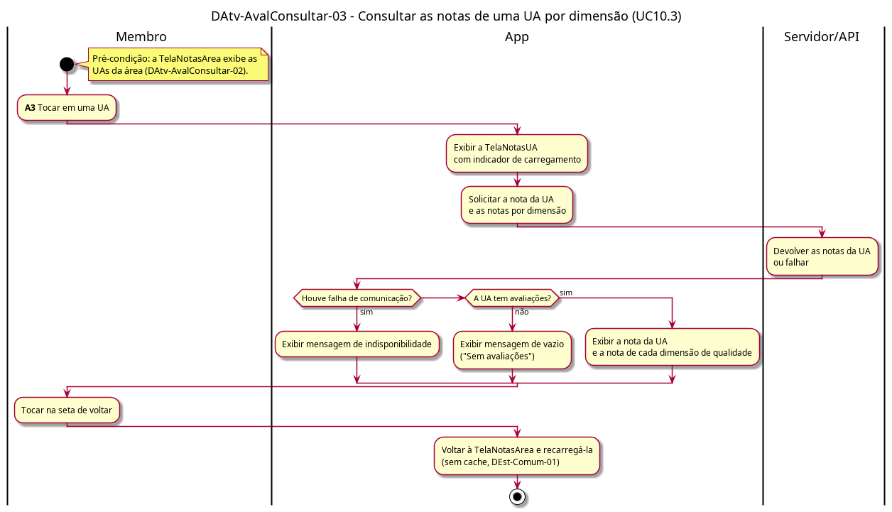

# DAtv-AvalConsultar-03 – Consultar as notas de uma UA por dimensão

| Campo | Valor |
|---|---|
| **Código** | `DAtv-AvalConsultar-03` |
| **Título** | Consultar as notas de uma UA por dimensão |
| **Autor(a)** | Pessoa D |
| **Revisor(a)** | Pessoa C |
| **Status** | Em produção |
| **Rastreia para** | `DCdu-AvalConsultar-01`, `DIhc-AvalConsultar-02`, `DIhc-AvalConsultar-03`, `DAtv-AvalConsultar-02`, `DD-AvalRegistrar-01`, `DEst-Comum-01` |

## Diagrama

Fonte: [`DAtv-AvalConsultar-03.puml`](DAtv-AvalConsultar-03.puml)

## Descrição

Atividades do UC10.3 do `DCdu-AvalConsultar-01`, em raias: Membro, App e Servidor/API.

Ao tocar em uma UA na `TelaNotasArea` (E1 do `DIhc-AvalConsultar-02`), o app abre a `TelaNotasUA` (`DIhc-AvalConsultar-03`), mostra o indicador de carregamento e pede ao Servidor/API a nota da UA e as notas por dimensão de qualidade (`DimensaoQualidade`, `DD-AvalRegistrar-01`). Com sucesso, o app mostra a nota da UA e a nota de cada dimensão (P-AC-8). Se a UA não tem avaliações, o app mostra o estado vazio com "Sem avaliações" (P-AC-4); se houve falha, a mensagem de indisponibilidade (`DEst-Comum-01`).

Esta é a última tela da consulta: a única saída é a seta de voltar, que leva à `TelaNotasArea`, recarregada ao ser exibida de novo.

**Tabela 1 – Atividades de interação do UC10.3**

| Atividade | Ação do Membro | Evento de interação | Gera DSeq (D-AVC-03) |
|---|---|---|---|
| A3 | Tocar em uma UA (abre a `TelaNotasUA` e carrega as notas) | E1 `aoEscolherUA` do `DIhc-AvalConsultar-02`; E0 da `TelaNotasUA` | Sim |

## Referências

ANTHROPIC. **Claude Code**. Assistente de IA. Disponível em: https://claude.com/claude-code. Acesso em: 31 out. 2026.

---

## Registro de revisão

| Data | Revisor(a) | Situação | Observações |
|---|---|---|---|
| | | | |
