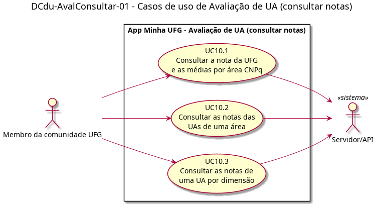

# DCdu-AvalConsultar-01 – Casos de uso de Avaliação de UA (consultar notas)

| Campo | Valor |
|---|---|
| **Código** | `DCdu-AvalConsultar-01` |
| **Título** | Casos de uso de Avaliação de UA (consultar notas) |
| **Autor(a)** | Pessoa D |
| **Revisor(a)** | Pessoa C |
| **Status** | Em produção |
| **Rastreia para** | `DCdu-Geral-01`, `DIhc-AvalRegistrar-01`, `DD-AvalRegistrar-01`, `DD-Locais-01`, `DEst-Comum-01`, `DAtv-AvalConsultar-01`, `DAtv-AvalConsultar-02`, `DAtv-AvalConsultar-03`, `DIhc-AvalConsultar-01`, `DIhc-AvalConsultar-02`, `DIhc-AvalConsultar-03` |

## Diagrama

Fonte: [`DCdu-AvalConsultar-01.puml`](DCdu-AvalConsultar-01.puml)

## Descrição

Detalha o caso de uso UC10 "Consultar notas de avaliação" do `DCdu-Geral-01` em três casos de uso. É parte da evolução do app: a consulta não existe na versão 3.1.1, então **não há captura de tela nem comportamento observado**. O que segue parte do enunciado (Apêndice A), que pede que o app mostre "a nota de avaliação por UA individual, nota média por área de conhecimento [...] conforme definição do CNPq, e nota para a UFG como um todo (média das notas de todas as UAs)". O que o enunciado não define está marcado como premissa `P-AC-n`, listada no [`README.md`](README.md) da pasta.

A fronteira com `AvalRegistrar` é a do contrato-base: lá se define como a avaliação nasce (`DD-AvalRegistrar-01`); aqui se consulta o que se calcula a partir dela.

### Atores

- **Membro da comunidade UFG:** ator primário, anônimo. Qualquer usuário consulta as notas, sem login; não precisa ter avaliado.
- **Servidor/API:** ator secundário. Fornece as notas já calculadas (P-AC-6).

### Casos de uso

**Tabela 1 – Casos de uso de Avaliação de UA (consultar notas)**

| Código | Caso de uso | Objetivo do usuário | Ator secundário |
|---|---|---|---|
| UC10.1 | Consultar a nota da UFG e as médias por área CNPq | Ver a nota geral da UFG e comparar as áreas do conhecimento | Servidor/API |
| UC10.2 | Consultar as notas das UAs de uma área | Ver a nota de cada unidade acadêmica de uma área | Servidor/API |
| UC10.3 | Consultar as notas de uma UA por dimensão | Ver em que dimensões de qualidade uma UA vai melhor ou pior | Servidor/API |

Os três casos formam uma navegação em profundidade (P-AC-2): UFG e áreas → UAs de uma área → dimensões de uma UA. Não há relação `<<include>>` nem `<<extend>>`: cada caso de uso é uma tela própria, com carga própria no servidor.

**UC10.1 – Consultar a nota da UFG e as médias por área CNPq**

- *Pré-condição:* o usuário está na `TelaAvaliacao` (`DIhc-AvalRegistrar-01`), aberta pelo cartão "Avaliação de UA" da tela inicial (P-AC-1).
- *Fluxo principal:* (1) o usuário toca em "Ver notas"; (2) o app abre a `TelaNotas` com o indicador de carregamento e pede ao servidor a nota da UFG e as médias por área; (3) o app mostra a nota da UFG e a lista de áreas, cada uma com sua média.
- *Fluxos alternativos:* **A1** sem internet ou servidor indisponível: mensagem de indisponibilidade (`DEst-Comum-01`); **A2** não há áreas com unidades acadêmicas: mensagem de vazio; **A3** área ou UFG sem nenhuma UA avaliada: mostra "Sem avaliações" no lugar da nota (P-AC-4).
- *Pós-condição:* as notas ficam em memória enquanto o usuário estiver na tela; ao voltar a ela, o app recarrega (sem cache).

**UC10.2 – Consultar as notas das UAs de uma área**

- *Pré-condição:* UC10.1 exibindo as áreas.
- *Fluxo principal:* (1) o usuário toca em uma área; (2) o app abre a `TelaNotasArea` com o indicador de carregamento e pede ao servidor as UAs da área com suas notas; (3) o app mostra a média da área e a lista de UAs (nome, sigla e nota), na ordem recebida do servidor.
- *Fluxos alternativos:* **A1** indisponibilidade, como em UC10.1; **A2** área sem UAs: mensagem de vazio; **A3** UA sem avaliações: "Sem avaliações" no lugar da nota, e a UA não entra na média da área (P-AC-4).
- *Pós-condição:* idem UC10.1.

**UC10.3 – Consultar as notas de uma UA por dimensão**

- *Pré-condição:* UC10.2 exibindo as UAs da área.
- *Fluxo principal:* (1) o usuário toca em uma UA; (2) o app abre a `TelaNotasUA` com o indicador de carregamento e pede ao servidor a nota da UA e as notas por dimensão; (3) o app mostra a nota da UA e a nota de cada dimensão de qualidade (P-AC-8).
- *Fluxos alternativos:* **A1** indisponibilidade, como em UC10.1; **A2** UA sem avaliações: mensagem de vazio "Sem avaliações".
- *Pós-condição:* idem UC10.1.

### Regras de cálculo (resumo; detalhadas nos contratos do D-AVC-03)

Escala de 0 a 5, exibida com uma casa decimal (P-AC-5). Dentro de uma avaliação, a média dos elementos dá a nota da dimensão, e a média das dimensões dá a nota da avaliação (enunciado; P-AR-12). A nota da UA é a média das notas de suas avaliações; a média da área é a média das notas das UAs da área; a nota da UFG é a média das notas de todas as UAs (P-AC-3). UAs sem avaliação não entram em nenhuma média (P-AC-4).

## Referências

ANTHROPIC. **Claude Code**. Assistente de IA. Disponível em: https://claude.com/claude-code. Acesso em: 31 out. 2026.

---

## Registro de revisão

| Data | Revisor(a) | Situação | Observações |
|---|---|---|---|
| | | | |
