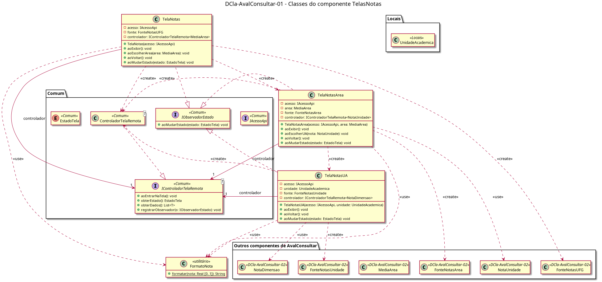

# DCla-AvalConsultar-01 – Classes do componente TelasNotas

| Campo | Valor |
|---|---|
| **Código** | `DCla-AvalConsultar-01` |
| **Título** | Classes do componente TelasNotas |
| **Autor(a)** | Phablo Tavares Paixão |
| **Revisor(a)** | Maicon Brendo da Silva |
| **Status** | Em produção |
| **Rastreia para** | `DCmp-AvalConsultar-01`, `DCla-AvalConsultar-02`, `DCla-Comum-03`, `DIhc-AvalConsultar-01`, `DIhc-AvalConsultar-02`, `DIhc-AvalConsultar-03`, `DAtv-AvalConsultar-01`, `DAtv-AvalConsultar-02`, `DAtv-AvalConsultar-03`, `DD-Locais-01` |

## Diagrama

Fonte: [`DCla-AvalConsultar-01.puml`](DCla-AvalConsultar-01.puml)

## Descrição

Classes do componente `TelasNotas`. Cada método `ao...` corresponde a um evento dos `DIhc-AvalConsultar-01` a `03`. As classes `<<Comum>>`, `<<Locais>>` e `<<DCla-AvalConsultar-02>>` são definidas em outros diagramas e só referenciadas.

- **TelaNotas:** `aoExibir` (E0) cria a `FonteNotasUFG` e o controlador e chama `aoEntrarNaTela`; `aoEscolherArea` (E1) cria a `TelaNotasArea` da área; `aoVoltar` (E2) volta à `TelaAvaliacao`. Mostra a nota da UFG pedindo `obterNotaUfg()` à fonte depois do estado `EXIBINDO`.
- **TelaNotasArea:** recebe a `MediaArea` tocada; `aoExibir` cria a `FonteNotasArea` com `area.areaConhecimento`; `aoEscolherUA` cria a `TelaNotasUA` com `nota.unidade`; `aoVoltar` volta à `TelaNotas`, que recarrega (sem cache).
- **TelaNotasUA:** recebe a `UnidadeAcademica` e guarda o `IAcessoApi` (`acesso`), como as outras duas telas; `aoExibir` cria a `FonteNotasUnidade`; `aoVoltar` volta à `TelaNotasArea`.
- **aoMudarEstado** (das três): reage aos estados do Comum (`DCla-Comum-03`), mostrando carregando, lista, vazio ou indisponível.
- **FormatoNota:** converte uma nota em texto com uma casa decimal ("4,3", P-AC-5), ou em "Sem avaliações" quando a nota está ausente (P-AC-4). Fica num só lugar para as três telas não repetirem a regra.

## Referências

ANTHROPIC. **Claude Code**. Assistente de IA. Disponível em: https://claude.com/claude-code. Acesso em: 1 nov. 2026.

---

## Registro de revisão

| Data | Revisor(a) | Situação | Observações |
|---|---|---|---|
| | | | |
