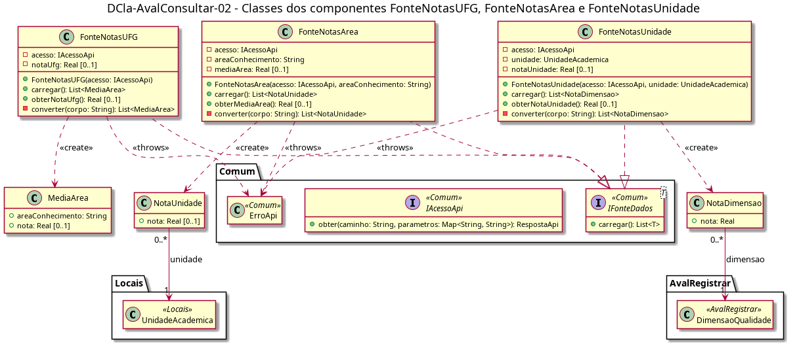

# DCla-AvalConsultar-02 – Classes das fontes de notas

| Campo | Valor |
|---|---|
| **Código** | `DCla-AvalConsultar-02` |
| **Título** | Classes das fontes de notas |
| **Autor(a)** | Pessoa D |
| **Revisor(a)** | Pessoa C |
| **Status** | Em produção |
| **Rastreia para** | `DCmp-AvalConsultar-01`, `DCla-AvalConsultar-01`, `DD-AvalConsultar-01`, `DCla-Comum-02`, `DCla-Comum-03`, `DD-AvalRegistrar-01`, `DD-Locais-01` |

## Diagrama

Fonte: [`DCla-AvalConsultar-02.puml`](DCla-AvalConsultar-02.puml)

## Descrição

Classes dos componentes `FonteNotasUFG`, `FonteNotasArea` e `FonteNotasUnidade`, e as entidades derivadas que elas criam (`DD-AvalConsultar-01`).

- Cada fonte implementa `IFonteDados<T>` do Comum: `carregar()` chama `IAcessoApi.obter` na rota da tela (P-AC-9), converte o JSON e devolve a lista. Erros de comunicação saem como `ErroApi` e viram o estado `INDISPONIVEL` no controlador (`DCla-Comum-03`); lista vazia vira `VAZIO`.
- O valor agregado de cada tela (nota da UFG, média da área, nota da UA) vem na mesma resposta da lista e fica guardado na fonte, lido pela tela com `obterNotaUfg()`, `obterMediaArea()` ou `obterNotaUnidade()`. Assim o controlador genérico do Comum continua lidando só com a lista, sem mudar a interface.
- As notas são `Real` de 0 a 5; `[0..1]` indica que podem estar ausentes quando não há avaliação (P-AC-4). As fontes não calculam médias: o cálculo é do Servidor/API (P-AC-6).
- `NotaUnidade.unidade` e `NotaDimensao.dimensao` referenciam `UnidadeAcademica` (`DD-Locais-01`) e `DimensaoQualidade` (`DD-AvalRegistrar-01`), sem redefini-las.

## Referências

ANTHROPIC. **Claude Code**. Assistente de IA. Disponível em: https://claude.com/claude-code. Acesso em: 1 nov. 2026.

---

## Registro de revisão

| Data | Revisor(a) | Situação | Observações |
|---|---|---|---|
| | | | |
