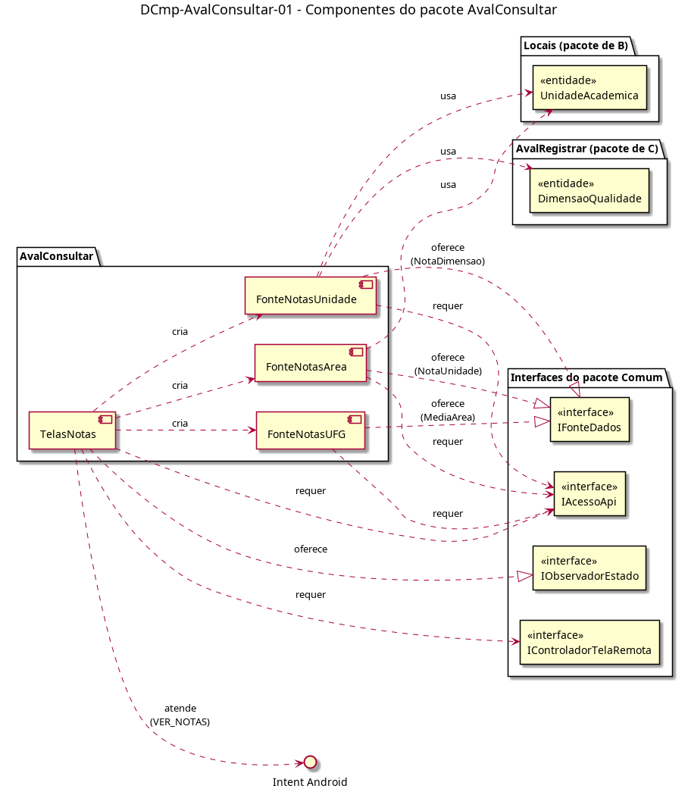

# DCmp-AvalConsultar-01 – Componentes do pacote AvalConsultar

| Campo | Valor |
|---|---|
| **Código** | `DCmp-AvalConsultar-01` |
| **Título** | Componentes do pacote AvalConsultar |
| **Autor(a)** | Phablo Tavares Paixão |
| **Revisor(a)** | Maicon Brendo da Silva |
| **Status** | Em produção |
| **Rastreia para** | `DPac-Geral-01`, `DCmp-Comum-01`, `DCmp-AvalRegistrar-01`, `DCla-AvalConsultar-01`, `DCla-AvalConsultar-02`, `DD-AvalConsultar-01`, `DIhc-AvalConsultar-01`, `DIhc-AvalConsultar-02`, `DIhc-AvalConsultar-03` |

## Diagrama

Fonte: [`DCmp-AvalConsultar-01.puml`](DCmp-AvalConsultar-01.puml)

## Descrição

Componentes do pacote `AvalConsultar`. Um componente de telas e uma fonte de dados por tela remota, no mesmo modelo de uso do `DCmp-Comum-01` já seguido por `Radio` e `AvalRegistrar`.

- **TelasNotas:** as três telas da consulta (`TelaNotas`, `TelaNotasArea`, `TelaNotasUA`; `DIhc-AvalConsultar-01` a `03`). Cada tela cria a sua fonte e um `ControladorTelaRemota` do Comum, e se registra como observadora dos estados. Classes em `DCla-AvalConsultar-01`.
- **FonteNotasUFG**, **FonteNotasArea**, **FonteNotasUnidade:** implementam `IFonteDados` do Comum e convertem o JSON da API em `MediaArea`, `NotaUnidade` e `NotaDimensao`. Classes em `DCla-AvalConsultar-02`.

**Dependências de outros pacotes.**

- `Comum`: `IAcessoApi`, `IControladorTelaRemota`, `IFonteDados` e `IObservadorEstado`, só referenciadas. Nenhuma interface do Comum muda.
- `Locais`: `UnidadeAcademica` (nota da UA e parâmetro da `FonteNotasUnidade`).
- `AvalRegistrar`: só a entidade `DimensaoQualidade`, ligada a cada `NotaDimensao`.
- Android: a `TelaNotas` atende o Intent implícito com a ação `VER_NOTAS`, disparado pelo botão "Ver notas" da `TelaAvaliacao` (`DCmp-AvalRegistrar-01`). Assim `AvalRegistrar` não depende de `AvalConsultar`, e o `DPac-Geral-01` fica sem ciclo (decisão de 01/11/2026). Ao atender o Intent, o app entrega à `TelaNotas` o `IAcessoApi`, como faz com as demais telas de entrada.

**Rotas da API** (P-AC-9, não observáveis): `GET /avaliacao/notas` (nota da UFG e médias por área), `GET /avaliacao/notas/area` com o parâmetro `area`, e `GET /avaliacao/notas/unidade` com o parâmetro `unidade` (`id` da UA).

## Referências

ANTHROPIC. **Claude Code**. Assistente de IA. Disponível em: https://claude.com/claude-code. Acesso em: 1 nov. 2026.

---

## Registro de revisão

| Data | Revisor(a) | Situação | Observações |
|---|---|---|---|
| | | | |
