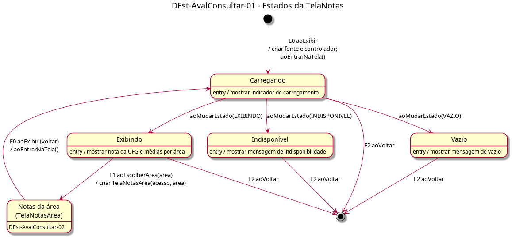

# DEst-AvalConsultar-01 – Estados da TelaNotas

| Campo | Valor |
|---|---|
| **Código** | `DEst-AvalConsultar-01` |
| **Título** | Estados da TelaNotas |
| **Autor(a)** | Pessoa D |
| **Revisor(a)** | Pessoa C |
| **Status** | Em produção |
| **Rastreia para** | `DIhc-AvalConsultar-01`, `DCla-AvalConsultar-01`, `DEst-Comum-01`, `DSeq-AvalConsultar-01`, `ECA-AvalConsultar-01`, `Contrato-AvalConsultar-01`, `DEst-AvalConsultar-02` |

## Diagrama

Fonte: [`DEst-AvalConsultar-01.puml`](DEst-AvalConsultar-01.puml)

## Descrição

Estados da `TelaNotas` (`DIhc-AvalConsultar-01`). Segue o ciclo genérico do Comum (`DEst-Comum-01`): ao exibir (E0), a tela cria a fonte e o controlador e entra em Carregando; o controlador avisa, por `aoMudarEstado`, se a carga terminou em Exibindo, Vazio ou Indisponível. Não há "tentar de novo": de Vazio e Indisponível o usuário só sai voltando.

Eventos tratados: E1 `aoEscolherArea` abre a `TelaNotasArea` (`DEst-AvalConsultar-02`); ao voltar dela, a tela recebe E0 de novo e recarrega; E2 `aoVoltar` volta à `TelaAvaliacao`. Os eventos e as ações correspondem aos métodos do `DCla-AvalConsultar-01` e às regras do `ECA-AvalConsultar-01`.

## Referências

ANTHROPIC. **Claude Code**. Assistente de IA. Disponível em: https://claude.com/claude-code. Acesso em: 1 nov. 2026.

---

## Registro de revisão

| Data | Revisor(a) | Situação | Observações |
|---|---|---|---|
| | | | |
