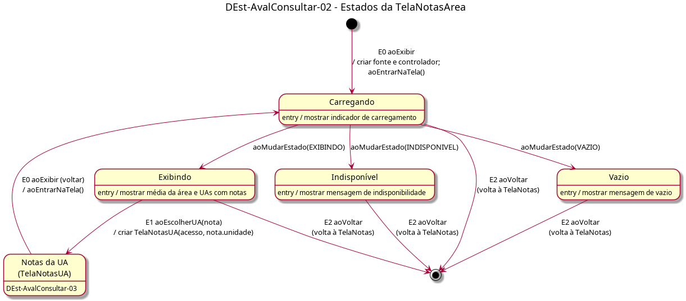

# DEst-AvalConsultar-02 – Estados da TelaNotasArea

| Campo | Valor |
|---|---|
| **Código** | `DEst-AvalConsultar-02` |
| **Título** | Estados da TelaNotasArea |
| **Autor(a)** | Phablo Tavares Paixão |
| **Revisor(a)** | Maicon Brendo da Silva |
| **Status** | Em produção |
| **Rastreia para** | `DIhc-AvalConsultar-02`, `DCla-AvalConsultar-01`, `DEst-Comum-01`, `DSeq-AvalConsultar-02`, `ECA-AvalConsultar-01`, `Contrato-AvalConsultar-01`, `DEst-AvalConsultar-03` |

## Diagrama

Fonte: [`DEst-AvalConsultar-02.puml`](DEst-AvalConsultar-02.puml)

## Descrição

Estados da `TelaNotasArea` (`DIhc-AvalConsultar-02`). Segue o ciclo genérico do Comum (`DEst-Comum-01`): ao exibir (E0), a tela cria a fonte e o controlador e entra em Carregando; o controlador avisa, por `aoMudarEstado`, se a carga terminou em Exibindo, Vazio ou Indisponível. Não há "tentar de novo": de Vazio e Indisponível o usuário só sai voltando.

Eventos tratados: E1 `aoEscolherUA` abre a `TelaNotasUA` (`DEst-AvalConsultar-03`); ao voltar dela, a tela recarrega; E2 `aoVoltar` volta à `TelaNotas`, que recarrega. Os eventos e as ações correspondem aos métodos do `DCla-AvalConsultar-01` e às regras do `ECA-AvalConsultar-01`.

## Referências

ANTHROPIC. **Claude Code**. Assistente de IA. Disponível em: https://claude.com/claude-code. Acesso em: 1 nov. 2026.

---

## Registro de revisão

| Data | Revisor(a) | Situação | Observações |
|---|---|---|---|
| | | | |
