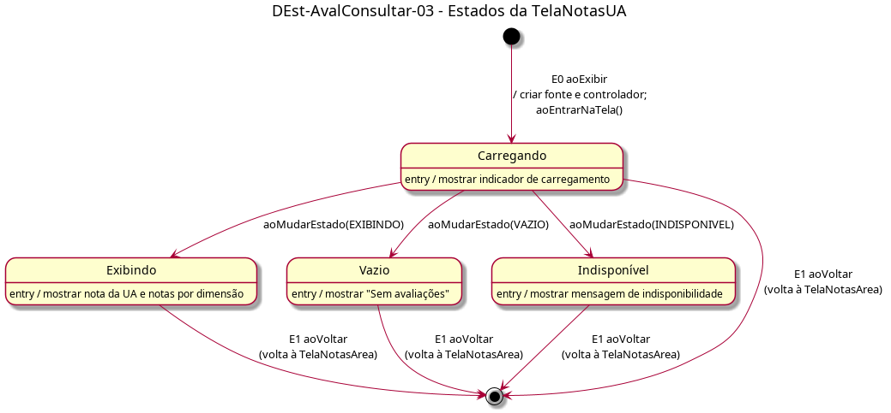

# DEst-AvalConsultar-03 – Estados da TelaNotasUA

| Campo | Valor |
|---|---|
| **Código** | `DEst-AvalConsultar-03` |
| **Título** | Estados da TelaNotasUA |
| **Autor(a)** | Pessoa D |
| **Revisor(a)** | Pessoa C |
| **Status** | Em produção |
| **Rastreia para** | `DIhc-AvalConsultar-03`, `DCla-AvalConsultar-01`, `DEst-Comum-01`, `DSeq-AvalConsultar-03`, `ECA-AvalConsultar-01`, `Contrato-AvalConsultar-01` |

## Diagrama

Fonte: [`DEst-AvalConsultar-03.puml`](DEst-AvalConsultar-03.puml)

## Descrição

Estados da `TelaNotasUA` (`DIhc-AvalConsultar-03`). Segue o ciclo genérico do Comum (`DEst-Comum-01`): ao exibir (E0), a tela cria a fonte e o controlador e entra em Carregando; o controlador avisa, por `aoMudarEstado`, se a carga terminou em Exibindo, Vazio ou Indisponível. Não há "tentar de novo": de Vazio e Indisponível o usuário só sai voltando.

Eventos tratados: não há evento para outra tela; E1 `aoVoltar` volta à `TelaNotasArea`, que recarrega. Os eventos e as ações correspondem aos métodos do `DCla-AvalConsultar-01` e às regras do `ECA-AvalConsultar-01`.

## Referências

ANTHROPIC. **Claude Code**. Assistente de IA. Disponível em: https://claude.com/claude-code. Acesso em: 1 nov. 2026.

---

## Registro de revisão

| Data | Revisor(a) | Situação | Observações |
|---|---|---|---|
| | | | |
