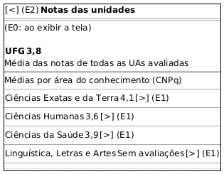

# DIhc-AvalConsultar-01 – Protótipo da TelaNotas (UFG e áreas CNPq)

| Campo | Valor |
|---|---|
| **Código** | `DIhc-AvalConsultar-01` |
| **Título** | Protótipo da TelaNotas (UFG e áreas CNPq) |
| **Autor(a)** | Pessoa D |
| **Revisor(a)** | Pessoa C |
| **Status** | Em produção |
| **Rastreia para** | `DCdu-AvalConsultar-01`, `DAtv-AvalConsultar-01`, `DIhc-AvalRegistrar-01`, `DIhc-AvalConsultar-02`, `DEst-Comum-01`, `DD-Locais-01` |

## Diagrama

Fonte: [`DIhc-AvalConsultar-01.puml`](DIhc-AvalConsultar-01.puml)

## Descrição

Protótipo da `TelaNotas`, aberta pelo botão "Ver notas" da `TelaAvaliacao` (E2 do `DIhc-AvalRegistrar-01`). **Esta tela não existe no app atual**; o protótipo parte do enunciado, sem captura de tela. O desenho, em PlantUML Salt, mostra a barra de título com a seta de voltar, a nota da UFG em destaque e a lista das áreas do conhecimento (CNPq) com a média de cada uma. Os nomes das áreas e as notas são ilustrativos; as áreas vêm da entidade `AreaConhecimento`, à qual cada UA está associada (`DD-Locais-01`).

**Tabela 1 – Eventos da TelaNotas**

| Evento | Origem | Efeito | Atividade |
|---|---|---|---|
| E0 | Exibição da tela | Carrega a nota da UFG e as médias por área | A1 (`DAtv-AvalConsultar-01`) |
| E1 | Toque em uma área | Abre a `TelaNotasArea` da área tocada | A2 (`DAtv-AvalConsultar-02`) |
| E2 | Toque na seta de voltar | Volta à `TelaAvaliacao` | – |

A área sem nenhuma UA avaliada mostra "Sem avaliações" e continua tocável: a lista da área mostra as UAs sem nota (P-AC-4). Os estados carregando, vazio e indisponível usam as mensagens genéricas do Comum (`DEst-Comum-01`) e serão tratados no DEst desta tela (D-AVC-03); não há protótipo separado para eles.

## Referências

ANTHROPIC. **Claude Code**. Assistente de IA. Disponível em: https://claude.com/claude-code. Acesso em: 31 out. 2026.

---

## Registro de revisão

| Data | Revisor(a) | Situação | Observações |
|---|---|---|---|
| | | | |
