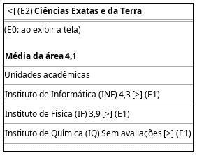

# DIhc-AvalConsultar-02 – Protótipo da TelaNotasArea (UAs de uma área)

| Campo | Valor |
|---|---|
| **Código** | `DIhc-AvalConsultar-02` |
| **Título** | Protótipo da TelaNotasArea (UAs de uma área) |
| **Autor(a)** | Phablo Tavares Paixão |
| **Revisor(a)** | Maicon Brendo da Silva |
| **Status** | Em produção |
| **Rastreia para** | `DCdu-AvalConsultar-01`, `DAtv-AvalConsultar-02`, `DIhc-AvalConsultar-01`, `DIhc-AvalConsultar-03`, `DEst-Comum-01`, `DD-Locais-01` |

## Diagrama

Fonte: [`DIhc-AvalConsultar-02.puml`](DIhc-AvalConsultar-02.puml)

## Descrição

Protótipo da `TelaNotasArea`, aberta ao tocar em uma área na `TelaNotas` (E1 do `DIhc-AvalConsultar-01`). Tela nova, sem captura de tela. O título é o nome da área; abaixo, a média da área e a lista de unidades acadêmicas (nome e sigla, `DD-Locais-01`) com a nota de cada uma, na ordem recebida do servidor. Nomes e notas são ilustrativos; no exemplo, a média 4,1 é a média de 4,3 e 3,9, sem o IQ, que não tem avaliações (P-AC-3, P-AC-4).

**Tabela 1 – Eventos da TelaNotasArea**

| Evento | Origem | Efeito | Atividade |
|---|---|---|---|
| E0 | Exibição da tela | Carrega as UAs da área com suas notas | A2 (`DAtv-AvalConsultar-02`) |
| E1 | Toque em uma UA | Abre a `TelaNotasUA` da UA tocada | A3 (`DAtv-AvalConsultar-03`) |
| E2 | Toque na seta de voltar | Volta à `TelaNotas`, que é recarregada | – |

Os estados carregando, vazio e indisponível seguem o Comum (`DEst-Comum-01`).

## Referências

ANTHROPIC. **Claude Code**. Assistente de IA. Disponível em: https://claude.com/claude-code. Acesso em: 31 out. 2026.

---

## Registro de revisão

| Data | Revisor(a) | Situação | Observações |
|---|---|---|---|
| | | | |
