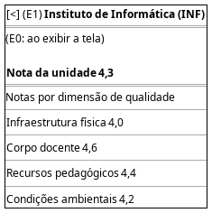

# DIhc-AvalConsultar-03 – Protótipo da TelaNotasUA (notas por dimensão)

| Campo | Valor |
|---|---|
| **Código** | `DIhc-AvalConsultar-03` |
| **Título** | Protótipo da TelaNotasUA (notas por dimensão) |
| **Autor(a)** | Pessoa D |
| **Revisor(a)** | Pessoa C |
| **Status** | Em produção |
| **Rastreia para** | `DCdu-AvalConsultar-01`, `DAtv-AvalConsultar-03`, `DIhc-AvalConsultar-02`, `DD-AvalRegistrar-01`, `DEst-Comum-01` |

## Diagrama

Fonte: [`DIhc-AvalConsultar-03.puml`](DIhc-AvalConsultar-03.puml)

## Descrição

Protótipo da `TelaNotasUA`, aberta ao tocar em uma UA na `TelaNotasArea` (E1 do `DIhc-AvalConsultar-02`). Tela nova, sem captura de tela. O título é o nome e a sigla da UA; abaixo, a nota da UA e a nota de cada dimensão de qualidade (`DimensaoQualidade`, `DD-AvalRegistrar-01`). As dimensões do exemplo são as citadas no enunciado, e as notas são ilustrativas. A tela só exibe dados: não há item tocável além da seta de voltar.

**Tabela 1 – Eventos da TelaNotasUA**

| Evento | Origem | Efeito | Atividade |
|---|---|---|---|
| E0 | Exibição da tela | Carrega a nota da UA e as notas por dimensão | A3 (`DAtv-AvalConsultar-03`) |
| E1 | Toque na seta de voltar | Volta à `TelaNotasArea`, que é recarregada | – |

UA sem avaliações mostra o estado vazio "Sem avaliações" (P-AC-4); carregando e indisponível seguem o Comum (`DEst-Comum-01`).

## Referências

ANTHROPIC. **Claude Code**. Assistente de IA. Disponível em: https://claude.com/claude-code. Acesso em: 31 out. 2026.

---

## Registro de revisão

| Data | Revisor(a) | Situação | Observações |
|---|---|---|---|
| | | | |
