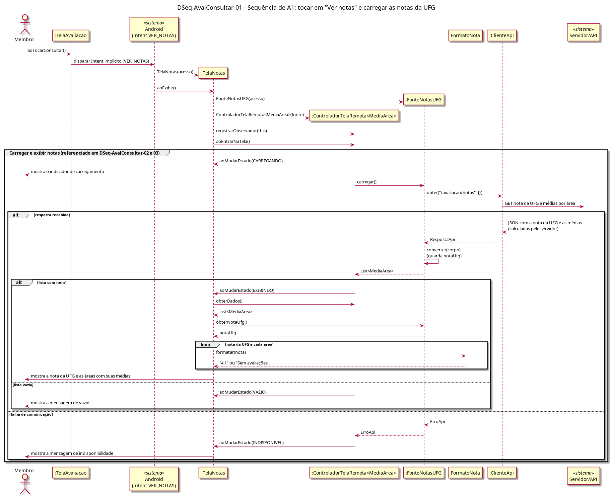

# DSeq-AvalConsultar-01 – Sequência de A1: tocar em "Ver notas" e carregar as notas da UFG

| Campo | Valor |
|---|---|
| **Código** | `DSeq-AvalConsultar-01` |
| **Título** | Sequência de A1: tocar em "Ver notas" e carregar as notas da UFG |
| **Autor(a)** | Pessoa D |
| **Revisor(a)** | Pessoa C |
| **Status** | Em produção |
| **Rastreia para** | `DAtv-AvalConsultar-01`, `DIhc-AvalConsultar-01`, `DIhc-AvalRegistrar-01`, `DCla-AvalConsultar-01`, `DCla-AvalConsultar-02`, `DCla-AvalRegistrar-01`, `DCla-Comum-02`, `DCla-Comum-03`, `DEst-AvalConsultar-01`, `Contrato-AvalConsultar-01` |

## Diagrama

Fonte: [`DSeq-AvalConsultar-01.puml`](DSeq-AvalConsultar-01.puml)

## Descrição

Detalha a atividade A1 do `DAtv-AvalConsultar-01` (UC10.1). O Membro toca em "Ver notas" na `TelaAvaliacao` (E2 do `DIhc-AvalRegistrar-01`); ela dispara o Intent implícito `VER_NOTAS` (decisão de 01/11/2026), e o Android cria a `TelaNotas` com o `IAcessoApi` e a exibe (E0 do `DIhc-AvalConsultar-01`).

Na entrada, a `TelaNotas` cria a `FonteNotasUFG` e o `ControladorTelaRemota<MediaArea>` do Comum, registra-se como observadora e chama `aoEntrarNaTela()`. O grupo **"Carregar e exibir notas"** é o ciclo de tela remota do Comum (`DEst-Comum-01`) aplicado à consulta, e é referenciado pelos `DSeq-AvalConsultar-02` e `03`: a fonte chama `obter("/avaliacao/notas", {})` (P-AC-9); o servidor devolve a nota da UFG e as médias por área já calculadas (P-AC-6); a fonte converte a resposta e guarda a nota da UFG. No estado `EXIBINDO`, a tela lê a lista e a nota da UFG e formata cada nota com `FormatoNota.formatar` ("Sem avaliações" quando ausente, P-AC-4). Lista vazia leva a `VAZIO`; `ErroApi` leva a `INDISPONIVEL`.

## Referências

ANTHROPIC. **Claude Code**. Assistente de IA. Disponível em: https://claude.com/claude-code. Acesso em: 1 nov. 2026.

---

## Registro de revisão

| Data | Revisor(a) | Situação | Observações |
|---|---|---|---|
| | | | |
