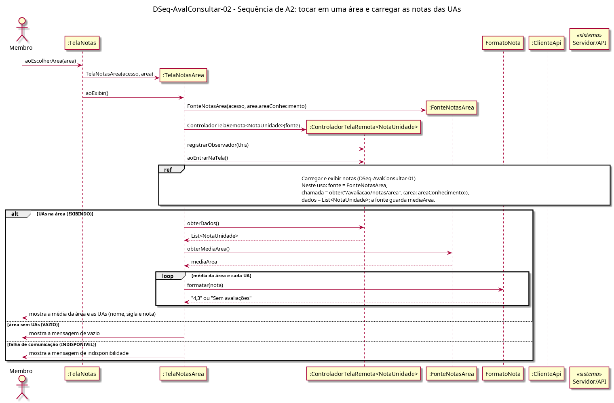

# DSeq-AvalConsultar-02 – Sequência de A2: tocar em uma área e carregar as notas das UAs

| Campo | Valor |
|---|---|
| **Código** | `DSeq-AvalConsultar-02` |
| **Título** | Sequência de A2: tocar em uma área e carregar as notas das UAs |
| **Autor(a)** | Phablo Tavares Paixão |
| **Revisor(a)** | Maicon Brendo da Silva |
| **Status** | Em produção |
| **Rastreia para** | `DAtv-AvalConsultar-02`, `DIhc-AvalConsultar-01`, `DIhc-AvalConsultar-02`, `DCla-AvalConsultar-01`, `DCla-AvalConsultar-02`, `DSeq-AvalConsultar-01`, `DEst-AvalConsultar-02`, `Contrato-AvalConsultar-01` |

## Diagrama

Fonte: [`DSeq-AvalConsultar-02.puml`](DSeq-AvalConsultar-02.puml)

## Descrição

Detalha a atividade A2 do `DAtv-AvalConsultar-02` (UC10.2), disparada pelo evento E1 do `DIhc-AvalConsultar-01`: a `TelaNotas` recebe `aoEscolherArea(area)`, cria a `TelaNotasArea(acesso, area)` e a exibe.

A `TelaNotasArea` cria a `FonteNotasArea` com o nome da área, o controlador do Comum e chama `aoEntrarNaTela()`. A carga é o grupo "Carregar e exibir notas" do `DSeq-AvalConsultar-01`, referenciado com `ref`, com a chamada `obter("/avaliacao/notas/area", {area})`. No `EXIBINDO`, a tela mostra a média da área (`obterMediaArea()`) e as UAs com nome, sigla e nota formatada; UA sem avaliação aparece com "Sem avaliações" (P-AC-4). Área sem UAs leva a `VAZIO`.

## Referências

ANTHROPIC. **Claude Code**. Assistente de IA. Disponível em: https://claude.com/claude-code. Acesso em: 1 nov. 2026.

---

## Registro de revisão

| Data | Revisor(a) | Situação | Observações |
|---|---|---|---|
| | | | |
