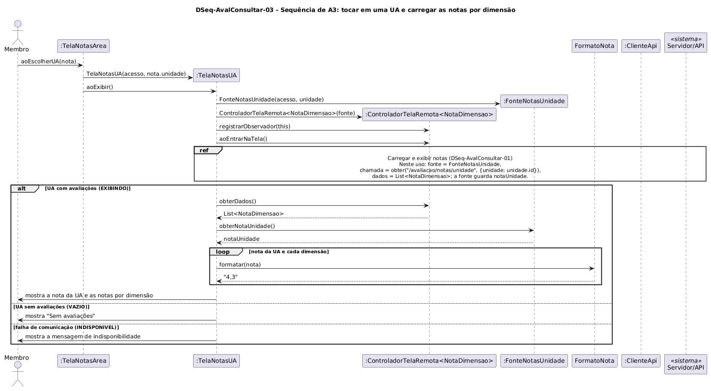

# DSeq-AvalConsultar-03 – Sequência de A3: tocar em uma UA e carregar as notas por dimensão

| Campo | Valor |
|---|---|
| **Código** | `DSeq-AvalConsultar-03` |
| **Título** | Sequência de A3: tocar em uma UA e carregar as notas por dimensão |
| **Autor(a)** | Phablo Tavares Paixão |
| **Revisor(a)** | Maicon Brendo da Silva |
| **Status** | Em produção |
| **Rastreia para** | `DAtv-AvalConsultar-03`, `DIhc-AvalConsultar-02`, `DIhc-AvalConsultar-03`, `DCla-AvalConsultar-01`, `DCla-AvalConsultar-02`, `DSeq-AvalConsultar-01`, `DEst-AvalConsultar-03`, `Contrato-AvalConsultar-01` |

## Diagrama

Fonte: [`DSeq-AvalConsultar-03.puml`](DSeq-AvalConsultar-03.puml)

## Descrição

Detalha a atividade A3 do `DAtv-AvalConsultar-03` (UC10.3), disparada pelo evento E1 do `DIhc-AvalConsultar-02`: a `TelaNotasArea` recebe `aoEscolherUA(nota)`, cria a `TelaNotasUA(acesso, nota.unidade)` e a exibe.

A `TelaNotasUA` cria a `FonteNotasUnidade` com a UA, o controlador do Comum e chama `aoEntrarNaTela()`. A carga é o grupo "Carregar e exibir notas" do `DSeq-AvalConsultar-01`, com a chamada `obter("/avaliacao/notas/unidade", {unidade: unidade.id})`. No `EXIBINDO`, a tela mostra a nota da UA (`obterNotaUnidade()`) e a nota de cada dimensão (P-AC-8). UA sem avaliações devolve lista vazia, e o estado `VAZIO` mostra "Sem avaliações" (P-AC-4).

## Referências

ANTHROPIC. **Claude Code**. Assistente de IA. Disponível em: https://claude.com/claude-code. Acesso em: 1 nov. 2026.

---

## Registro de revisão

| Data | Revisor(a) | Situação | Observações |
|---|---|---|---|
| | | | |
