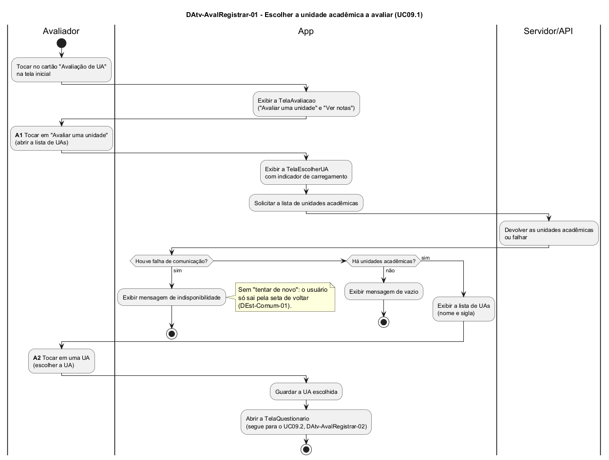

# DAtv-AvalRegistrar-01 – Escolher a unidade acadêmica a avaliar

| Campo | Valor |
|---|---|
| **Código** | `DAtv-AvalRegistrar-01` |
| **Título** | Escolher a unidade acadêmica a avaliar |
| **Autor(a)** | José Eduardo Gontijo de Carvalho |
| **Revisor(a)** | Maicon Brendo da Silva (Pessoa B) |
| **Status** | Em produção |
| **Rastreia para** | `DCdu-AvalRegistrar-01`, `DIhc-AvalRegistrar-01`, `DIhc-AvalRegistrar-02`, `DEst-AvalRegistrar-02`, `DEst-Comum-01`, `DSeq-AvalRegistrar-01`, `DSeq-AvalRegistrar-02`, `DAtv-AvalRegistrar-02` |

## Diagrama

Fonte: [`DAtv-AvalRegistrar-01.puml`](DAtv-AvalRegistrar-01.puml)

## Descrição

Atividades do UC09.1 do `DCdu-AvalRegistrar-01`, em raias: Avaliador (Membro anônimo), App e Servidor/API. A funcionalidade é nova e não existe no app atual; o fluxo parte do enunciado e das premissas `P-AR-n`.

O Avaliador toca no cartão "Avaliação de UA" da tela inicial (E9 do `DIhc-Inicio-01`) e o app exibe a `TelaAvaliacao` (P-AR-1). Esses dois passos são navegação trivial e não geram diagrama de sequência. O fluxo se divide em duas atividades de interação, numeradas como no contrato-base (seção 6); cada uma gera um DSeq:

**Tabela 1 – Atividades do UC09.1 e diagramas de sequência**

| Atividade | Ação do Avaliador | Evento de interação | Diagrama de sequência |
|---|---|---|---|
| A1 | Abrir a lista de UAs (tocar em "Avaliar uma unidade") | E1 `aoTocarAvaliar` da `TelaAvaliacao` (`DIhc-AvalRegistrar-01`) | `DSeq-AvalRegistrar-01` |
| A2 | Escolher a UA (tocar em uma unidade da lista) | E1 `aoEscolherUA` da `TelaEscolherUA` (`DIhc-AvalRegistrar-02`) | `DSeq-AvalRegistrar-02` |

Em A1 o app cria a `TelaEscolherUA`, mostra o indicador de carregamento e pede ao Servidor/API a lista de unidades acadêmicas (P-AR-2). A resposta segue o ciclo genérico de tela remota (`DEst-Comum-01`, `DEst-AvalRegistrar-02`): lista exibida (nome e sigla de cada UA, sem busca nem filtro, P-AR-18), mensagem de vazio ou mensagem de indisponibilidade, com a apresentação do padrão do Comum (P-AR-10). Nos dois últimos casos, o usuário só sai pela seta de voltar, pois a versão atual não tem "tentar de novo". A chamada ao servidor e o desfecho ficam dentro do DSeq da atividade que os dispara, e não em atividades separadas.

Em A2 o app guarda a UA escolhida, cria a `TelaQuestionario` e passa ao UC09.2 (`DAtv-AvalRegistrar-02`).

## Referências

INSTITUTE OF ELECTRICAL AND ELECTRONICS ENGINEERS. **Guide to the Software Engineering Body of Knowledge – SWEBOK v4**. Cap. 11 (Software Engineering Models and Methods). IEEE, 2024.

ANTHROPIC. **Claude Code**. Assistente de IA. Disponível em: claude.ai/code. Acesso em: 30 out. 2026. Uso: rascunho do texto e dos diagramas a partir da especificação e das instruções do autor, que revisou o conteúdo. Questão: Apêndice <X>, Seção <X.1>.

---

## Registro de revisão

| Data | Revisor(a) | Situação | Observações |
|---|---|---|---|
| | | | |
