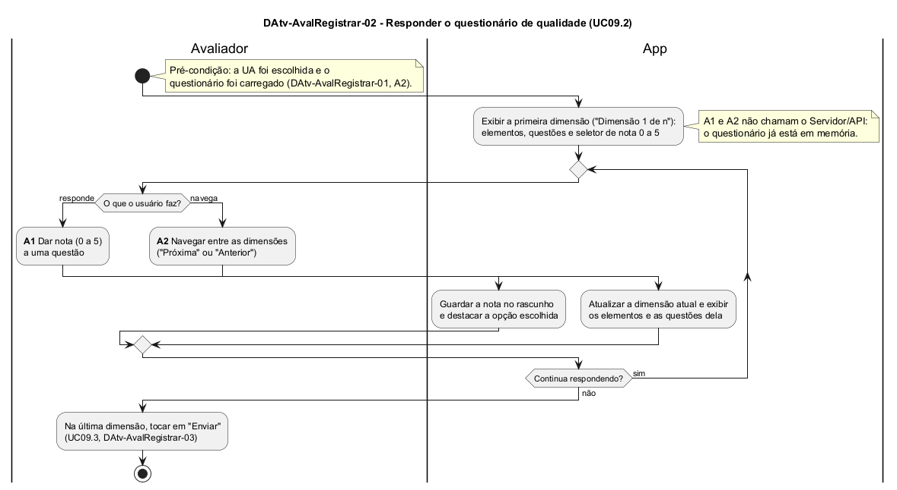

# DAtv-AvalRegistrar-02 – Responder o questionário de qualidade

| Campo | Valor |
|---|---|
| **Código** | `DAtv-AvalRegistrar-02` |
| **Título** | Responder o questionário de qualidade |
| **Autor(a)** | José Eduardo Gontijo de Carvalho |
| **Revisor(a)** | Maicon Brendo da Silva (Pessoa B) |
| **Status** | Em produção |
| **Rastreia para** | `DCdu-AvalRegistrar-01`, `DAtv-AvalRegistrar-01`, `DAtv-AvalRegistrar-03`, `DIhc-AvalRegistrar-03`, `DEst-AvalRegistrar-03`, `DSeq-AvalRegistrar-03`, `DSeq-AvalRegistrar-04` |

## Diagrama

Fonte: [`DAtv-AvalRegistrar-02.puml`](DAtv-AvalRegistrar-02.puml)

## Descrição

Atividades do UC09.2 do `DCdu-AvalRegistrar-01`, em raias: Avaliador e App. A raia do Servidor/API não aparece porque, depois da carga do questionário (que pertence ao A2 do `DAtv-AvalRegistrar-01`), nenhuma atividade desta etapa chama o servidor: as notas ficam no rascunho em memória até o envio (`DAtv-AvalRegistrar-03`). A funcionalidade é nova e não existe no app atual.

O app mostra uma dimensão de qualidade por vez ("Dimensão k de n"), com os elementos educacionais e, em cada um, as questões com o seletor de nota de 0 a 5 (P-AR-4, P-AR-5; `DIhc-AvalRegistrar-03`). Enquanto responde, o Avaliador repete duas atividades de interação, numeradas como no contrato-base (seção 6); cada uma gera um DSeq:

**Tabela 1 – Atividades do UC09.2 e diagramas de sequência**

| Atividade | Ação do Avaliador | Evento de interação | Diagrama de sequência |
|---|---|---|---|
| A1 | Dar nota a uma questão | E1 `aoDarNota` | `DSeq-AvalRegistrar-03` |
| A2 | Navegar entre as dimensões ("Próxima" ou "Anterior") | E2 `aoAvancarDimensao` ou E3 `aoVoltarDimensao` | `DSeq-AvalRegistrar-04` |

A nota de uma questão pode ser trocada quantas vezes o usuário quiser antes de enviar, e a navegação não exige que a dimensão esteja completa: a conferência é feita só no envio, pela validação do UC09.4 (P-AR-13; `DAtv-AvalRegistrar-03`). Sair pela seta de voltar (E5) abandona a avaliação e descarta as notas (P-AR-8); é navegação trivial e não gera DSeq. Quando o usuário termina, toca em "Enviar" na última dimensão, o que continua em `DAtv-AvalRegistrar-03`.

## Referências

INSTITUTE OF ELECTRICAL AND ELECTRONICS ENGINEERS. **Guide to the Software Engineering Body of Knowledge – SWEBOK v4**. Cap. 11 (Software Engineering Models and Methods). IEEE, 2024.

ANTHROPIC. **Claude Code**. Assistente de IA. Disponível em: claude.ai/code. Acesso em: 30 out. 2026. Uso: rascunho do texto e dos diagramas a partir da especificação e das instruções do autor, que revisou o conteúdo. Questão: Apêndice <X>, Seção <X.1>.

---

## Registro de revisão

| Data | Revisor(a) | Situação | Observações |
|---|---|---|---|
| | | | |
