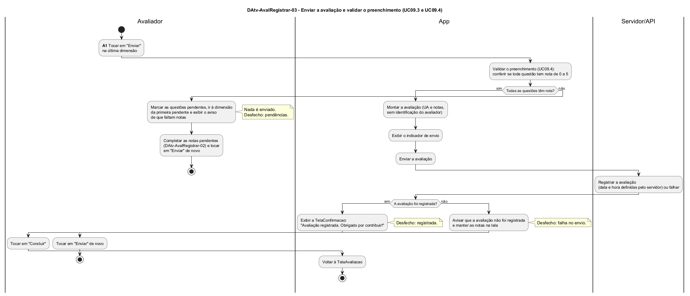

# DAtv-AvalRegistrar-03 – Enviar a avaliação e validar o preenchimento

| Campo | Valor |
|---|---|
| **Código** | `DAtv-AvalRegistrar-03` |
| **Título** | Enviar a avaliação e validar o preenchimento |
| **Autor(a)** | José Eduardo Gontijo de Carvalho |
| **Revisor(a)** | Maicon Brendo da Silva (Pessoa B) |
| **Status** | Em produção |
| **Rastreia para** | `DCdu-AvalRegistrar-01`, `DAtv-AvalRegistrar-02`, `DAtv-AvalRegistrar-04`, `DIhc-AvalRegistrar-03`, `DIhc-AvalRegistrar-04`, `DEst-AvalRegistrar-03`, `DEst-AvalRegistrar-04`, `DSeq-AvalRegistrar-05` |

## Diagrama

Fonte: [`DAtv-AvalRegistrar-03.puml`](DAtv-AvalRegistrar-03.puml)

## Descrição

Atividades do UC09.3 (Enviar a avaliação) e do UC09.4 (Validar o preenchimento, incluído em UC09.3) do `DCdu-AvalRegistrar-01`, em raias: Avaliador, App e Servidor/API. A funcionalidade é nova e não existe no app atual.

Há uma única atividade de interação, que gera um DSeq (contrato-base, seção 6):

**Tabela 1 – Atividade do UC09.3 e diagrama de sequência**

| Atividade | Ação do Avaliador | Evento de interação | Diagrama de sequência |
|---|---|---|---|
| A1 | Enviar a avaliação (tocar em "Enviar" na última dimensão) | E4 `aoEnviar` | `DSeq-AvalRegistrar-05` |

A validação do UC09.4 é um passo interno do App dentro de A1 (o detalhe do passo está em `DAtv-AvalRegistrar-04`), e não uma atividade separada: ela acontece sem nova ação do usuário e, por isso, entra como mensagens do mesmo DSeq. O fluxo tem três desfechos, que correspondem aos estados do `DEst-AvalRegistrar-03`:

**Tabela 2 – Desfechos do envio**

| Desfecho | Condição | O que o app faz | Estado |
|---|---|---|---|
| Pendências | a validação reprova: há questão sem nota (P-AR-5) | não envia; marca as questões pendentes, vai à dimensão da primeira pendente e mostra o aviso de que faltam notas (P-AR-14, P-AR-15, P-AR-28); o usuário completa as notas e toca em "Enviar" de novo | Validação reprovada |
| Falha no envio | a validação aprova, mas o envio não é registrado (qualquer falha de comunicação ou resposta de erro) | avisa que a avaliação não foi registrada e mantém todas as notas na tela; o usuário toca em "Enviar" de novo (P-AR-6, P-AR-15) | Falha no envio |
| Registrada | a validação aprova e o servidor registra | abre a `TelaConfirmacao` (`DIhc-AvalRegistrar-04`); "Concluir" volta à `TelaAvaliacao` (P-AR-19) | (fim; `TelaConfirmacao`) |

Quando a validação aprova, o app monta a avaliação só com a UA e as notas, sem nenhum dado do avaliador (P-AR-7), mostra o indicador de envio (P-AR-17) e ignora os toques até a resposta, para que um toque repetido não crie duas avaliações (P-AR-27). A data e a hora do registro são definidas pelo servidor. Cada envio bem-sucedido cria uma avaliação nova, mesmo para a mesma UA, e uma avaliação registrada não pode ser editada nem excluída (contrato-base, seção 8). O toque em "Concluir" é navegação trivial e não gera DSeq.

## Referências

INSTITUTE OF ELECTRICAL AND ELECTRONICS ENGINEERS. **Guide to the Software Engineering Body of Knowledge – SWEBOK v4**. Cap. 11 (Software Engineering Models and Methods). IEEE, 2024.

ANTHROPIC. **Claude Code**. Assistente de IA. Disponível em: claude.ai/code. Acesso em: 30 out. 2026. Uso: rascunho do texto e dos diagramas a partir da especificação e das instruções do autor, que revisou o conteúdo. Questão: Apêndice <X>, Seção <X.1>.

---

## Registro de revisão

| Data | Revisor(a) | Situação | Observações |
|---|---|---|---|
| | | | |
