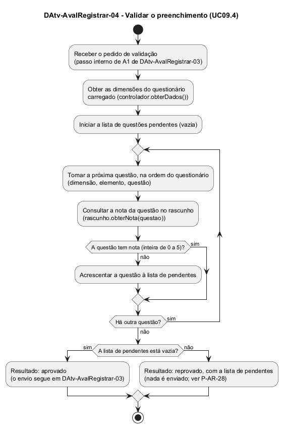

# DAtv-AvalRegistrar-04 – Validar o preenchimento

| Campo | Valor |
|---|---|
| **Código** | `DAtv-AvalRegistrar-04` |
| **Título** | Validar o preenchimento |
| **Autor(a)** | José Eduardo Gontijo de Carvalho |
| **Revisor(a)** | Maicon Brendo da Silva (Pessoa B) |
| **Status** | Em produção |
| **Rastreia para** | `DCdu-AvalRegistrar-01`, `DAtv-AvalRegistrar-03`, `DCla-AvalRegistrar-01`, `DEst-AvalRegistrar-03`, `DSeq-AvalRegistrar-05`, `Contrato-AvalRegistrar-01`, `ECA-AvalRegistrar-01` |

## Diagrama

Fonte: [`DAtv-AvalRegistrar-04.puml`](DAtv-AvalRegistrar-04.puml)

## Descrição

Atividades do UC09.4 (Validar o preenchimento) do `DCdu-AvalRegistrar-01`. O UC09.4 é incluído pelo UC09.3 (`<<include>>`): ele nunca é iniciado pelo usuário; roda quando o Avaliador toca em "Enviar" (A1 de `DAtv-AvalRegistrar-03`). A funcionalidade é nova e não existe no app atual.

Este diagrama existe porque o enunciado (Apêndice D) pede um diagrama de atividades para cada caso de uso. Ele detalha o que acontece dentro do passo "Validar o preenchimento" do `DAtv-AvalRegistrar-03`.

**Só o App participa.** A validação confere as notas que já estão no rascunho em memória: não há ação do usuário nem chamada ao servidor. Pelo contrato-base (seção 6), uma atividade é uma ação em que o usuário interage com o app ou o app interage com um sistema externo; passos internos triviais não geram diagrama de sequência. Por isso este DAtv **não tem atividade numerada** e não gera DSeq próprio: o passo aparece como mensagens dentro do `DSeq-AvalRegistrar-05` (`rascunho.estaCompleto(dimensoes)` e `questoesPendentes(dimensoes)`).

**Como a validação funciona.** O app percorre o questionário carregado na ordem (dimensão, elemento, questão), consulta a nota de cada questão no `RascunhoAvaliacao` e acrescenta à lista de pendentes toda questão sem nota. A regra é a de P-AR-5: a nota é um número inteiro de 0 a 5 e todas as questões são obrigatórias. O resultado tem duas saídas:

**Tabela 1 – Resultado da validação**

| Resultado | Condição | Efeito |
|---|---|---|
| Aprovado | a lista de pendentes é vazia | o envio segue (A1 de `DAtv-AvalRegistrar-03`) |
| Reprovado | há ao menos uma questão pendente | nada é enviado; o app marca as pendentes em todas as dimensões e vai à dimensão da primeira pendente (P-AR-28), no estado "Validação reprovada" (`DEst-AvalRegistrar-03`) |

As operações envolvidas são `RascunhoAvaliacao.questoesPendentes` e `RascunhoAvaliacao.estaCompleto` (`DCla-AvalRegistrar-01`), com contrato em `Contrato-AvalRegistrar-01`.

## Referências

INSTITUTE OF ELECTRICAL AND ELECTRONICS ENGINEERS. **Guide to the Software Engineering Body of Knowledge – SWEBOK v4**. Cap. 11 (Software Engineering Models and Methods). IEEE, 2024.

ANTHROPIC. **Claude Code**. Assistente de IA. Disponível em: claude.ai/code. Acesso em: 30 out. 2026. Uso: rascunho do texto e dos diagramas a partir da especificação e das instruções do autor, que revisou o conteúdo. Questão: Apêndice <X>, Seção <X.1>.

---

## Registro de revisão

| Data | Revisor(a) | Situação | Observações |
|---|---|---|---|
| | | | |
