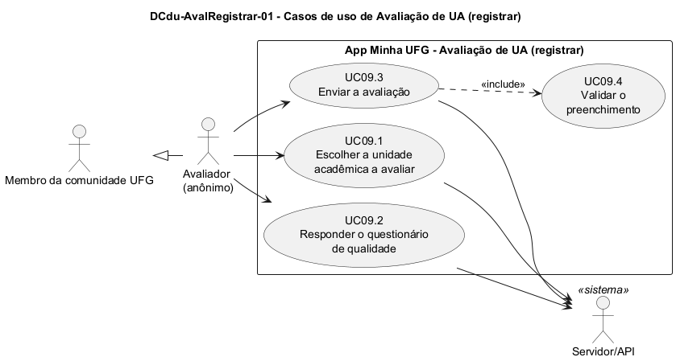

# DCdu-AvalRegistrar-01 – Casos de uso de Avaliação de UA (registrar)

| Campo | Valor |
|---|---|
| **Código** | `DCdu-AvalRegistrar-01` |
| **Título** | Casos de uso de Avaliação de UA (registrar) |
| **Autor(a)** | José Eduardo Gontijo de Carvalho |
| **Revisor(a)** | Maicon Brendo da Silva (Pessoa B) |
| **Status** | Em produção |
| **Rastreia para** | `DCdu-Geral-01`, `DPac-Geral-01`, `DIhc-Inicio-01`, `DD-Locais-01`, `DCla-Comum-02`, `DEst-Comum-01`, `DAtv-AvalRegistrar-01`, `DAtv-AvalRegistrar-02`, `DAtv-AvalRegistrar-03`, `DAtv-AvalRegistrar-04`, `DIhc-AvalRegistrar-01`, `DIhc-AvalRegistrar-02`, `DIhc-AvalRegistrar-03`, `DIhc-AvalRegistrar-04`, `DD-AvalRegistrar-01`, `DCmp-AvalRegistrar-01`, `DCla-AvalRegistrar-01`, `DCla-AvalRegistrar-02`, `DCla-AvalRegistrar-03`, `DCla-AvalRegistrar-04`, `DSeq-AvalRegistrar-01`, `DSeq-AvalRegistrar-02`, `DSeq-AvalRegistrar-03`, `DSeq-AvalRegistrar-04`, `DSeq-AvalRegistrar-05`, `DEst-AvalRegistrar-01`, `DEst-AvalRegistrar-02`, `DEst-AvalRegistrar-03`, `DEst-AvalRegistrar-04`, `Contrato-AvalRegistrar-01`, `ECA-AvalRegistrar-01` |

## Diagrama

Fonte: [`DCdu-AvalRegistrar-01.puml`](DCdu-AvalRegistrar-01.puml)

## Descrição

O diagrama detalha o caso de uso macro UC09 "Avaliar UA" do `DCdu-Geral-01`. Esta é a funcionalidade nova do projeto (evolução do app): o app atual não tem avaliação, então **não há captura de tela nem comportamento observado**. Tudo o que está aqui parte do enunciado (Apêndice A) e do contrato-base (seção 8), e o que o enunciado não define está marcado como premissa `P-AR-n`, listada na Tabela 2 e consolidada no [`README.md`](README.md) da pasta, para o revisor e a equipe confirmarem.

O enunciado define a avaliação assim: uma **dimensão de qualidade** (por exemplo, infraestrutura física, corpo docente, recursos pedagógicos, condições ambientais) reúne **elementos educacionais** (por exemplo, salas de aula, laboratórios, limpeza); para cada elemento há **questões predefinidas**, respondidas com uma nota de 0 (péssima) a 5 (excelente). A média dos elementos dá a nota da dimensão, e a média das dimensões dá a nota da avaliação da unidade acadêmica (UA) (P-AR-12). Esse cálculo é da funcionalidade `AvalConsultar`; aqui o escopo é **como a avaliação nasce**: escolher a UA, responder, validar e enviar.

### Atores

- **Avaliador:** ator primário. É o Membro da comunidade UFG que registra uma avaliação. É **anônimo**: não há login nem identificação (contrato-base, seção 8).
- **Servidor/API:** ator secundário. Fornece a lista de UAs e as dimensões, elementos e questões, cadastrados pelo painel web, e recebe a avaliação registrada.

O Navegador e os demais aplicativos externos não participam desta funcionalidade.

### Casos de uso

**Tabela 1 – Casos de uso de Avaliação de UA (registrar)**

| Código | Caso de uso | Objetivo do usuário | Ator secundário |
|---|---|---|---|
| UC09.1 | Escolher a unidade acadêmica a avaliar | Indicar qual UA (por exemplo, o Instituto de Informática) será avaliada | Servidor/API |
| UC09.2 | Responder o questionário de qualidade | Dar uma nota de 0 a 5 a cada questão de cada elemento de cada dimensão | Servidor/API |
| UC09.3 | Enviar a avaliação | Registrar a avaliação completa da UA | Servidor/API |
| UC09.4 | Validar o preenchimento | (incluído em UC09.3) Garantir que toda questão tem uma nota válida antes do envio | – |

**UC09.1 – Escolher a unidade acadêmica a avaliar**

- *Pré-condição:* o usuário tocou no cartão "Avaliação de UA" da tela inicial (E9 do `DIhc-Inicio-01`), o app abriu a `TelaAvaliacao` (`DIhc-AvalRegistrar-01`, P-AR-1) e o usuário tocou em "Avaliar uma unidade".
- *Fluxo principal:* (1) o app pede ao servidor a lista de unidades acadêmicas (P-AR-2); (2) o app mostra a lista; (3) o usuário toca em uma UA; (4) o app guarda a UA escolhida e passa ao questionário (UC09.2).
- *Fluxos alternativos:* **A1** sem internet ou servidor indisponível: o app mostra a mensagem de indisponibilidade, no ciclo genérico de telas remotas (`DEst-Comum-01`, `DCla-Comum-02`, P-AR-10); **A2** lista vazia: o app mostra a mensagem de vazio (P-AR-10).
- *Pós-condição:* uma UA está selecionada para ser avaliada.

**UC09.2 – Responder o questionário de qualidade**

- *Pré-condição:* UC09.1 concluído (há UA selecionada).
- *Fluxo principal:* (1) o app pede ao servidor as dimensões de qualidade, com seus elementos educacionais e as questões de cada elemento; o questionário é o mesmo para qualquer UA (P-AR-3, P-AR-9); (2) o app apresenta o questionário (P-AR-4: dimensão por dimensão); (3) para cada questão, o usuário escolhe uma nota inteira de 0 a 5 (P-AR-5); (4) o usuário pode voltar a uma dimensão já respondida e mudar uma nota antes de enviar.
- *Fluxos alternativos:* **A1** sem internet ou servidor indisponível ao carregar o questionário: indisponibilidade, como em UC09.1 (P-AR-10); **A2** o usuário volta e abandona a avaliação: as notas informadas são descartadas e nada é enviado (P-AR-8).
- *Pós-condição:* o app tem as notas informadas pelo usuário para a UA escolhida; nada foi registrado no servidor.

**UC09.3 – Enviar a avaliação**

- *Pré-condição:* UC09.2 em andamento.
- *Fluxo principal:* (1) o usuário toca em enviar; (2) o app executa UC09.4 (validação); (3) o app envia ao servidor a UA e todas as notas, sem nenhum dado de identificação (P-AR-7); (4) o servidor registra a avaliação; (5) o app confirma ao usuário que a avaliação foi registrada.
- *Fluxos alternativos:* **A1** validação reprova (UC09.4): o app não envia, indica as questões sem nota e o usuário continua preenchendo; **A2** falha de comunicação no envio: o app avisa que a avaliação não foi registrada e mantém as notas na tela para o usuário tentar de novo (P-AR-6).
- *Pós-condição:* a avaliação está registrada e **não pode ser editada nem excluída** (contrato-base, seção 8). O mesmo usuário pode avaliar a mesma UA outra vez; cada envio cria uma nova avaliação.

**UC09.4 – Validar o preenchimento**

- *Incluído por:* UC09.3.
- *Fluxo principal:* o app confere que toda questão do questionário tem uma nota inteira entre 0 e 5 (P-AR-5).
- *Resultado:* aprovado (segue o envio) ou reprovado, com a lista das questões pendentes.

### O que fica de fora, por decisão do contrato

- **Editar ou excluir** uma avaliação registrada: não existe caso de uso, pois o contrato proíbe.
- **Identificar o avaliador** ou limitar uma avaliação por pessoa: não há login e o mesmo avaliador pode repetir (contrato-base, seção 8).
- **Ver notas e médias** por UA, por área do conhecimento e da UFG: é a funcionalidade `AvalConsultar` (UC10 do `DCdu-Geral-01`), a cargo de Phablo Tavares Paixão (Pessoa D). Ela é aberta pelo botão "Ver notas" da `TelaAvaliacao` e aqui só é referenciada.

### Premissas desta funcionalidade

A **Tabela 2** traz as premissas citadas por este item. A tabela completa (P-AR-1 em diante), com os itens que citam cada uma, está no [`README.md`](README.md) da pasta.

**Tabela 2 – Premissas de Avaliação de UA (registrar) citadas neste item**

| Código | Premissa | Situação |
|---|---|---|
| P-AR-1 | O ponto de entrada é o cartão "Avaliação de UA" da tela inicial (E9 de `DIhc-Inicio-01`, decisão de 20/10 em `Docs/decisoes.md`). A tela aberta por ele é a `TelaAvaliacao`, definida em `DIhc-AvalRegistrar-01`, com os botões "Avaliar uma unidade" (segue para o registro, tratado aqui) e "Ver notas" (abre a tela de `AvalConsultar`) | Decisão desta especificação, a confirmar com Phablo Tavares Paixão (Pessoa D), que fará `AvalConsultar` |
| P-AR-2 | A lista de UAs vem do Servidor/API, com a entidade `UnidadeAcademica` de B (especialização de `Local`, `DD-Locais-01`); a escolha é por toque em uma lista | Premissa de projeto |
| P-AR-3 | Dimensões, elementos e questões são cadastrados no painel web e obtidos do Servidor/API a cada avaliação, sem cache (`Docs/decisoes.md` e `DCdu-Geral-01`) | Premissa de projeto |
| P-AR-4 | O questionário é apresentado dimensão por dimensão, com navegação para frente e para trás; a forma das telas é definida em `DIhc-AvalRegistrar-03` | Premissa de projeto |
| P-AR-5 | A nota é um número inteiro de 0 (péssima) a 5 (excelente), e todas as questões são obrigatórias para enviar | Premissa de projeto (o enunciado dá a escala, não diz se é inteira nem se é obrigatória) |
| P-AR-6 | O envio é uma única chamada; se falhar, as notas permanecem na tela para novo envio | Premissa de projeto |
| P-AR-7 | A avaliação enviada contém só a UA e as notas, sem identificação do avaliador | Contrato-base, seção 8 |
| P-AR-8 | Sair da avaliação antes de enviar descarta as notas; o app não guarda rascunho | Premissa de projeto |
| P-AR-9 | O questionário (dimensões, elementos e questões) é o mesmo para qualquer UA; a UA escolhida só entra no envio | Premissa de projeto (o enunciado não prevê questões diferentes por UA) |
| P-AR-10 | A apresentação dos estados vazio e indisponível segue o padrão do Comum (`DEst-Comum-01`); como o app atual não tem mensagens observadas, os textos seguem o padrão do Comum | Premissa de projeto |
| P-AR-12 | A nota de um elemento é a média das notas de suas questões, e a de uma dimensão é a média dos seus elementos; o cálculo é de `AvalConsultar`, e aqui só se registram as notas por questão | Premissa de projeto (o enunciado fala da média dos elementos, não da média das questões) |

### Itens que detalham este caso de uso

Seguindo a ordem do contrato (casos de uso, atividades, IHC, entidades, componentes e classes, sequência, estados, contratos e regras E-C-A):

- **Atividades:** `DAtv-AvalRegistrar-01` (UC09.1), `DAtv-AvalRegistrar-02` (UC09.2) e `DAtv-AvalRegistrar-03` (UC09.3) e `DAtv-AvalRegistrar-04` (UC09.4).
- **Interface:** `DIhc-AvalRegistrar-01` (`TelaAvaliacao`, entrada), `-02` (`TelaEscolherUA`), `-03` (`TelaQuestionario`) e `-04` (`TelaConfirmacao`).
- **Dados:** `DD-AvalRegistrar-01` (entidades da avaliação e do questionário), entrega que `AvalConsultar` usa.
- **Estrutura:** `DCmp-AvalRegistrar-01` e `DCla-AvalRegistrar-01` a `-04`.
- **Comportamento:** `DSeq-AvalRegistrar-01` a `-05` e `DEst-AvalRegistrar-01` a `-04`.
- **Contratos e regras:** `Contrato-AvalRegistrar-01` e `ECA-AvalRegistrar-01`.

## Referências

INSTITUTE OF ELECTRICAL AND ELECTRONICS ENGINEERS. **Guide to the Software Engineering Body of Knowledge – SWEBOK v4**. Cap. 11 (Software Engineering Models and Methods). IEEE, 2024.

UNIVERSIDADE FEDERAL DE GOIÁS. Instituto de Informática. **Definição de Atividades Práticas Supervisionadas (APS) da Disciplina**: INF 0290 – Projeto de Software, 2026/2. Goiânia, 2026. Apêndice A.

ANTHROPIC. **Claude Code**. Assistente de IA. Disponível em: claude.ai/code. Acesso em: 30 out. 2026. Uso: rascunho do texto e dos diagramas a partir da especificação e das instruções do autor, que revisou o conteúdo. Questão: Apêndice <X>, Seção <X.1>.

---

## Registro de revisão

| Data | Revisor(a) | Situação | Observações |
|---|---|---|---|
| | | | |
