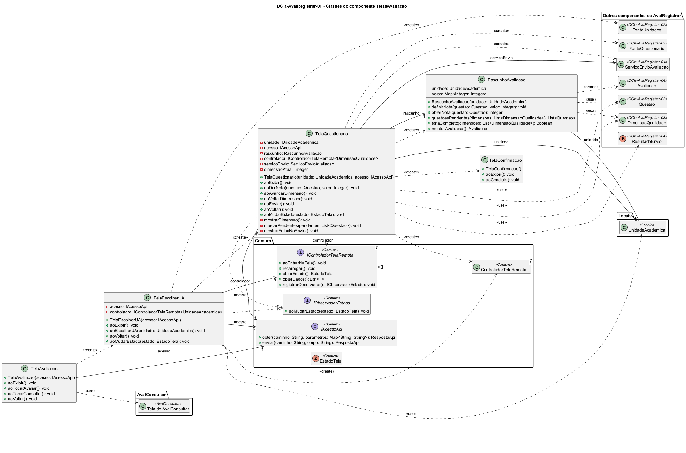

# DCla-AvalRegistrar-01 – Classes do componente TelasAvaliacao

| Campo | Valor |
|---|---|
| **Código** | `DCla-AvalRegistrar-01` |
| **Título** | Classes do componente TelasAvaliacao |
| **Autor(a)** | José Eduardo Gontijo de Carvalho |
| **Revisor(a)** | Maicon Brendo da Silva (Pessoa B) |
| **Status** | Em produção |
| **Rastreia para** | `DCmp-AvalRegistrar-01`, `DIhc-AvalRegistrar-01`, `DIhc-AvalRegistrar-02`, `DIhc-AvalRegistrar-03`, `DIhc-AvalRegistrar-04`, `DCla-AvalRegistrar-02`, `DCla-AvalRegistrar-03`, `DCla-AvalRegistrar-04`, `DCla-Comum-02`, `DCla-Comum-03`, `DEst-AvalRegistrar-02`, `DEst-AvalRegistrar-03`, `DD-Locais-01` |

## Diagrama

Fonte: [`DCla-AvalRegistrar-01.puml`](DCla-AvalRegistrar-01.puml)

## Descrição

Cada método `ao...` das telas corresponde a um evento dos `DIhc-AvalRegistrar-01` a `-04`. As classes e interfaces `<<Comum>>`, `<<Locais>>` e `<<AvalConsultar>>` pertencem a outros pacotes e não são redefinidas aqui; as classes dos demais componentes de `AvalRegistrar` aparecem só como referência, com o código do `DCla` onde estão. As interfaces do Comum estão desenhadas com todas as operações atuais (`DCla-Comum-02` e `DCla-Comum-03`).

- **TelaAvaliacao:** tela de entrada, aberta pelo cartão "Avaliação de UA" (P-AR-1). `aoTocarAvaliar` cria a `TelaEscolherUA`; `aoTocarConsultar` abre a tela de `AvalConsultar` (de Phablo, fora do escopo; ainda sem nome definido); `aoVoltar` volta ao menu. Guarda o `IAcessoApi` recebido no construtor para passá-lo adiante (desenhado como a associação `acesso`).
- **TelaEscolherUA:** lista as UAs. Implementa `IObservadorEstado` (`DCla-Comum-03`). Em `aoExibir`, na entrada, cria `FonteUnidades`, o `ControladorTelaRemota<UnidadeAcademica>` e se registra como observador; no retorno (ao voltar do questionário) só chama `controlador.aoEntrarNaTela()`, porque o app não guarda cache. `aoEscolherUA` cria a `TelaQuestionario`. Não usa `recarregar()`, pois a lista não tem filtro (P-AR-10).
- **TelaQuestionario:** mostra uma dimensão por vez (P-AR-4). `dimensaoAtual` é o índice a partir de 0 da dimensão exibida. `aoExibir` só ocorre na entrada: cria `RascunhoAvaliacao`, `FonteQuestionario`, o controlador e o `ServicoEnvioAvaliacao`. `aoDarNota` só atualiza o rascunho (P-AR-5), sem ir ao servidor. `aoEnviar` valida o rascunho; se há pendências, chama `marcarPendentes` e não envia; se está completo, chama `servicoEnvio.enviar` e trata o `ResultadoEnvio`: `REGISTRADA` abre a `TelaConfirmacao`, e `NAO_REGISTRADA` chama `mostrarFalhaNoEnvio`, mantendo as notas (P-AR-6). `aoVoltar` descarta o rascunho (P-AR-8). `marcarPendentes` também leva a tela à dimensão da primeira questão pendente (P-AR-28), e durante o envio a tela ignora os toques (P-AR-27). O envio não passa pelo controlador do Comum, por ser um POST (estados em `DEst-AvalRegistrar-03`).
- **TelaConfirmacao:** mostra "Avaliação registrada. Obrigado por contribuir!" e o botão "Concluir"; `aoConcluir` volta à `TelaAvaliacao`.
- **RascunhoAvaliacao:** guarda em memória as notas dadas (`notas`: id da questão → valor) para a UA escolhida; é descartado ao sair (P-AR-8). `questoesPendentes` e `estaCompleto` comparam as notas com as dimensões do questionário carregado. `montarAvaliacao` cria a `Avaliacao` a enviar; como o rascunho guarda só o id da questão, cada `NotaQuestao` leva uma `Questao` com apenas o `id` (P-AR-24).

As mensagens de vazio e de indisponibilidade seguem o padrão do Comum (P-AR-10).

As premissas `P-AR-n` citadas estão listadas em [`AvalRegistrar/README.md`](README.md).

## Referências

INSTITUTE OF ELECTRICAL AND ELECTRONICS ENGINEERS. **Guide to the Software Engineering Body of Knowledge – SWEBOK v4**. Cap. 3 (Software Design). IEEE, 2024.

ANTHROPIC. **Claude Code**. Assistente de IA. Disponível em: claude.ai/code. Acesso em: 30 out. 2026. Uso: rascunho do texto e dos diagramas a partir da especificação e das instruções do autor, que revisou o conteúdo. Questão: Apêndice <X>, Seção <X.1>.

---

## Registro de revisão

| Data | Revisor(a) | Situação | Observações |
|---|---|---|---|
| | | | |
