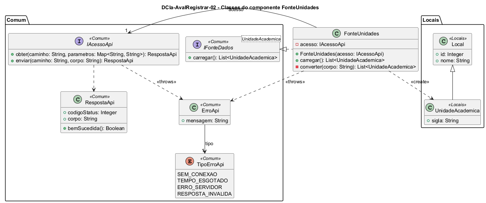

# DCla-AvalRegistrar-02 – Classes do componente FonteUnidades

| Campo | Valor |
|---|---|
| **Código** | `DCla-AvalRegistrar-02` |
| **Título** | Classes do componente FonteUnidades |
| **Autor(a)** | José Eduardo Gontijo de Carvalho |
| **Revisor(a)** | Maicon Brendo da Silva (Pessoa B) |
| **Status** | Em produção |
| **Rastreia para** | `DCmp-AvalRegistrar-01`, `DCla-AvalRegistrar-01`, `DCla-Comum-02`, `DCla-Comum-03`, `DD-Locais-01`, `DSeq-AvalRegistrar-01` |

## Diagrama

Fonte: [`DCla-AvalRegistrar-02.puml`](DCla-AvalRegistrar-02.puml)

## Descrição

- **FonteUnidades:** implementa `IFonteDados<UnidadeAcademica>` (`DCla-Comum-03`). `carregar()` faz uma única chamada `IAcessoApi.obter` (`DCla-Comum-02`) ao recurso `/unidades-academicas`, sem parâmetros (P-AR-11), e `converter` monta os objetos `UnidadeAcademica` a partir do JSON (P-AR-23). As UAs são entregues na ordem recebida, que o servidor define (P-AR-25). Não há cache: cada entrada na `TelaEscolherUA` chama `carregar()` de novo. O `ErroApi` não é tratado aqui: ele sobe ao `ControladorTelaRemota`, que leva a tela ao estado Indisponível (`DEst-Comum-01`).
- **UnidadeAcademica** e **Local:** entidades de Maicon (Pessoa B), definidas em `DD-Locais-01`; aparecem só como referência (`<<Locais>>`), com os atributos de que `AvalRegistrar` precisa (`id`, `nome` e `sigla`). Nada é redefinido aqui. A lista de UAs vem do Servidor/API (P-AR-2).
- As interfaces e classes `<<Comum>>` pertencem ao pacote Comum e não são redefinidas aqui; estão desenhadas com todas as operações atuais.

As premissas `P-AR-n` citadas estão listadas em [`AvalRegistrar/README.md`](README.md).

## Referências

INSTITUTE OF ELECTRICAL AND ELECTRONICS ENGINEERS. **Guide to the Software Engineering Body of Knowledge – SWEBOK v4**. Cap. 3 (Software Design). IEEE, 2024.

ANTHROPIC. **Claude Code**. Assistente de IA. Disponível em: claude.ai/code. Acesso em: 30 out. 2026. Uso: rascunho do texto e dos diagramas a partir da especificação e das instruções do autor, que revisou o conteúdo. Questão: Apêndice <X>, Seção <X.1>.

---

## Registro de revisão

| Data | Revisor(a) | Situação | Observações |
|---|---|---|---|
| | | | |
