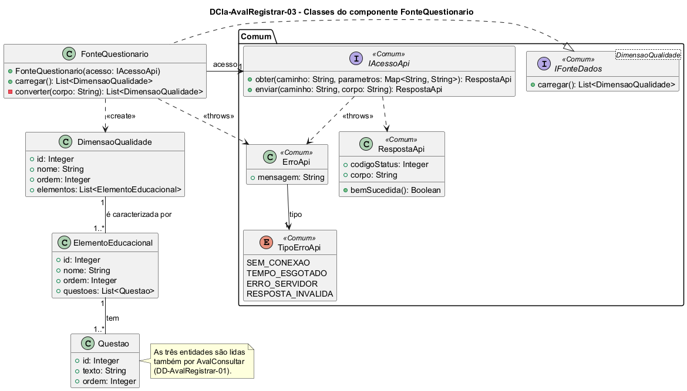

# DCla-AvalRegistrar-03 – Classes do componente FonteQuestionario

| Campo | Valor |
|---|---|
| **Código** | `DCla-AvalRegistrar-03` |
| **Título** | Classes do componente FonteQuestionario |
| **Autor(a)** | José Eduardo Gontijo de Carvalho |
| **Revisor(a)** | Maicon Brendo da Silva (Pessoa B) |
| **Status** | Em produção |
| **Rastreia para** | `DCmp-AvalRegistrar-01`, `DD-AvalRegistrar-01`, `DCla-AvalRegistrar-01`, `DCla-AvalRegistrar-04`, `DCla-Comum-02`, `DCla-Comum-03`, `DSeq-AvalRegistrar-02` |

## Diagrama

Fonte: [`DCla-AvalRegistrar-03.puml`](DCla-AvalRegistrar-03.puml)

## Descrição

- **FonteQuestionario:** implementa `IFonteDados<DimensaoQualidade>` (`DCla-Comum-03`). `carregar()` faz uma única chamada `IAcessoApi.obter` (`DCla-Comum-02`) ao recurso `/avaliacao/questionario`, sem parâmetros (P-AR-11), e `converter` monta as dimensões, com seus elementos e questões, a partir do JSON (P-AR-23). O questionário é o mesmo para toda UA (P-AR-9), por isso a fonte não recebe a UA. Não há cache: o questionário é cadastrado no painel web e pedido a cada avaliação (P-AR-3). `converter` devolve dimensões, elementos e questões em ordem crescente de `ordem` (P-AR-25) e rejeita um questionário malformado (P-AR-29). O `ErroApi` sobe ao controlador do Comum, como em `FonteUnidades`.
- **DimensaoQualidade**, **ElementoEducacional** e **Questao:** entidades descritas no `DD-AvalRegistrar-01`, com as associações `DimensaoQualidade` 1 — 1..* `ElementoEducacional` e `ElementoEducacional` 1 — 1..* `Questao`. `id` e `ordem` são atribuídos pelo servidor (P-AR-20). Sem operações: são só dados. As três são usadas pelas telas (`DCla-AvalRegistrar-01`), pelo rascunho e pela avaliação (`DCla-AvalRegistrar-04`), e lidas por `AvalConsultar`.
- As interfaces e classes `<<Comum>>` pertencem ao pacote Comum e não são redefinidas aqui.

As premissas `P-AR-n` citadas estão listadas em [`AvalRegistrar/README.md`](README.md).

## Referências

INSTITUTE OF ELECTRICAL AND ELECTRONICS ENGINEERS. **Guide to the Software Engineering Body of Knowledge – SWEBOK v4**. Cap. 3 (Software Design). IEEE, 2024.

ANTHROPIC. **Claude Code**. Assistente de IA. Disponível em: claude.ai/code. Acesso em: 30 out. 2026. Uso: rascunho do texto e dos diagramas a partir da especificação e das instruções do autor, que revisou o conteúdo. Questão: Apêndice <X>, Seção <X.1>.

---

## Registro de revisão

| Data | Revisor(a) | Situação | Observações |
|---|---|---|---|
| | | | |
