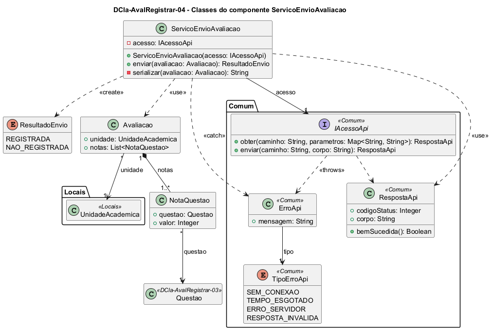

# DCla-AvalRegistrar-04 – Classes do componente ServicoEnvioAvaliacao

| Campo | Valor |
|---|---|
| **Código** | `DCla-AvalRegistrar-04` |
| **Título** | Classes do componente ServicoEnvioAvaliacao |
| **Autor(a)** | José Eduardo Gontijo de Carvalho |
| **Revisor(a)** | Maicon Brendo da Silva (Pessoa B) |
| **Status** | Em produção |
| **Rastreia para** | `DCmp-AvalRegistrar-01`, `DD-AvalRegistrar-01`, `DCla-AvalRegistrar-01`, `DCla-AvalRegistrar-03`, `DCla-Comum-02`, `DD-Locais-01`, `DSeq-AvalRegistrar-05` |

## Diagrama

Fonte: [`DCla-AvalRegistrar-04.puml`](DCla-AvalRegistrar-04.puml)

## Descrição

- **ServicoEnvioAvaliacao:** `enviar(avaliacao)` chama `IAcessoApi.enviar("/avaliacoes", corpo)` (`DCla-Comum-02`; P-AR-11), com o corpo produzido por `serializar`, e devolve um `ResultadoEnvio`. Se a resposta é bem-sucedida, o resultado é `REGISTRADA`; se há qualquer `ErroApi` ou a resposta não é bem-sucedida, é `NAO_REGISTRADA`. A operação **nunca lança exceção**: ao contrário das fontes de dados, o envio não passa pelo `ControladorTelaRemota`, e a tela só precisa saber se a avaliação foi registrada ou não (P-AR-6). `serializar` produz um JSON com o `idUnidade` e a lista de notas, cada uma com `idQuestao` e `valor` (P-AR-23), **sem nenhum dado do avaliador** (P-AR-7), nem identificador ou data e hora da avaliação, que o servidor atribui (P-AR-22). Um reenvio depois de uma resposta perdida pode criar uma segunda avaliação (P-AR-26).
- **ResultadoEnvio:** enumeração `REGISTRADA`, `NAO_REGISTRADA`.
- **Avaliacao** e **NotaQuestao:** entidades descritas no `DD-AvalRegistrar-01`. No app, `Avaliacao` tem `unidade` e `notas` (`Avaliacao` 1 — 1..* `NotaQuestao`); o `id` e a data e hora do registro existem só no servidor (P-AR-22). `NotaQuestao.valor` é inteiro entre 0 e 5 e há uma nota por questão (P-AR-5). Uma avaliação, depois de criada, não é alterada (contrato-base, seção 8).
- **UnidadeAcademica** (de Maicon, `DD-Locais-01`) e **Questao** (`DCla-AvalRegistrar-03`) aparecem só como referência. As interfaces e classes `<<Comum>>` pertencem ao pacote Comum e não são redefinidas aqui.

As premissas `P-AR-n` citadas estão listadas em [`AvalRegistrar/README.md`](README.md).

## Referências

INSTITUTE OF ELECTRICAL AND ELECTRONICS ENGINEERS. **Guide to the Software Engineering Body of Knowledge – SWEBOK v4**. Cap. 3 (Software Design). IEEE, 2024.

ANTHROPIC. **Claude Code**. Assistente de IA. Disponível em: claude.ai/code. Acesso em: 30 out. 2026. Uso: rascunho do texto e dos diagramas a partir da especificação e das instruções do autor, que revisou o conteúdo. Questão: Apêndice <X>, Seção <X.1>.

---

## Registro de revisão

| Data | Revisor(a) | Situação | Observações |
|---|---|---|---|
| | | | |
