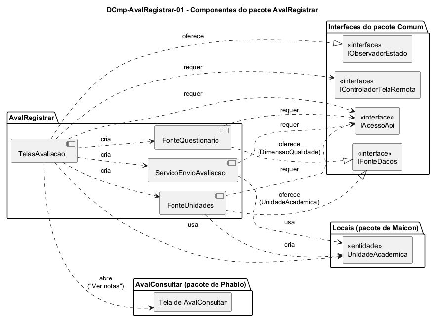

# DCmp-AvalRegistrar-01 – Componentes do pacote AvalRegistrar

| Campo | Valor |
|---|---|
| **Código** | `DCmp-AvalRegistrar-01` |
| **Título** | Componentes do pacote AvalRegistrar |
| **Autor(a)** | José Eduardo Gontijo de Carvalho |
| **Revisor(a)** | Maicon Brendo da Silva (Pessoa B) |
| **Status** | Em produção |
| **Rastreia para** | `DPac-Geral-01`, `DCmp-Comum-01`, `DCla-AvalRegistrar-01`, `DCla-AvalRegistrar-02`, `DCla-AvalRegistrar-03`, `DCla-AvalRegistrar-04`, `DD-AvalRegistrar-01`, `DD-Locais-01`, `DSeq-AvalRegistrar-05` |

## Diagrama

Fonte: [`DCmp-AvalRegistrar-01.puml`](DCmp-AvalRegistrar-01.puml)

## Descrição

O pacote `AvalRegistrar` tem quatro componentes. Eles dependem do pacote `Comum` apenas por interfaces, como pede o `DPac-Geral-01`, e do pacote `Locais` pela entidade `UnidadeAcademica`, de Maicon (Pessoa B), que é só referenciada (`DD-Locais-01`). Essa é a dependência `AvalRegistrar` → `Locais` prevista no `DPac-Geral-01`.

**Tabela 1 – Componentes do pacote AvalRegistrar**

| Componente | Responsabilidade | Interface oferecida | Interfaces requeridas (pacote Comum) | Classes |
|---|---|---|---|---|
| TelasAvaliacao | Reúne as quatro telas do registro: entrada ("Avaliar uma unidade" e "Ver notas"), lista de UAs, questionário e confirmação; guarda o rascunho das notas, valida o preenchimento e decide o que fazer com o resultado do envio | `IObservadorEstado` (implementada pelas telas de lista e de questionário) | `IControladorTelaRemota`, `IAcessoApi` (só repassada aos demais componentes) | `DCla-AvalRegistrar-01` |
| FonteUnidades | Busca a lista de unidades acadêmicas na API e a converte em objetos `UnidadeAcademica` | `IFonteDados` (implementada para `UnidadeAcademica`) | `IAcessoApi` | `DCla-AvalRegistrar-02` |
| FonteQuestionario | Busca as dimensões de qualidade, com seus elementos e questões, e as converte em objetos; o questionário é o mesmo para toda UA | `IFonteDados` (implementada para `DimensaoQualidade`) | `IAcessoApi` | `DCla-AvalRegistrar-03` |
| ServicoEnvioAvaliacao | Envia a avaliação à API e devolve se ela foi registrada ou não; não lança exceção | Operação `enviar` da própria classe (não há interface formal) | `IAcessoApi` | `DCla-AvalRegistrar-04` |

**Como os componentes cooperam.** A `TelasAvaliacao` cria um controlador de estados (`ControladorTelaRemota`, pacote Comum) para a lista de UAs, entregando a ele a `FonteUnidades`, e outro para o questionário, com a `FonteQuestionario`; esse desenho segue o modelo de uso do `DCmp-Comum-01`. O envio **não** passa pelo controlador, porque é um POST e não uma carga de tela: a `TelasAvaliacao` chama o `ServicoEnvioAvaliacao` e trata o resultado. As três chamadas à API usam a `IAcessoApi`, recebida pela primeira tela e repassada a cada componente (P-AR-11).

**Dependências de outros pacotes.**

- `Locais`: `UnidadeAcademica` é a entidade da lista (`FonteUnidades` a cria), da tela e do envio (`Avaliacao.unidade`).
- `AvalConsultar`: o botão "Ver notas" da tela de entrada abre a tela de consulta de Phablo (P-AR-1), apenas referenciada. Essa dependência `AvalRegistrar` → `AvalConsultar` não consta no `DPac-Geral-01`, que só prevê a dependência contrária (`AvalConsultar` depende das entidades de `AvalRegistrar`, `DD-AvalRegistrar-01`); ela fica registrada como pendência para a integração.

**Decisão de projeto.** Separar fontes e serviço de envio das telas deixa as telas sem conhecer o formato do JSON, e permite testar as conversões e o envio sozinhos. Como o questionário é o mesmo para toda UA (P-AR-9) e o app não guarda cache (P-AR-3), `FonteQuestionario` não recebe a UA escolhida; o envio é uma única chamada (P-AR-6).

As premissas `P-AR-n` citadas estão listadas em [`AvalRegistrar/README.md`](README.md).

## Referências

INSTITUTE OF ELECTRICAL AND ELECTRONICS ENGINEERS. **Guide to the Software Engineering Body of Knowledge – SWEBOK v4**. Cap. 3 (Software Design). IEEE, 2024.

ANTHROPIC. **Claude Code**. Assistente de IA. Disponível em: claude.ai/code. Acesso em: 30 out. 2026. Uso: rascunho do texto e dos diagramas a partir da especificação e das instruções do autor, que revisou o conteúdo. Questão: Apêndice <X>, Seção <X.1>.

---

## Registro de revisão

| Data | Revisor(a) | Situação | Observações |
|---|---|---|---|
| | | | |
