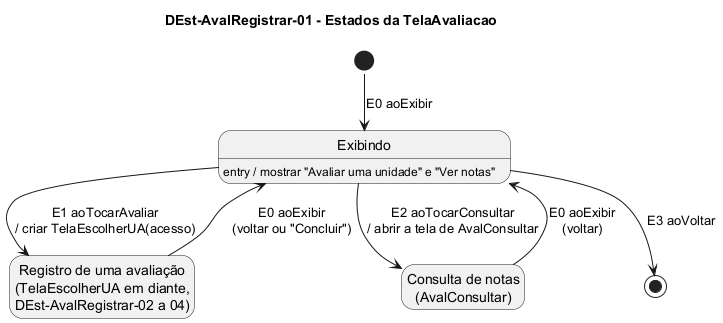

# DEst-AvalRegistrar-01 – Estados da TelaAvaliacao

| Campo | Valor |
|---|---|
| **Código** | `DEst-AvalRegistrar-01` |
| **Título** | Estados da TelaAvaliacao |
| **Autor(a)** | José Eduardo Gontijo de Carvalho |
| **Revisor(a)** | Maicon Brendo da Silva (Pessoa B) |
| **Status** | Em produção |
| **Rastreia para** | `DIhc-AvalRegistrar-01`, `DEst-AvalRegistrar-02`, `DEst-AvalRegistrar-04`, `DSeq-AvalRegistrar-01`, `DCla-AvalRegistrar-01` |

## Diagrama

Fonte: [`DEst-AvalRegistrar-01.puml`](DEst-AvalRegistrar-01.puml)

## Descrição

Especifica como a `TelaAvaliacao` reage aos eventos de interação do `DIhc-AvalRegistrar-01`. A tela é nova no projeto (não existe no app atual) e não tem conteúdo remoto: por isso não usa os estados de tela remota do Comum (`DEst-Comum-01`) e tem um único estado próprio, **Exibindo**. Os outros dois estados do diagrama representam as telas para onde o usuário vai e de onde volta.

- **E0 `aoExibir`:** entrada na tela ou retorno a ela (da escolha de UA, da confirmação, da consulta de notas). Leva sempre a Exibindo.
- **E1 `aoTocarAvaliar`:** cria a `TelaEscolherUA` e passa ao registro de uma avaliação (`DEst-AvalRegistrar-02` em diante; `DSeq-AvalRegistrar-01`).
- **E2 `aoTocarConsultar`:** abre a tela de `AvalConsultar`, fora do escopo desta pasta (P-AR-1).
- **E3 `aoVoltar`:** volta ao menu e encerra a tela.

**Tabela 1 – Transições da `TelaAvaliacao`**

| Origem | Evento | Condição | Ação | Destino |
|---|---|---|---|---|
| (início) | E0 `aoExibir` | – | mostrar os botões "Avaliar uma unidade" e "Ver notas" | Exibindo |
| Exibindo | E1 `aoTocarAvaliar` | – | criar `TelaEscolherUA(acesso)` | Registro de uma avaliação |
| Exibindo | E2 `aoTocarConsultar` | – | abrir a tela de `AvalConsultar` | Consulta de notas |
| Registro de uma avaliação | E0 `aoExibir` | o usuário voltou da escolha de UA ou tocou em "Concluir" (`DEst-AvalRegistrar-04`) | – | Exibindo |
| Consulta de notas | E0 `aoExibir` | o usuário voltou | – | Exibindo |
| Exibindo | E3 `aoVoltar` | – | – | (fim) |

As premissas citadas estão listadas, com os itens que as citam, em [`README.md`](README.md): aqui, a P-AR-1.

## Referências

INSTITUTE OF ELECTRICAL AND ELECTRONICS ENGINEERS. **Guide to the Software Engineering Body of Knowledge – SWEBOK v4**. Cap. 11 (Software Engineering Models and Methods). IEEE, 2024.

ANTHROPIC. **Claude Code**. Assistente de IA. Disponível em: claude.ai/code. Acesso em: 30 out. 2026. Uso: rascunho do texto e dos diagramas a partir da especificação e das instruções do autor, que revisou o conteúdo. Questão: Apêndice <X>, Seção <X.1>.

---

## Registro de revisão

| Data | Revisor(a) | Situação | Observações |
|---|---|---|---|
| | | | |
