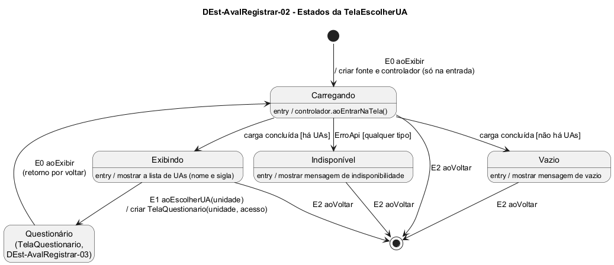

# DEst-AvalRegistrar-02 – Estados da TelaEscolherUA

| Campo | Valor |
|---|---|
| **Código** | `DEst-AvalRegistrar-02` |
| **Título** | Estados da TelaEscolherUA |
| **Autor(a)** | José Eduardo Gontijo de Carvalho |
| **Revisor(a)** | Maicon Brendo da Silva (Pessoa B) |
| **Status** | Em produção |
| **Rastreia para** | `DIhc-AvalRegistrar-02`, `DEst-Comum-01`, `DCla-Comum-03`, `DEst-AvalRegistrar-01`, `DEst-AvalRegistrar-03`, `DSeq-AvalRegistrar-01`, `DSeq-AvalRegistrar-02`, `DCla-AvalRegistrar-01` |

## Diagrama

Fonte: [`DEst-AvalRegistrar-02.puml`](DEst-AvalRegistrar-02.puml)

## Descrição

Especifica como a `TelaEscolherUA` reage aos eventos do `DIhc-AvalRegistrar-02`. A tela é nova no projeto (não existe no app atual). Os estados Carregando, Exibindo, Vazio e Indisponível são exatamente os do ciclo genérico de tela remota do Comum (`DEst-Comum-01`, implementado por `ControladorTelaRemota`, `DCla-Comum-03`); a apresentação de vazio e de indisponibilidade segue o padrão do Comum (P-AR-10). Esta tela acrescenta só:

- **E0 `aoExibir`:** é o `aoEntrarNaTela` do Comum. Na primeira entrada, a tela cria a `FonteUnidades`, o controlador e registra-se como observador; ao retornar do questionário, só chama `aoEntrarNaTela()`. Nos dois casos leva a Carregando, pois o app não guarda cache (`DSeq-AvalRegistrar-01`).
- **E1 `aoEscolherUA(unidade)`:** só possível em Exibindo, onde a lista está na tela. Cria a `TelaQuestionario` e passa ao `DEst-AvalRegistrar-03` (`DSeq-AvalRegistrar-02`).
- **E2 `aoVoltar`:** possível em todos os estados; encerra a tela e volta à `TelaAvaliacao` (`DEst-AvalRegistrar-01`).

Não se usa `recarregar()`, pois a tela não tem filtro. Como a versão atual não tem "tentar de novo", de Indisponível e de Vazio o usuário só sai por E2.

**Tabela 1 – Transições da `TelaEscolherUA`**

| Origem | Evento | Condição | Ação | Destino |
|---|---|---|---|---|
| (início) | E0 `aoExibir` | primeira entrada | criar `FonteUnidades(acesso)`, controlador e observador; `controlador.aoEntrarNaTela()` | Carregando |
| Carregando | carga concluída | há UAs | – | Exibindo |
| Carregando | carga concluída | não há UAs | – | Vazio |
| Carregando | `ErroApi` | qualquer tipo | – | Indisponível |
| Exibindo | E1 `aoEscolherUA(unidade)` | – | criar `TelaQuestionario(unidade, acesso)` | Questionário (`DEst-AvalRegistrar-03`) |
| Questionário | E0 `aoExibir` | o usuário voltou do questionário | `controlador.aoEntrarNaTela()` | Carregando |
| Carregando, Exibindo, Vazio ou Indisponível | E2 `aoVoltar` | – | – | (fim) |

A premissa citada (P-AR-10) está listada em [`README.md`](README.md).

## Referências

INSTITUTE OF ELECTRICAL AND ELECTRONICS ENGINEERS. **Guide to the Software Engineering Body of Knowledge – SWEBOK v4**. Cap. 11 (Software Engineering Models and Methods). IEEE, 2024.

ANTHROPIC. **Claude Code**. Assistente de IA. Disponível em: claude.ai/code. Acesso em: 30 out. 2026. Uso: rascunho do texto e dos diagramas a partir da especificação e das instruções do autor, que revisou o conteúdo. Questão: Apêndice <X>, Seção <X.1>.

---

## Registro de revisão

| Data | Revisor(a) | Situação | Observações |
|---|---|---|---|
| | | | |
