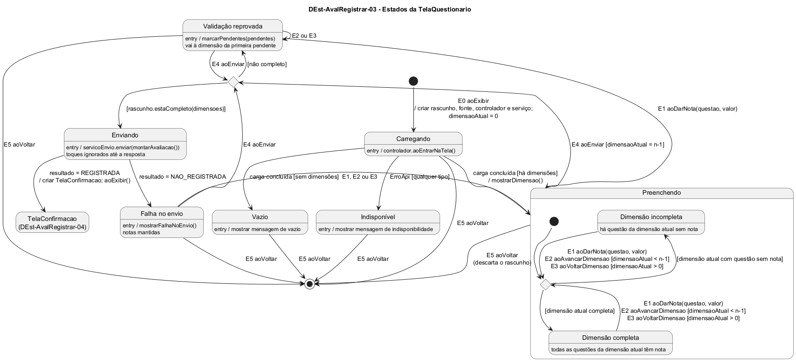

# DEst-AvalRegistrar-03 – Estados da TelaQuestionario

| Campo | Valor |
|---|---|
| **Código** | `DEst-AvalRegistrar-03` |
| **Título** | Estados da TelaQuestionario |
| **Autor(a)** | José Eduardo Gontijo de Carvalho |
| **Revisor(a)** | Maicon Brendo da Silva (Pessoa B) |
| **Status** | Em produção |
| **Rastreia para** | `DIhc-AvalRegistrar-03`, `DEst-Comum-01`, `DCla-Comum-03`, `DEst-AvalRegistrar-02`, `DEst-AvalRegistrar-04`, `DSeq-AvalRegistrar-02`, `DSeq-AvalRegistrar-03`, `DSeq-AvalRegistrar-04`, `DSeq-AvalRegistrar-05`, `DCla-AvalRegistrar-01` |

## Diagrama

Fonte: [`DEst-AvalRegistrar-03.puml`](DEst-AvalRegistrar-03.puml)

## Descrição

Especifica como a `TelaQuestionario` reage aos eventos do `DIhc-AvalRegistrar-03`. A tela é nova no projeto (não existe no app atual). A **carga do questionário** segue o ciclo genérico de tela remota do Comum (`DEst-Comum-01`, `DCla-Comum-03`): Carregando, e daí Preenchendo (que faz o papel de "Exibindo" do Comum), Vazio ou Indisponível. A apresentação de vazio e de indisponibilidade segue o padrão do Comum (P-AR-10). Não se usa `recarregar()`. O que a tela acrescenta é o preenchimento e o envio, que não passam pelo controlador do Comum: o envio é um POST tratado por `ServicoEnvioAvaliacao`, que devolve `REGISTRADA` ou `NAO_REGISTRADA`.

**Estados.**

- **Carregando:** entrada pelo E0 `aoExibir`, que cria o rascunho, a fonte, o controlador e o serviço de envio, define `dimensaoAtual = 0` e chama `controlador.aoEntrarNaTela()`. O questionário é o mesmo para qualquer UA (P-AR-3, P-AR-9).
- **Preenchendo:** a primeira dimensão está na tela. Tem dois subestados, só para destacar se a dimensão atual está completa (todas as questões com nota) ou incompleta; E1, E2 e E3 são internos e reavaliam o subestado: E1 `aoDarNota` guarda a nota (e a troca, se já havia, P-AR-13), E2 `aoAvancarDimensao` e E3 `aoVoltarDimensao` mudam `dimensaoAtual` e mostram a outra dimensão. A navegação não exige dimensão completa (P-AR-13). Notas inteiras de 0 a 5 (P-AR-5).
- **Validação reprovada:** o E4 `aoEnviar` achou questões sem nota (UC09.4); nada foi enviado, as pendentes foram marcadas em todas as dimensões, a tela foi levada à dimensão da primeira pendente e o aviso foi mostrado (P-AR-14, P-AR-28). Em E2 e E3 o usuário continua na mesma situação, para procurar as outras questões marcadas; ao dar uma nota (E1), volta a Preenchendo.
- **Enviando:** a avaliação está completa e foi entregue ao serviço de envio; a tela mostra o indicador de envio (P-AR-17) e ignora os toques, inclusive na seta de voltar, até a resposta (P-AR-27).
- **Falha no envio:** o resultado foi `NAO_REGISTRADA`; a tela mostra a falha e **mantém as notas** (P-AR-6). "Enviar" (E4) tenta de novo; qualquer E1, E2 ou E3 volta a Preenchendo.
- **Vazio e Indisponível:** do Comum. Só a seta de voltar (E5) está disponível.
- **Fim:** pelo resultado `REGISTRADA`, a tela cria a `TelaConfirmacao` e chama `aoExibir()` nela (`DEst-AvalRegistrar-04`); ou pelo E5 `aoVoltar`, que descarta o rascunho (P-AR-8) e volta à `TelaEscolherUA`.

**Tabela 1 – Transições da `TelaQuestionario`**

| Origem | Evento | Condição | Ação | Destino |
|---|---|---|---|---|
| (início) | E0 `aoExibir` | – | criar rascunho, fonte, controlador e serviço; `dimensaoAtual = 0`; `aoEntrarNaTela()` | Carregando |
| Carregando | carga concluída | há dimensões | `mostrarDimensao()` | Preenchendo |
| Carregando | carga concluída | não há dimensões | – | Vazio |
| Carregando | `ErroApi` | qualquer tipo | – | Indisponível |
| Preenchendo | E1 `aoDarNota(questao, valor)` | – | `rascunho.definirNota(questao, valor)`; atualizar a tela | Preenchendo |
| Preenchendo | E2 `aoAvancarDimensao` | `dimensaoAtual < n-1` | `dimensaoAtual` + 1; `mostrarDimensao()` | Preenchendo |
| Preenchendo | E3 `aoVoltarDimensao` | `dimensaoAtual > 0` | `dimensaoAtual` − 1; `mostrarDimensao()` | Preenchendo |
| Preenchendo, Validação reprovada ou Falha no envio | E4 `aoEnviar` | `rascunho.estaCompleto(dimensoes)` e (em Preenchendo) última dimensão | `servicoEnvio.enviar(rascunho.montarAvaliacao())` | Enviando |
| Preenchendo, Validação reprovada ou Falha no envio | E4 `aoEnviar` | não está completo | `marcarPendentes(rascunho.questoesPendentes(dimensoes))`: marca as pendentes e vai à dimensão da primeira | Validação reprovada |
| Validação reprovada | E1 `aoDarNota(questao, valor)` | – | `rascunho.definirNota(questao, valor)`; a marca da questão sai | Preenchendo |
| Validação reprovada | E2 `aoAvancarDimensao` ou E3 `aoVoltarDimensao` | como em Preenchendo | muda a dimensão; as marcas continuam | Validação reprovada |
| Falha no envio | E1, E2 ou E3 | como em Preenchendo | executa a ação do evento | Preenchendo |
| Enviando | resultado do envio | `REGISTRADA` | criar `TelaConfirmacao`; `aoExibir()` | (fim: `TelaConfirmacao`) |
| Enviando | resultado do envio | `NAO_REGISTRADA` | `mostrarFalhaNoEnvio()` | Falha no envio |
| Carregando, Preenchendo, Validação reprovada, Falha no envio, Vazio ou Indisponível | E5 `aoVoltar` | – | descartar o rascunho | (fim: `TelaEscolherUA`) |

O E4 só é oferecido na última dimensão; em Validação reprovada e em Falha no envio o usuário pode estar em qualquer dimensão e o botão aparece quando ele chega à última. Em Enviando, nenhum evento de interação é aceito. As premissas citadas estão listadas, com os itens que as citam, em [`README.md`](README.md).

## Referências

INSTITUTE OF ELECTRICAL AND ELECTRONICS ENGINEERS. **Guide to the Software Engineering Body of Knowledge – SWEBOK v4**. Cap. 11 (Software Engineering Models and Methods). IEEE, 2024.

ANTHROPIC. **Claude Code**. Assistente de IA. Disponível em: claude.ai/code. Acesso em: 30 out. 2026. Uso: rascunho do texto e dos diagramas a partir da especificação e das instruções do autor, que revisou o conteúdo. Questão: Apêndice <X>, Seção <X.1>.

---

## Registro de revisão

| Data | Revisor(a) | Situação | Observações |
|---|---|---|---|
| | | | |
