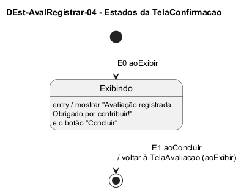

# DEst-AvalRegistrar-04 – Estados da TelaConfirmacao

| Campo | Valor |
|---|---|
| **Código** | `DEst-AvalRegistrar-04` |
| **Título** | Estados da TelaConfirmacao |
| **Autor(a)** | José Eduardo Gontijo de Carvalho |
| **Revisor(a)** | Maicon Brendo da Silva (Pessoa B) |
| **Status** | Em produção |
| **Rastreia para** | `DIhc-AvalRegistrar-04`, `DEst-AvalRegistrar-01`, `DEst-AvalRegistrar-03`, `DSeq-AvalRegistrar-05`, `DCla-AvalRegistrar-01` |

## Diagrama

Fonte: [`DEst-AvalRegistrar-04.puml`](DEst-AvalRegistrar-04.puml)

## Descrição

Especifica como a `TelaConfirmacao` reage aos eventos do `DIhc-AvalRegistrar-04`. A tela é nova no projeto (não existe no app atual) e não tem conteúdo remoto: não usa os estados de tela remota do Comum (`DEst-Comum-01`) e tem um único estado, **Exibindo**.

- **E0 `aoExibir`:** a tela é criada pela `TelaQuestionario` quando o envio resulta em `REGISTRADA` (`DEst-AvalRegistrar-03`, `DSeq-AvalRegistrar-05`) e mostra a mensagem de confirmação e o botão "Concluir" (P-AR-15).
- **E1 `aoConcluir`:** encerra o registro e volta à `TelaAvaliacao`, que reage com o seu E0 (`DEst-AvalRegistrar-01`). A tela não tem seta de voltar, portanto E1 é a única saída (P-AR-19).

**Tabela 1 – Transições da `TelaConfirmacao`**

| Origem | Evento | Condição | Ação | Destino |
|---|---|---|---|---|
| (início) | E0 `aoExibir` | – | mostrar "Avaliação registrada. Obrigado por contribuir!" e o botão "Concluir" | Exibindo |
| Exibindo | E1 `aoConcluir` | – | voltar à `TelaAvaliacao` (`aoExibir`), descartando as telas intermediárias | (fim) |

As premissas citadas estão listadas, com os itens que as citam, em [`README.md`](README.md).

## Referências

INSTITUTE OF ELECTRICAL AND ELECTRONICS ENGINEERS. **Guide to the Software Engineering Body of Knowledge – SWEBOK v4**. Cap. 11 (Software Engineering Models and Methods). IEEE, 2024.

ANTHROPIC. **Claude Code**. Assistente de IA. Disponível em: claude.ai/code. Acesso em: 30 out. 2026. Uso: rascunho do texto e dos diagramas a partir da especificação e das instruções do autor, que revisou o conteúdo. Questão: Apêndice <X>, Seção <X.1>.

---

## Registro de revisão

| Data | Revisor(a) | Situação | Observações |
|---|---|---|---|
| | | | |
