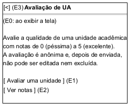

# DIhc-AvalRegistrar-01 – Tela de entrada da avaliação de UA (TelaAvaliacao)

| Campo | Valor |
|---|---|
| **Código** | `DIhc-AvalRegistrar-01` |
| **Título** | Tela de entrada da avaliação de UA (TelaAvaliacao) |
| **Autor(a)** | José Eduardo Gontijo de Carvalho |
| **Revisor(a)** | Maicon Brendo da Silva (Pessoa B) |
| **Status** | Em produção |
| **Rastreia para** | `DCdu-AvalRegistrar-01`, `DIhc-Inicio-01`, `DAtv-AvalRegistrar-01`, `DEst-AvalRegistrar-01`, `DSeq-AvalRegistrar-01`, `DCla-AvalRegistrar-01` |

## Diagrama

Fonte: [`DIhc-AvalRegistrar-01.puml`](DIhc-AvalRegistrar-01.puml)

## Descrição

Protótipo da `TelaAvaliacao`, a tela aberta pelo cartão "Avaliação de UA" da tela inicial (E9 do `DIhc-Inicio-01`). **Esta tela não existe no app atual**: a avaliação de UA é a funcionalidade nova do projeto, e o protótipo parte do enunciado e do contrato-base, sem captura de tela. O desenho está em PlantUML Salt e mostra a barra de título, com a seta de voltar e o nome da tela, um texto de apresentação (P-AR-16) e dois botões. Os rótulos `(E0)` a `(E3)` marcam os eventos de interação.

A definição desta tela como ponto de entrada de `AvalRegistrar` e `AvalConsultar` é decisão da especificação do projeto (P-AR-1), a confirmar com Phablo Tavares Paixão (Pessoa D), responsável por `AvalConsultar`. O botão "Ver notas" abre a tela de `AvalConsultar`, que fica fora do escopo desta pasta e só é referenciada.

**Tabela 1 – Eventos de interação da `TelaAvaliacao`**

| Rótulo | Elemento | Gesto | Operação da tela | Efeito | Atividade e DSeq |
|---|---|---|---|---|---|
| E0 | Tela (ao ser exibida) | Entrada na tela ou retorno a ela | `aoExibir()` | Mostra a tela com os dois botões; não há conteúdo remoto | – (navegação trivial) |
| E1 | Botão "Avaliar uma unidade" | Toque | `aoTocarAvaliar()` | Cria a `TelaEscolherUA` e inicia o carregamento da lista de UAs (`DIhc-AvalRegistrar-02`) | `DAtv-AvalRegistrar-01`, A1; `DSeq-AvalRegistrar-01` |
| E2 | Botão "Ver notas" | Toque | `aoTocarConsultar()` | Abre a tela de `AvalConsultar` (fora do escopo desta pasta) | – (`AvalConsultar`) |
| E3 | Seta de voltar | Toque | `aoVoltar()` | Volta ao menu (tela inicial) | – (navegação trivial) |

O evento E0 ocorre também ao voltar da `TelaEscolherUA` (seta de voltar) e da `TelaConfirmacao` ("Concluir", `DIhc-AvalRegistrar-04`). A tela não tem conteúdo remoto: não usa os estados de tela remota do Comum (`DEst-Comum-01`), e seus estados estão no `DEst-AvalRegistrar-01`.

## Referências

INSTITUTE OF ELECTRICAL AND ELECTRONICS ENGINEERS. **Guide to the Software Engineering Body of Knowledge – SWEBOK v4**. Cap. 11 (Software Engineering Models and Methods). IEEE, 2024.

ANTHROPIC. **Claude Code**. Assistente de IA. Disponível em: claude.ai/code. Acesso em: 30 out. 2026. Uso: rascunho do texto e dos diagramas a partir da especificação e das instruções do autor, que revisou o conteúdo. Questão: Apêndice <X>, Seção <X.1>.

---

## Registro de revisão

| Data | Revisor(a) | Situação | Observações |
|---|---|---|---|
| | | | |
