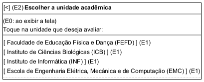

# DIhc-AvalRegistrar-02 – Tela de escolha da unidade acadêmica (TelaEscolherUA)

| Campo | Valor |
|---|---|
| **Código** | `DIhc-AvalRegistrar-02` |
| **Título** | Tela de escolha da unidade acadêmica (TelaEscolherUA) |
| **Autor(a)** | José Eduardo Gontijo de Carvalho |
| **Revisor(a)** | Maicon Brendo da Silva (Pessoa B) |
| **Status** | Em produção |
| **Rastreia para** | `DCdu-AvalRegistrar-01`, `DIhc-AvalRegistrar-01`, `DAtv-AvalRegistrar-01`, `DEst-AvalRegistrar-02`, `DEst-Comum-01`, `DSeq-AvalRegistrar-01`, `DSeq-AvalRegistrar-02`, `DCla-AvalRegistrar-01`, `DD-Locais-01` |

## Diagrama

Fonte: [`DIhc-AvalRegistrar-02.puml`](DIhc-AvalRegistrar-02.puml)

## Descrição

Protótipo da `TelaEscolherUA`. **Esta tela não existe no app atual**: é parte da funcionalidade nova de avaliação de UA, modelada a partir do enunciado, sem captura de tela. O desenho em PlantUML Salt mostra a barra de título com a seta de voltar e a lista de unidades acadêmicas, cada uma com nome e sigla. Os nomes do desenho são ilustrativos; a lista real vem do Servidor/API, com a entidade `UnidadeAcademica` de `DD-Locais-01` (P-AR-2). A lista é exibida na ordem recebida (P-AR-25), sem busca nem filtro (P-AR-18).

**Tabela 1 – Eventos de interação da `TelaEscolherUA`**

| Rótulo | Elemento | Gesto | Operação da tela | Efeito | Atividade e DSeq |
|---|---|---|---|---|---|
| E0 | Tela (ao ser exibida) | Entrada na tela ou retorno a ela | `aoExibir()` | Carrega a lista de UAs (`obter("/unidades-academicas", {})`) e mostra o resultado | `DAtv-AvalRegistrar-01`, A1; `DSeq-AvalRegistrar-01` |
| E1 | Unidade acadêmica da lista | Toque | `aoEscolherUA(unidade)` | Guarda a UA escolhida, cria a `TelaQuestionario` e passa ao questionário (`DIhc-AvalRegistrar-03`) | `DAtv-AvalRegistrar-01`, A2; `DSeq-AvalRegistrar-02` |
| E2 | Seta de voltar | Toque | `aoVoltar()` | Volta à `TelaAvaliacao` (`DIhc-AvalRegistrar-01`) | – (navegação trivial) |

O evento E0 ocorre sempre que a tela é exibida, inclusive ao voltar do questionário; como o app não guarda cache, a lista é carregada de novo.

**Estados de carga.** A tela segue o ciclo genérico de tela remota do Comum (`DEst-Comum-01`): Carregando, Exibindo, Vazio e Indisponível, tratados no `DEst-AvalRegistrar-02`. Não há protótipo separado para eles: no lugar da lista, a tela mostra o indicador de carregamento, a mensagem de vazio ou a mensagem de indisponibilidade, com os textos do padrão do Comum (P-AR-10). O evento E1 só existe quando a lista é exibida; a seta de voltar (E2) existe em todos os estados.

## Referências

INSTITUTE OF ELECTRICAL AND ELECTRONICS ENGINEERS. **Guide to the Software Engineering Body of Knowledge – SWEBOK v4**. Cap. 11 (Software Engineering Models and Methods). IEEE, 2024.

ANTHROPIC. **Claude Code**. Assistente de IA. Disponível em: claude.ai/code. Acesso em: 30 out. 2026. Uso: rascunho do texto e dos diagramas a partir da especificação e das instruções do autor, que revisou o conteúdo. Questão: Apêndice <X>, Seção <X.1>.

---

## Registro de revisão

| Data | Revisor(a) | Situação | Observações |
|---|---|---|---|
| | | | |
