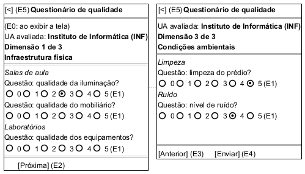

# DIhc-AvalRegistrar-03 – Tela do questionário de qualidade (TelaQuestionario)

| Campo | Valor |
|---|---|
| **Código** | `DIhc-AvalRegistrar-03` |
| **Título** | Tela do questionário de qualidade (TelaQuestionario) |
| **Autor(a)** | José Eduardo Gontijo de Carvalho |
| **Revisor(a)** | Maicon Brendo da Silva (Pessoa B) |
| **Status** | Em produção |
| **Rastreia para** | `DCdu-AvalRegistrar-01`, `DIhc-AvalRegistrar-02`, `DIhc-AvalRegistrar-04`, `DAtv-AvalRegistrar-02`, `DAtv-AvalRegistrar-03`, `DEst-AvalRegistrar-03`, `DEst-Comum-01`, `DSeq-AvalRegistrar-02`, `DSeq-AvalRegistrar-03`, `DSeq-AvalRegistrar-04`, `DSeq-AvalRegistrar-05`, `DCla-AvalRegistrar-01` |

## Diagrama

Fonte: [`DIhc-AvalRegistrar-03.puml`](DIhc-AvalRegistrar-03.puml)

## Descrição

Protótipo da `TelaQuestionario`. **Esta tela não existe no app atual**: é parte da funcionalidade nova de avaliação de UA, modelada a partir do enunciado, sem captura de tela. O desenho em PlantUML Salt mostra duas variantes da mesma tela: à esquerda uma dimensão que não é a última (aqui a primeira, "Dimensão 1 de 3", sem "Anterior" e com "Próxima"), à direita a última dimensão ("Dimensão 3 de 3", com "Anterior" e "Enviar"). Os dados do desenho são ilustrativos.

A tela mostra **uma dimensão de qualidade por vez** (P-AR-4): a barra de título com a seta de voltar, o nome da UA avaliada, o indicador "Dimensão k de n", o nome da dimensão, os elementos educacionais da dimensão e, sob cada elemento, as suas questões. Cada questão tem um seletor de nota com seis opções, de 0 (péssima) a 5 (excelente), e nenhuma vem pré-selecionada (P-AR-5, P-AR-13). Os botões variam com a posição da dimensão:

| Botão | Aparece | Evento |
|---|---|---|
| "Anterior" | da segunda dimensão em diante (oculto na primeira) | E3 |
| "Próxima" | nas dimensões que não são a última | E2 |
| "Enviar" | só na última dimensão | E4 |

As dimensões, elementos e questões vêm do Servidor/API (P-AR-3) e são os mesmos para qualquer UA (P-AR-9). Os rótulos `(E0)` a `(E5)` marcam os eventos de interação.

**Tabela 1 – Eventos de interação da `TelaQuestionario`**

| Rótulo | Elemento | Gesto | Operação da tela | Efeito | Atividade e DSeq |
|---|---|---|---|---|---|
| E0 | Tela (ao ser exibida) | Entrada na tela | `aoExibir()` | Cria o rascunho e o serviço de envio, carrega o questionário e mostra a primeira dimensão | `DAtv-AvalRegistrar-01`, A2; `DSeq-AvalRegistrar-02` |
| E1 | Opção de nota (0 a 5) de uma questão | Toque | `aoDarNota(questao, valor)` | Guarda a nota no rascunho e destaca a opção escolhida; um novo toque na mesma questão troca a nota (P-AR-13); sem chamada ao servidor | `DAtv-AvalRegistrar-02`, A1; `DSeq-AvalRegistrar-03` |
| E2 | Botão "Próxima" | Toque | `aoAvancarDimensao()` | Mostra a dimensão seguinte | `DAtv-AvalRegistrar-02`, A2; `DSeq-AvalRegistrar-04` |
| E3 | Botão "Anterior" | Toque | `aoVoltarDimensao()` | Mostra a dimensão anterior, com as notas já dadas | `DAtv-AvalRegistrar-02`, A2; `DSeq-AvalRegistrar-04` |
| E4 | Botão "Enviar" | Toque | `aoEnviar()` | Valida o preenchimento e, se aprovado, envia a avaliação | `DAtv-AvalRegistrar-03`, A1; `DSeq-AvalRegistrar-05` |
| E5 | Seta de voltar | Toque | `aoVoltar()` | Abandona a avaliação, descarta as notas (P-AR-8) e volta à `TelaEscolherUA` | – (navegação trivial) |

O evento E0 ocorre uma só vez por avaliação: ao voltar do questionário, quem é exibida de novo é a `TelaEscolherUA`, e escolher uma UA cria um questionário e um rascunho novos. Não há aviso de confirmação ao sair (P-AR-8).

**Validação reprovada.** Se, ao tocar em "Enviar" (E4), há questões sem nota (P-AR-5), o app não envia nada: marca as questões pendentes e mostra um aviso do tipo "Faltam N questões sem nota" (P-AR-14, P-AR-15). A tela vai à dimensão da primeira questão pendente (P-AR-28), e as marcas valem para todas as dimensões; o usuário dá as notas que faltam (E1) e navega com "Anterior" e "Próxima" (E3, E2) até as outras dimensões marcadas. A marca de uma questão some quando ela recebe nota. Depois, volta à última dimensão e toca em "Enviar" de novo.

**Envio e falha no envio.** Com o preenchimento completo, o app mostra o indicador de envio (P-AR-17) e ignora os toques nos botões e na seta de voltar até a resposta, para que não haja envio duplicado (P-AR-27). Se o servidor não registrar a avaliação, a tela volta a ficar ativa, mostra a mensagem de falha (P-AR-15) e **mantém todas as notas** (P-AR-6); o usuário pode tocar em "Enviar" de novo (E4) ou mudar notas antes. Se o servidor registrar, o app abre a `TelaConfirmacao` (`DIhc-AvalRegistrar-04`).

**Estados de carga.** A carga do questionário segue o ciclo genérico do Comum (`DEst-Comum-01`): indicador de carregamento, mensagem de vazio (questionário sem dimensões) e mensagem de indisponibilidade, com a apresentação do padrão do Comum (P-AR-10). Nesses três casos não há notas para dar, e só a seta de voltar (E5) está disponível. Os estados estão no `DEst-AvalRegistrar-03`.

## Referências

INSTITUTE OF ELECTRICAL AND ELECTRONICS ENGINEERS. **Guide to the Software Engineering Body of Knowledge – SWEBOK v4**. Cap. 11 (Software Engineering Models and Methods). IEEE, 2024.

ANTHROPIC. **Claude Code**. Assistente de IA. Disponível em: claude.ai/code. Acesso em: 30 out. 2026. Uso: rascunho do texto e dos diagramas a partir da especificação e das instruções do autor, que revisou o conteúdo. Questão: Apêndice <X>, Seção <X.1>.

---

## Registro de revisão

| Data | Revisor(a) | Situação | Observações |
|---|---|---|---|
| | | | |
