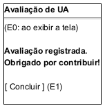

# DIhc-AvalRegistrar-04 – Tela de confirmação da avaliação (TelaConfirmacao)

| Campo | Valor |
|---|---|
| **Código** | `DIhc-AvalRegistrar-04` |
| **Título** | Tela de confirmação da avaliação (TelaConfirmacao) |
| **Autor(a)** | José Eduardo Gontijo de Carvalho |
| **Revisor(a)** | Maicon Brendo da Silva (Pessoa B) |
| **Status** | Em produção |
| **Rastreia para** | `DCdu-AvalRegistrar-01`, `DIhc-AvalRegistrar-01`, `DIhc-AvalRegistrar-03`, `DAtv-AvalRegistrar-03`, `DEst-AvalRegistrar-04`, `DSeq-AvalRegistrar-05`, `DCla-AvalRegistrar-01` |

## Diagrama

Fonte: [`DIhc-AvalRegistrar-04.puml`](DIhc-AvalRegistrar-04.puml)

## Descrição

Protótipo da `TelaConfirmacao`, mostrada quando o servidor registra a avaliação. **Esta tela não existe no app atual**: é parte da funcionalidade nova de avaliação de UA, modelada a partir do enunciado, sem captura de tela. O desenho em PlantUML Salt mostra a barra de título, a mensagem "Avaliação registrada. Obrigado por contribuir!" (P-AR-15) e o botão "Concluir".

A tela **não tem seta de voltar** (P-AR-19): a avaliação já foi registrada e não pode ser editada nem excluída (contrato-base, seção 8), então não há para onde voltar no questionário, cujas notas já foram enviadas e descartadas. A única saída é "Concluir".

**Tabela 1 – Eventos de interação da `TelaConfirmacao`**

| Rótulo | Elemento | Gesto | Operação da tela | Efeito | Atividade e DSeq |
|---|---|---|---|---|---|
| E0 | Tela (ao ser exibida) | Entrada na tela, após o envio registrado | `aoExibir()` | Mostra a mensagem de confirmação e o botão "Concluir" | `DAtv-AvalRegistrar-03`, A1; `DSeq-AvalRegistrar-05` |
| E1 | Botão "Concluir" | Toque | `aoConcluir()` | Encerra o registro e volta à `TelaAvaliacao` (`DIhc-AvalRegistrar-01`), descartando as telas intermediárias (P-AR-19) | – (navegação trivial) |

A tela não tem conteúdo remoto nem estados de carga; seus estados estão no `DEst-AvalRegistrar-04`.

## Referências

INSTITUTE OF ELECTRICAL AND ELECTRONICS ENGINEERS. **Guide to the Software Engineering Body of Knowledge – SWEBOK v4**. Cap. 11 (Software Engineering Models and Methods). IEEE, 2024.

ANTHROPIC. **Claude Code**. Assistente de IA. Disponível em: claude.ai/code. Acesso em: 30 out. 2026. Uso: rascunho do texto e dos diagramas a partir da especificação e das instruções do autor, que revisou o conteúdo. Questão: Apêndice <X>, Seção <X.1>.

---

## Registro de revisão

| Data | Revisor(a) | Situação | Observações |
|---|---|---|---|
| | | | |
