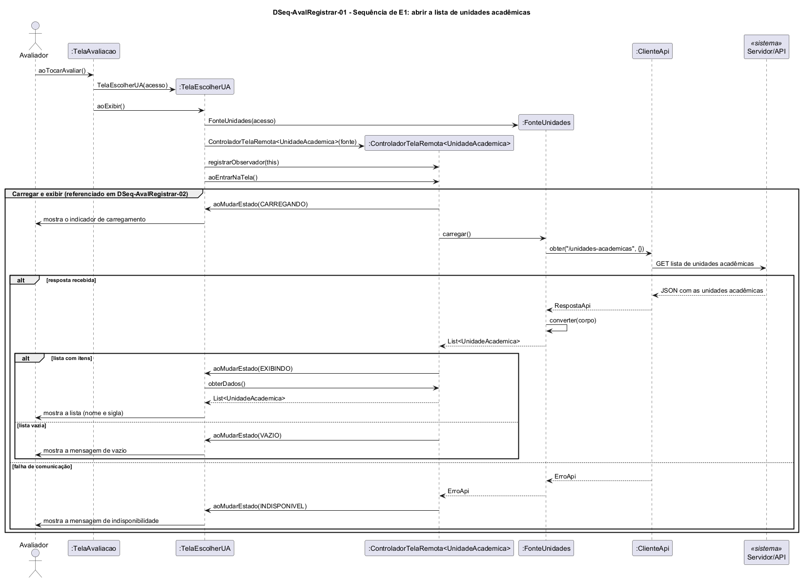

# DSeq-AvalRegistrar-01 – Sequência de E1: abrir a lista de unidades acadêmicas

| Campo | Valor |
|---|---|
| **Código** | `DSeq-AvalRegistrar-01` |
| **Título** | Sequência de E1: abrir a lista de unidades acadêmicas |
| **Autor(a)** | José Eduardo Gontijo de Carvalho |
| **Revisor(a)** | Maicon Brendo da Silva (Pessoa B) |
| **Status** | Em produção |
| **Rastreia para** | `DCdu-AvalRegistrar-01`, `DAtv-AvalRegistrar-01`, `DIhc-AvalRegistrar-01`, `DIhc-AvalRegistrar-02`, `DCla-AvalRegistrar-01`, `DCla-AvalRegistrar-02`, `DCla-Comum-02`, `DCla-Comum-03`, `DEst-Comum-01`, `Contrato-AvalRegistrar-01` |

## Diagrama

Fonte: [`DSeq-AvalRegistrar-01.puml`](DSeq-AvalRegistrar-01.puml)

## Descrição

Detalha a ação A1 "abrir a lista de unidades acadêmicas" do `DAtv-AvalRegistrar-01` (caso de uso UC09.1 do `DCdu-AvalRegistrar-01`), disparada pelo evento E1 do `DIhc-AvalRegistrar-01`: o Avaliador toca em "Avaliar uma unidade" na `TelaAvaliacao`.

**Mensagens.** A `TelaAvaliacao` chama `aoTocarAvaliar()`, cria a `TelaEscolherUA(acesso)` e a exibe com `aoExibir()` (entrada na tela). Na entrada, a `TelaEscolherUA` cria a `FonteUnidades(acesso)` e o `ControladorTelaRemota<UnidadeAcademica>(fonte)` do Comum (`DCla-Comum-03`), registra-se como observador (`registrarObservador(this)`) e só então chama `aoEntrarNaTela()`, de modo que recebe todas as mudanças de estado desde `CARREGANDO`. A criação segue o `DCla-AvalRegistrar-01` e o `Contrato-AvalRegistrar-01`.

**Carregar e exibir.** O grupo "Carregar e exibir" é o ciclo genérico do `DEst-Comum-01`: o controlador avisa `CARREGANDO`, chama `FonteUnidades.carregar()`, que faz uma única chamada `obter("/unidades-academicas", {})` ao Servidor/API por meio de `IAcessoApi` (implementada por `ClienteApi`, `DCla-Comum-02`) e converte o JSON em `List<UnidadeAcademica>` (`DCla-AvalRegistrar-02`). Os três desfechos são:

- lista com itens: `EXIBINDO`; a tela pede `obterDados()` ao controlador e mostra a lista com nome e sigla de cada unidade;
- lista vazia: `VAZIO`; a tela mostra a mensagem de vazio;
- falha de comunicação (ou resposta ilegível, `RESPOSTA_INVALIDA`): a `ClienteApi` ou a fonte lança `ErroApi`, que o controlador trata e não repassa à tela (`Contrato-Comum-03`); estado `INDISPONIVEL` e mensagem de indisponibilidade.

Não há `recarregar()`: a lista não tem filtro. O grupo é referenciado no `DSeq-AvalRegistrar-02`, que o reutiliza para carregar o questionário.

**Premissas.** P-AR-1 (a `TelaAvaliacao` é a tela aberta pelo cartão "Avaliação de UA" e oferece "Avaliar uma unidade"); P-AR-2 (a lista de UAs vem do Servidor/API); P-AR-10 (mensagens de vazio e de indisponibilidade seguem o padrão do Comum, pois não são observáveis); P-AR-11 (a rota `GET /unidades-academicas` e o formato JSON são premissa de projeto).

## Referências

INSTITUTE OF ELECTRICAL AND ELECTRONICS ENGINEERS. **Guide to the Software Engineering Body of Knowledge – SWEBOK v4**. Cap. 11 (Software Engineering Models and Methods). IEEE, 2024.

ANTHROPIC. **Claude Code**. Assistente de IA. Disponível em: claude.ai/code. Acesso em: 30 out. 2026. Uso: rascunho do texto e dos diagramas a partir da especificação e das instruções do autor, que revisou o conteúdo. Questão: Apêndice <X>, Seção <X.1>.

---

## Registro de revisão

| Data | Revisor(a) | Situação | Observações |
|---|---|---|---|
| | | | |
