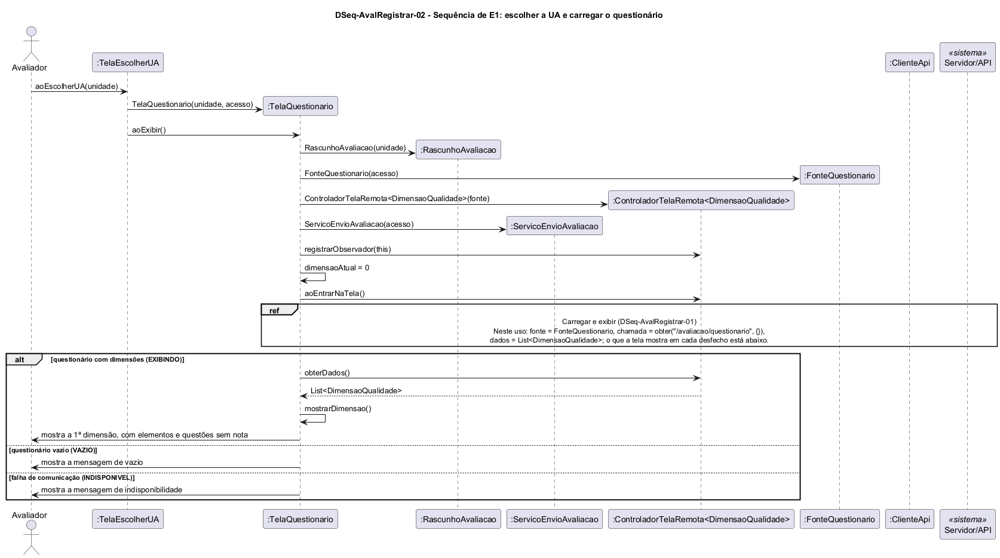

# DSeq-AvalRegistrar-02 – Sequência de E1: escolher a UA e carregar o questionário

| Campo | Valor |
|---|---|
| **Código** | `DSeq-AvalRegistrar-02` |
| **Título** | Sequência de E1: escolher a UA e carregar o questionário |
| **Autor(a)** | José Eduardo Gontijo de Carvalho |
| **Revisor(a)** | Maicon Brendo da Silva (Pessoa B) |
| **Status** | Em produção |
| **Rastreia para** | `DCdu-AvalRegistrar-01`, `DAtv-AvalRegistrar-01`, `DIhc-AvalRegistrar-02`, `DIhc-AvalRegistrar-03`, `DCla-AvalRegistrar-01`, `DCla-AvalRegistrar-03`, `DCla-AvalRegistrar-04`, `DCla-Comum-02`, `DCla-Comum-03`, `DEst-Comum-01`, `DSeq-AvalRegistrar-01`, `Contrato-AvalRegistrar-01` |

## Diagrama

Fonte: [`DSeq-AvalRegistrar-02.puml`](DSeq-AvalRegistrar-02.puml)

## Descrição

Detalha a ação A2 "escolher a UA" do `DAtv-AvalRegistrar-01` (UC09.1, passo final, e início do UC09.2 do `DCdu-AvalRegistrar-01`), disparada pelo evento E1 do `DIhc-AvalRegistrar-02`: o Avaliador toca em uma unidade da lista e a `TelaEscolherUA` recebe `aoEscolherUA(unidade)`.

**Mensagens.** A `TelaEscolherUA` cria a `TelaQuestionario(unidade, acesso)` e a exibe com `aoExibir()`. Na entrada, a `TelaQuestionario` cria, nesta ordem: o `RascunhoAvaliacao(unidade)`, que guardará as notas em memória; a `FonteQuestionario(acesso)`; o `ControladorTelaRemota<DimensaoQualidade>(fonte)` do Comum; e o `ServicoEnvioAvaliacao(acesso)`, usado só no envio (`DSeq-AvalRegistrar-05`). Depois registra-se como observador (`registrarObservador(this)`), define `dimensaoAtual = 0` e chama `aoEntrarNaTela()`. O rascunho nasce sem notas e vive só enquanto a tela existir (P-AR-8, tratada no `DSeq-AvalRegistrar-03`).

**Carregar e exibir.** O ciclo de carga é o grupo "Carregar e exibir" do `DSeq-AvalRegistrar-01`, referenciado por `ref`, com estas substituições: a fonte é a `FonteQuestionario` (`DCla-AvalRegistrar-03`), a chamada é `obter("/avaliacao/questionario", {})` e o resultado é `List<DimensaoQualidade>`. O questionário é o mesmo para qualquer UA, por isso a chamada não leva parâmetros (P-AR-9), e é buscado de novo a cada avaliação, sem cache (P-AR-3). O que a tela faz em cada desfecho está no `alt` após o `ref`:

- `EXIBINDO`: a tela pede `obterDados()`, chama `mostrarDimensao()` e mostra a primeira dimensão (nome da UA, "Dimensão 1 de n", elementos e questões, ainda sem nota), conforme o `DIhc-AvalRegistrar-03` e a apresentação dimensão por dimensão (P-AR-4);
- `VAZIO`: mensagem de vazio;
- `INDISPONIVEL`: mensagem de indisponibilidade; o `ErroApi` é tratado pelo controlador (`Contrato-Comum-03`).

**Premissas.** P-AR-3, P-AR-4 e P-AR-9, citadas acima; P-AR-8 (rascunho só em memória); P-AR-10 (mensagens de vazio e de indisponibilidade no padrão do Comum); P-AR-11 (rota `GET /avaliacao/questionario` e formato JSON não observáveis).

## Referências

INSTITUTE OF ELECTRICAL AND ELECTRONICS ENGINEERS. **Guide to the Software Engineering Body of Knowledge – SWEBOK v4**. Cap. 11 (Software Engineering Models and Methods). IEEE, 2024.

ANTHROPIC. **Claude Code**. Assistente de IA. Disponível em: claude.ai/code. Acesso em: 30 out. 2026. Uso: rascunho do texto e dos diagramas a partir da especificação e das instruções do autor, que revisou o conteúdo. Questão: Apêndice <X>, Seção <X.1>.

---

## Registro de revisão

| Data | Revisor(a) | Situação | Observações |
|---|---|---|---|
| | | | |
