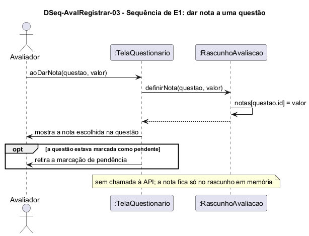

# DSeq-AvalRegistrar-03 – Sequência de E1: dar nota a uma questão

| Campo | Valor |
|---|---|
| **Código** | `DSeq-AvalRegistrar-03` |
| **Título** | Sequência de E1: dar nota a uma questão |
| **Autor(a)** | José Eduardo Gontijo de Carvalho |
| **Revisor(a)** | Maicon Brendo da Silva (Pessoa B) |
| **Status** | Em produção |
| **Rastreia para** | `DCdu-AvalRegistrar-01`, `DAtv-AvalRegistrar-02`, `DIhc-AvalRegistrar-03`, `DEst-AvalRegistrar-03`, `DCla-AvalRegistrar-01`, `Contrato-AvalRegistrar-01` |

## Diagrama

Fonte: [`DSeq-AvalRegistrar-03.puml`](DSeq-AvalRegistrar-03.puml)

## Descrição

Detalha a ação A1 "dar nota a uma questão" do `DAtv-AvalRegistrar-02` (UC09.2 do `DCdu-AvalRegistrar-01`), disparada pelo evento E1 do `DIhc-AvalRegistrar-03`: o Avaliador toca em uma das seis notas (0 a 5) de uma questão e a `TelaQuestionario` recebe `aoDarNota(questao, valor)`.

**Mensagens.** A tela chama `RascunhoAvaliacao.definirNota(questao, valor)`, que guarda o valor em `notas`, indexado pelo id da questão; se já havia nota, ela é substituída, o que permite ao Avaliador mudar de ideia antes de enviar. Em seguida a tela atualiza o seletor da questão. Se a questão estava marcada como pendente por uma validação reprovada (`DSeq-AvalRegistrar-05`), a marcação é retirada e a tela volta ao estado Preenchendo (`DEst-AvalRegistrar-03`).

**Sem servidor.** Nenhuma mensagem chega à `IAcessoApi` nem ao Servidor/API: a nota fica apenas no rascunho em memória e só será enviada no `DSeq-AvalRegistrar-05`. Se o Avaliador sair da avaliação, o rascunho é descartado e nada é guardado (P-AR-8).

**Premissas.** P-AR-5 (a nota é um inteiro de 0 a 5, e é a tela, com seis opções fixas, que garante esse domínio) e P-AR-8 (nada é persistido).

## Referências

INSTITUTE OF ELECTRICAL AND ELECTRONICS ENGINEERS. **Guide to the Software Engineering Body of Knowledge – SWEBOK v4**. Cap. 11 (Software Engineering Models and Methods). IEEE, 2024.

ANTHROPIC. **Claude Code**. Assistente de IA. Disponível em: claude.ai/code. Acesso em: 30 out. 2026. Uso: rascunho do texto e dos diagramas a partir da especificação e das instruções do autor, que revisou o conteúdo. Questão: Apêndice <X>, Seção <X.1>.

---

## Registro de revisão

| Data | Revisor(a) | Situação | Observações |
|---|---|---|---|
| | | | |
