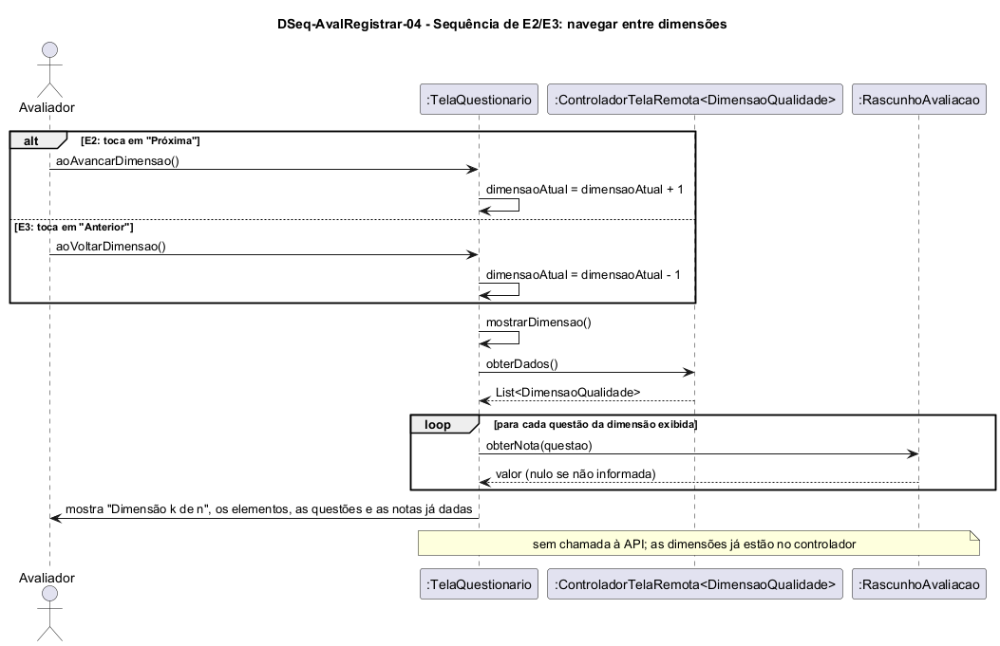

# DSeq-AvalRegistrar-04 – Sequência de E2/E3: navegar entre dimensões

| Campo | Valor |
|---|---|
| **Código** | `DSeq-AvalRegistrar-04` |
| **Título** | Sequência de E2/E3: navegar entre dimensões |
| **Autor(a)** | José Eduardo Gontijo de Carvalho |
| **Revisor(a)** | Maicon Brendo da Silva (Pessoa B) |
| **Status** | Em produção |
| **Rastreia para** | `DCdu-AvalRegistrar-01`, `DAtv-AvalRegistrar-02`, `DIhc-AvalRegistrar-03`, `DEst-AvalRegistrar-03`, `DCla-AvalRegistrar-01`, `DCla-Comum-03`, `Contrato-AvalRegistrar-01` |

## Diagrama

Fonte: [`DSeq-AvalRegistrar-04.puml`](DSeq-AvalRegistrar-04.puml)

## Descrição

Detalha a ação A2 "navegar entre dimensões" do `DAtv-AvalRegistrar-02` (UC09.2 do `DCdu-AvalRegistrar-01`). O `alt` reúne os dois eventos do `DIhc-AvalRegistrar-03`: E2, toque em "Próxima" (`aoAvancarDimensao()`), e E3, toque em "Anterior" (`aoVoltarDimensao()`). Os botões só aparecem onde cabem (sem "Anterior" na primeira dimensão e sem "Próxima" na última), então `dimensaoAtual` nunca sai do intervalo de 0 a n-1.

**Mensagens.** Em cada ramo a `TelaQuestionario` soma ou subtrai 1 de `dimensaoAtual` (índice a partir de 0) e chama a operação privada `mostrarDimensao()`. Esta obtém as dimensões com `obterDados()` do `ControladorTelaRemota<DimensaoQualidade>` e, para cada questão da dimensão exibida, consulta `RascunhoAvaliacao.obterNota(questao)` (nulo se não informada), de modo que o Avaliador vê as notas já dadas ao voltar a uma dimensão anterior e pode alterá-las (`DSeq-AvalRegistrar-03`). A tela mostra "Dimensão k de n", o nome da dimensão, seus elementos e questões.

**Sem servidor.** Navegar não chama a API: as dimensões já foram carregadas na entrada da tela (`DSeq-AvalRegistrar-02`) e ficam no controlador. O estado do controlador permanece `EXIBINDO` (`DEst-Comum-01`); a navegação é interna ao estado Preenchendo do `DEst-AvalRegistrar-03`.

**Premissas.** P-AR-4 (questionário dimensão por dimensão, com navegação para frente e para trás), P-AR-3 (as dimensões vêm do servidor a cada avaliação, sem cache, e não são pedidas de novo ao navegar) e P-AR-8 (as notas só existem em memória).

## Referências

INSTITUTE OF ELECTRICAL AND ELECTRONICS ENGINEERS. **Guide to the Software Engineering Body of Knowledge – SWEBOK v4**. Cap. 11 (Software Engineering Models and Methods). IEEE, 2024.

ANTHROPIC. **Claude Code**. Assistente de IA. Disponível em: claude.ai/code. Acesso em: 30 out. 2026. Uso: rascunho do texto e dos diagramas a partir da especificação e das instruções do autor, que revisou o conteúdo. Questão: Apêndice <X>, Seção <X.1>.

---

## Registro de revisão

| Data | Revisor(a) | Situação | Observações |
|---|---|---|---|
| | | | |
