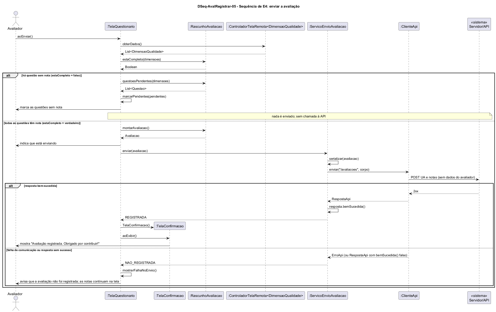

# DSeq-AvalRegistrar-05 – Sequência de E4: enviar a avaliação

| Campo | Valor |
|---|---|
| **Código** | `DSeq-AvalRegistrar-05` |
| **Título** | Sequência de E4: enviar a avaliação |
| **Autor(a)** | José Eduardo Gontijo de Carvalho |
| **Revisor(a)** | Maicon Brendo da Silva (Pessoa B) |
| **Status** | Em produção |
| **Rastreia para** | `DCdu-AvalRegistrar-01`, `DAtv-AvalRegistrar-03`, `DIhc-AvalRegistrar-03`, `DIhc-AvalRegistrar-04`, `DEst-AvalRegistrar-03`, `DCla-AvalRegistrar-01`, `DCla-AvalRegistrar-04`, `DCla-Comum-02`, `Contrato-AvalRegistrar-01` |

## Diagrama

Fonte: [`DSeq-AvalRegistrar-05.puml`](DSeq-AvalRegistrar-05.puml)

## Descrição

Detalha a ação A1 "enviar a avaliação" do `DAtv-AvalRegistrar-03` (UC09.3 e, como passo interno, UC09.4 "Validar o preenchimento", do `DCdu-AvalRegistrar-01`), disparada pelo evento E4 do `DIhc-AvalRegistrar-03`: o Avaliador toca em "Enviar" na última dimensão e a `TelaQuestionario` recebe `aoEnviar()`.

**Validação (UC09.4).** A tela obtém as dimensões com `obterDados()` e chama `RascunhoAvaliacao.estaCompleto(dimensoes)`, que confere se toda questão tem nota (P-AR-5). Se for falso, a tela chama `questoesPendentes(dimensoes)` e `marcarPendentes(pendentes)`, mostra as questões sem nota e **não envia nada**: não há chamada à API, e o Avaliador continua preenchendo (estado Validação reprovada do `DEst-AvalRegistrar-03`).

**Envio (UC09.3).** Se for verdadeiro, a tela monta a `Avaliacao` com `montarAvaliacao()`, indica que está enviando (estado Enviando) e chama `ServicoEnvioAvaliacao.enviar(avaliacao)`. O serviço serializa a avaliação (`serializar`) e chama `enviar("/avaliacoes", corpo)` de `IAcessoApi`, implementada por `ClienteApi` (`DCla-Comum-02`), que faz o POST ao Servidor/API. O corpo contém só a unidade e as notas, sem nenhum dado do avaliador (P-AR-7), e o servidor define a data e a hora do registro. O envio é uma única chamada e não passa pelo controlador do Comum (P-AR-6, P-AR-11). O serviço nunca lança exceção; ele devolve um `ResultadoEnvio`:

- resposta bem-sucedida (`RespostaApi.bemSucedida()`): `REGISTRADA`. A tela cria a `TelaConfirmacao()` e a exibe com `aoExibir()` ("Avaliação registrada. Obrigado por contribuir!"). O rascunho é descartado e a confirmação substitui o questionário, de modo que voltar não permite reenviar a mesma avaliação (P-AR-30). Uma avaliação registrada não pode ser editada nem excluída (contrato-base, seção 8);
- falha de comunicação (`ErroApi`, de qualquer tipo) ou resposta sem sucesso (P-AR-31): `NAO_REGISTRADA`. A tela chama `mostrarFalhaNoEnvio()`, avisa que a avaliação não foi registrada e mantém as notas e a dimensão exibida, de modo que o Avaliador pode tocar em "Enviar" de novo (P-AR-6).

**Premissas.** P-AR-5, P-AR-6, P-AR-7 e P-AR-11, citadas acima, e duas novas deste item, a incluir na tabela do `README.md` da pasta:

| Código | Premissa | Situação |
|---|---|---|
| P-AR-30 | Registrada a avaliação, a `TelaConfirmacao` substitui a `TelaQuestionario` na navegação e o rascunho é descartado: voltar a partir da confirmação não retorna ao questionário (evita reenvio); "Concluir" leva à `TelaAvaliacao` | Premissa de projeto |
| P-AR-31 | O app só distingue sucesso (status 2xx) de falha no envio: não lê o corpo da resposta ao POST nem recebe um identificador da avaliação; qualquer resposta de erro do servidor é tratada como `NAO_REGISTRADA` | Premissa de projeto |

## Referências

INSTITUTE OF ELECTRICAL AND ELECTRONICS ENGINEERS. **Guide to the Software Engineering Body of Knowledge – SWEBOK v4**. Cap. 11 (Software Engineering Models and Methods). IEEE, 2024.

ANTHROPIC. **Claude Code**. Assistente de IA. Disponível em: claude.ai/code. Acesso em: 30 out. 2026. Uso: rascunho do texto e dos diagramas a partir da especificação e das instruções do autor, que revisou o conteúdo. Questão: Apêndice <X>, Seção <X.1>.

---

## Registro de revisão

| Data | Revisor(a) | Situação | Observações |
|---|---|---|---|
| | | | |
