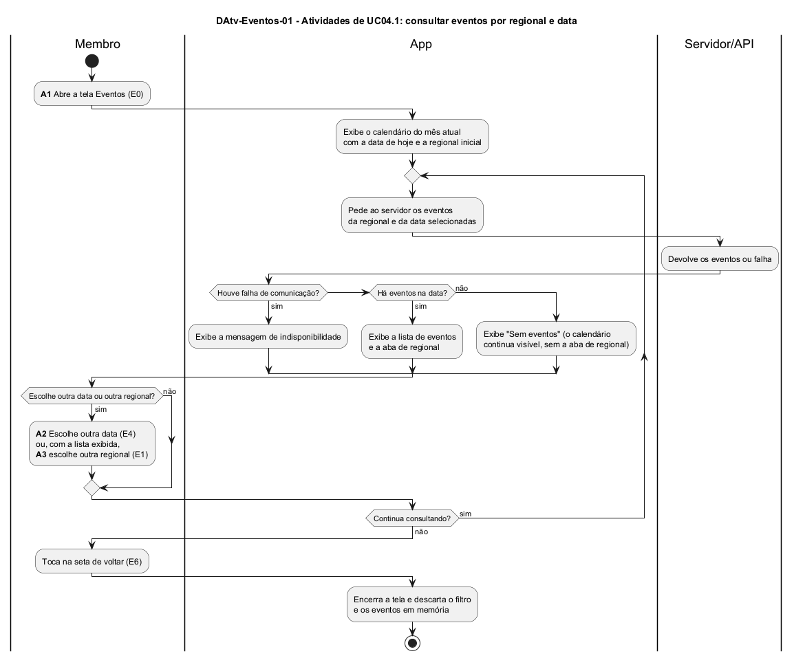

# DAtv-Eventos-01 – Atividades de UC04.1: consultar eventos por regional e data

| Campo | Valor |
|---|---|
| **Código** | `DAtv-Eventos-01` |
| **Título** | Atividades de UC04.1: consultar eventos por regional e data |
| **Autor(a)** | José Eduardo Gontijo de Carvalho (Pessoa C) |
| **Revisor(a)** | Phablo Tavares Paixão (Pessoa D) |
| **Status** | Em produção |
| **Rastreia para** | `DCdu-Eventos-01`, `DSeq-Eventos-01`, `DSeq-Eventos-02`, `DSeq-Eventos-03`, `DIhc-Eventos-01`, `DEst-Eventos-01`, `DEst-Comum-01` |

## Diagrama

Fonte: [`DAtv-Eventos-01.puml`](DAtv-Eventos-01.puml)

## Descrição

Fluxo do caso de uso UC04.1 em raias: o Membro, o App e o Servidor/API. As ações em que o usuário interage com o app são numeradas e cada uma gera um diagrama de sequência (contrato-base, seção 6). Os rótulos E0 a E6 são os eventos de interação de `DIhc-Eventos-01`:

| Atividade | Ação do usuário | Evento (`DIhc-Eventos-01`) | Diagrama de sequência |
|---|---|---|---|
| A1 | Abrir a tela Eventos (o app carrega os eventos de hoje na regional inicial: P-EV-2, P-EV-6) | E0 | `DSeq-Eventos-01` |
| A2 | Escolher outra data no calendário (P-EV-12) | E4 | `DSeq-Eventos-02` |
| A3 | Escolher outra regional na faixa de abas, que só aparece com a lista exibida (P-EV-2, P-EV-10) | E1 | `DSeq-Eventos-03` |
| – | Tocar na seta de voltar: o app encerra a tela e descarta o filtro e os eventos em memória | E6 | (passo interno trivial, sem diagrama de sequência; ver `DEst-Eventos-01`) |

A chamada ao servidor e a exibição do resultado (lista, "sem eventos" ou indisponibilidade) acontecem em cada uma dessas atividades. Por isso são mensagens dentro do diagrama de sequência da atividade que as dispara, e não atividades separadas; separá-las duplicaria diagramas sem acrescentar informação. Os três desfechos da consulta seguem o ciclo genérico de `DEst-Comum-01`. Dos três, foram observados a lista (capturas 19 e 28) e o estado sem eventos, com "Sem eventos" e "Não há eventos para esse dia!", o calendário ainda visível e a aba de regional oculta (captura 29, P-EV-10); a indisponibilidade de Eventos não foi capturada (P-EV-11).

A situação das premissas citadas está na tabela de [`Eventos/README.md`](README.md).

## Referências

INSTITUTE OF ELECTRICAL AND ELECTRONICS ENGINEERS. **Guide to the Software Engineering Body of Knowledge – SWEBOK v4**. Cap. 11 (Software Engineering Models and Methods). IEEE, 2024.

ANTHROPIC. **Claude Code**. Assistente de IA. Disponível em: claude.ai/code. Acesso em: 30 out. 2026. Uso: apoio à redação e aos diagramas, a partir das instruções, das capturas de tela e das correções do autor (resumo em `IA/registro-C.md`). Questão: Apêndice <X>, Seção <X.1>.

---

## Registro de revisão

| Data | Revisor(a) | Situação | Observações |
|---|---|---|---|
| | | | |
