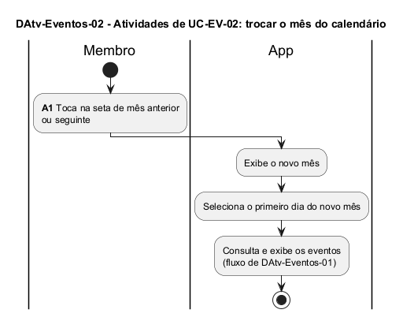

# DAtv-Eventos-02 – Atividades de UC-EV-02: trocar o mês do calendário

| Campo | Valor |
|---|---|
| **Código** | `DAtv-Eventos-02` |
| **Título** | Atividades de UC-EV-02: trocar o mês do calendário |
| **Autor(a)** | José Eduardo Gontijo de Carvalho (Pessoa C) |
| **Revisor(a)** | Phablo Tavares Paixão (Pessoa D) |
| **Status** | Em produção (primeira versão) |
| **Rastreia para** | `DCdu-Eventos-01`, `DSeq-Eventos-04`, `DAtv-Eventos-01`, `DIhc-Eventos-01` |

## Diagrama

Fonte: [`DAtv-Eventos-02.puml`](DAtv-Eventos-02.puml)

## Descrição

Fluxo do caso de uso UC-EV-02. Há uma só atividade de interação, **A1 – tocar na seta de mês**, detalhada em `DSeq-Eventos-04`. Depois de exibir o novo mês e selecionar o primeiro dia dele (P-EV-3), o app repete a consulta de eventos já descrita em `DAtv-Eventos-01`, por isso o fluxo apenas a referencia.

As premissas `P-EV-n` citadas estão listadas, com o que falta confirmar nas capturas de tela do app, em [`Eventos/README.md`](README.md).

## Referências

INSTITUTE OF ELECTRICAL AND ELECTRONICS ENGINEERS. **Guide to the Software Engineering Body of Knowledge – SWEBOK v4**. Cap. 11 (Software Engineering Models and Methods). IEEE, 2024.

---

## Registro de revisão

| Data | Revisor(a) | Situação | Observações |
|---|---|---|---|
| | | | |
