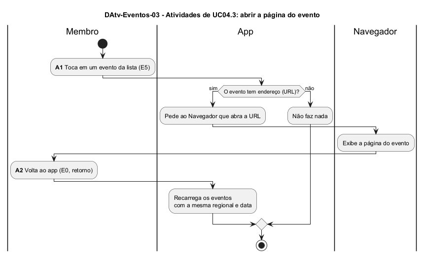

# DAtv-Eventos-03 – Atividades de UC04.3: abrir a página do evento

| Campo | Valor |
|---|---|
| **Código** | `DAtv-Eventos-03` |
| **Título** | Atividades de UC04.3: abrir a página do evento |
| **Autor(a)** | José Eduardo Gontijo de Carvalho (Pessoa C) |
| **Revisor(a)** | Phablo Tavares Paixão (Pessoa D) |
| **Status** | Em produção |
| **Rastreia para** | `DCdu-Eventos-01`, `DSeq-Eventos-05`, `DCla-Comum-01`, `DEst-Eventos-01` |

## Diagrama

Fonte: [`DAtv-Eventos-03.puml`](DAtv-Eventos-03.puml)

## Descrição

Fluxo do caso de uso UC04.3, que estende o UC04.1. As atividades de interação são **A1 – tocar em um evento** (E5) e **A2 – voltar ao app** (E0, retorno), ambas detalhadas em `DSeq-Eventos-05`. Se o evento tem endereço, o app pede ao Navegador que o abra, por meio do componente LinkExterno do pacote Comum (`DCla-Comum-01`); se não tem, o toque não tem efeito. Só a página aberta no Navegador foi observada (capturas 8 e 21, com título, local e período); o toque no cartão e o caso sem endereço são a premissa P-EV-4, ainda pendente de captura. Quando o usuário volta ao app, a tela é exibida de novo e recarrega os eventos da mesma regional e data (`DEst-Eventos-01`).

A situação da premissa P-EV-4 está na tabela de [`Eventos/README.md`](README.md).

## Referências

INSTITUTE OF ELECTRICAL AND ELECTRONICS ENGINEERS. **Guide to the Software Engineering Body of Knowledge – SWEBOK v4**. Cap. 11 (Software Engineering Models and Methods). IEEE, 2024.

ANTHROPIC. **Claude Code**. Assistente de IA. Disponível em: claude.ai/code. Acesso em: 30 out. 2026. Uso: apoio à redação e aos diagramas, a partir das instruções, das capturas de tela e das correções do autor (resumo em `IA/registro-C.md`). Questão: Apêndice <X>, Seção <X.1>.

---

## Registro de revisão

| Data | Revisor(a) | Situação | Observações |
|---|---|---|---|
| | | | |
