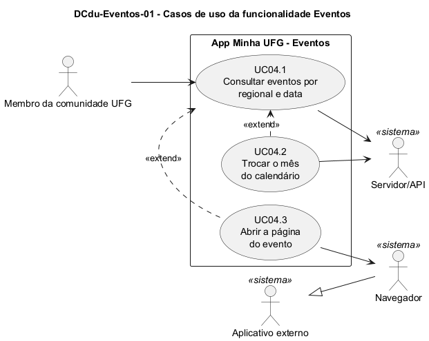

# DCdu-Eventos-01 – Casos de uso da funcionalidade Eventos

| Campo | Valor |
|---|---|
| **Código** | `DCdu-Eventos-01` |
| **Título** | Casos de uso da funcionalidade Eventos |
| **Autor(a)** | José Eduardo Gontijo de Carvalho (Pessoa C) |
| **Revisor(a)** | Phablo Tavares Paixão (Pessoa D) |
| **Status** | Em produção |
| **Rastreia para** | `DCdu-Geral-01`, `DAtv-Eventos-01`, `DAtv-Eventos-02`, `DAtv-Eventos-03`, `DIhc-Eventos-01`, `DCla-Comum-01`, `DD-Eventos-01` |

## Diagrama

Fonte: [`DCdu-Eventos-01.puml`](DCdu-Eventos-01.puml)

## Descrição

Detalha o caso de uso macro UC04 "Consultar eventos" do `DCdu-Geral-01` em três casos de uso. O único ator primário é o Membro da comunidade UFG (anônimo). Os atores secundários são o Servidor/API, que fornece os eventos cadastrados pelo painel web, e o Navegador, que abre a página de um evento. O Navegador é uma especialização do ator abstrato Aplicativo externo, como no `DCdu-Geral-01`; a abertura é feita pelo componente `LinkExterno` do pacote Comum (`DCla-Comum-01`).

**Base de observação** (versão 3.2.0, iPhone). O cartão "Eventos" no menu inicial (captura 1); a tela de lista em 30/10/2026 (captura 19), em novembro (captura 28) e em dezembro, sem eventos (captura 29); e a página do evento no portal da UFG, aberta no Navegador (capturas 8 e 21). A tela tem barra de título com a seta de voltar, um calendário mensal com setas, a regional em abas (só "GOIÂNIA" visível) e cartões de evento com miniatura, título e período (P-EV-1 e P-EV-2). O que as capturas não mostram (toque em dia e em cartão, outras regionais, estado indisponível, ordem da lista) é premissa `P-EV-n` pendente ou não observável; a situação de cada uma está na tabela de [`Eventos/README.md`](README.md).

**Tabela 1 – Casos de uso de Eventos**

| Código | Caso de uso | Objetivo do usuário | Atores secundários | Relação |
|---|---|---|---|---|
| UC04.1 | Consultar eventos por regional e data | Ver os eventos de uma regional que acontecem em uma data | Servidor/API | Caso de uso base |
| UC04.2 | Trocar o mês do calendário | Navegar para o mês anterior ou o seguinte | Servidor/API | Estende UC04.1 |
| UC04.3 | Abrir a página do evento | Ler os detalhes do evento no site da UFG | Navegador | Estende UC04.1 |

**UC04.1 – Consultar eventos por regional e data**

- *Pré-condição:* o usuário tocou no cartão Eventos do menu inicial (captura 1).
- *Fluxo principal:* (1) o app exibe a tela, com a seta de voltar, o calendário do mês atual com a data de hoje selecionada (círculo branco) e a regional inicial escolhida, a aba "GOIÂNIA" (P-EV-1, P-EV-2, P-EV-6); (2) o app pede ao servidor os eventos da regional e da data selecionadas (rota e parâmetros: P-EV-5); (3) o app lista os eventos em cartões com miniatura, título e período; (4) o usuário pode escolher outra data (E4, P-EV-12) ou, com a lista exibida, outra regional (E1, P-EV-2), e o fluxo volta ao passo 2; (5) o usuário toca na seta de voltar (E6): a tela é encerrada, o filtro e os eventos em memória são descartados e o app exibe o menu inicial.
- *Fluxos alternativos:* **A1** não há eventos na data: o app mostra uma ilustração, "Sem eventos" e "Não há eventos para esse dia!"; o calendário continua visível e a aba de regional some (captura 29, P-EV-10); **A2** sem internet ou servidor indisponível: o app mostra a mensagem de indisponibilidade (estados em `DEst-Comum-01`; não capturada em Eventos, P-EV-11); **A3** evento com intervalo de datas: aparece em todas as datas do intervalo, do início ao fim (capturas 19 e 28, P-EV-9).
- *Pós-condição:* a tela mostra o resultado da consulta da regional e da data selecionadas.

**UC04.2 – Trocar o mês do calendário** (estende UC04.1)

- *Ponto de extensão:* depois do passo 3 do UC04.1, com a tela exibida.
- *Fluxo principal:* (1) o usuário toca na seta de mês anterior (E2) ou seguinte (E3); (2) o app exibe o novo mês e mantém o número do dia selecionado (30 de outubro, 30 de novembro, 30 de dezembro: P-EV-7); se o novo mês for mais curto que o dia, seleciona o último dia dele (P-EV-8); (3) o app consulta os eventos como no passo 2 do UC04.1.
- *Fluxos alternativos:* os mesmos A1 e A2 do UC04.1. A troca de mês também é possível sem eventos, pois o calendário continua visível (P-EV-10).

**UC04.3 – Abrir a página do evento** (estende UC04.1)

- *Ponto de extensão:* depois do passo 3 do UC04.1, com ao menos um evento listado.
- *Fluxo principal:* (1) o usuário toca em um evento (E5); (2) o app pede ao Navegador que abra o endereço do evento (P-EV-4); (3) o Navegador exibe a página, que mostra o título, o local e o período do evento (capturas 8 e 21); (4) ao voltar ao app, a tela é exibida de novo (E0, retorno), mantém a regional e a data selecionadas e recarrega os eventos, pois o app não guarda cache (`DEst-Comum-01`).
- *Fluxos alternativos:* **A1** evento sem endereço: o app não reage ao toque (P-EV-4); **A2** endereço inválido ou nenhum navegador disponível: o app atual não mostra mensagem (`ResultadoAbertura`, `DCla-Comum-01`).
- *Pós-condição:* a tela mostra de novo os eventos da mesma regional e data.

Nota: o local do evento ("Centro de Línguas, Câmpus Samambaia", captura 8; "Biblioteca Seccional Cepae Prof. Geraldo Faria Campos, Campus Samambaia", captura 21) aparece só na página do portal; o cartão da lista não o mostra (captura 19), e por isso ele não é dado do modelo (`DD-Eventos-01`).

## Referências

INSTITUTE OF ELECTRICAL AND ELECTRONICS ENGINEERS. **Guide to the Software Engineering Body of Knowledge – SWEBOK v4**. Cap. 11 (Software Engineering Models and Methods). IEEE, 2024.

ANTHROPIC. **Claude Code**. Assistente de IA. Disponível em: claude.ai/code. Acesso em: 30 out. 2026. Uso: apoio à redação e aos diagramas, a partir das instruções, das capturas de tela e das correções do autor (resumo em `IA/registro-C.md`). Questão: Apêndice <X>, Seção <X.1>.

---

## Registro de revisão

| Data | Revisor(a) | Situação | Observações |
|---|---|---|---|
| | | | |
